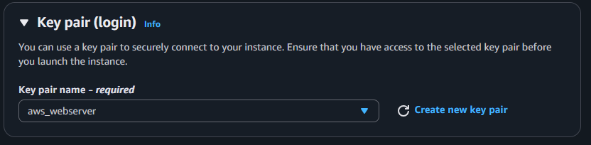
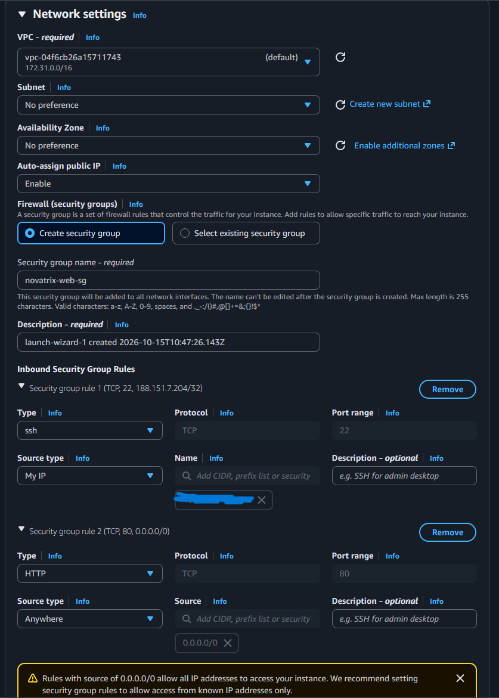
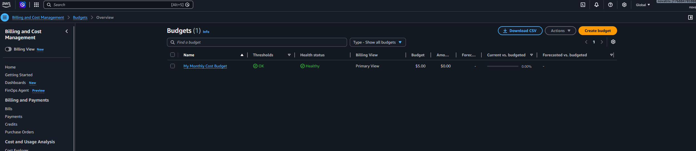

# V.42 Compute

**Repo: https://github.com/00aughar/AWS_MOV25**

**August Hartwig**
**MOV25**
**20/10**

## Delmoment 2, Provisionera en EC2-instans

Konfigurera en EC2-instans via AWS portalen:
EC2 > Launch Instance > Namn "webserver", OS: amazon linux, Instanstyp: t3 micro (Låg kostnad och får användas i free tier) > new key pair, Namn: "aws_webserver" > konfigurera säkerhetsregel, namn: "novatrix-web-sg", tillåt trafik på port 22 för ssh anslutning från min lokala hosts IP address & tillåt trafik på port 80 för HTTP så webservern kan besökas via internet  > Launch instance






Kontrollera att instansen körs i AWS portalen:


## Delmoment 3, Konfigurera värdmiljön
Anslut via SSH och installera en webbserver.

Navigera till mappen där nyckel lagras. Anslut sedan med:

```
ssh -i .\aws_webserver.pem ec2-user@(webserverns publika ip)
```

Installation och uppstart av HTTPD
```
sudo yum update -y
sudo yum install httpd -y
sudo systemctl start httpd
sudo systemctl enable httpd
sudo systemctl status httpd
```
Status från *sudo systemctl status httpd*:


Testa besök apache testsidans websida:
http://(webservens publika IP)


## Delmoment 4, Driftsätt applikationen

Bygg upp HTML sidan med följande kommando ansluten till instansen via terminalen:

```
sudo tee /var/www/html/index.html > /dev/null <<'EOF'
<!DOCTYPE html>
<html lang="sv">
<head><meta charset="UTF-8"><title>Novatrix AB</title></head>
<body>
  <h1>Novatrix AB</h1>
  <p>Denna websidan ska användas som en tjänst för Novatrix ärendeformulär och ska byggas upp med en Wordpress stack</p>
</body>
</html>
EOF
```

## Delmoment 5, Verifiera och dokumentera

Sidan nås från internet, vilket betyder att instansen är igång och webbservern körs, att index.html ligger på rätt plats och att port 80 i säkerhetsgruppen är öppen för trafik.

Besök sidan via den publika Ip-adressen för instansen:


## Delmoment 6, Kostnadskontroll

Skapa budgetlarm:
Billing and Cost Management > Budgets > "Create Budget", template "Monthly Cost Budget", Vald budget $5.00 per månad, varning till min mail om 85% av budget nås & varning vid 100% av budget.

Bilden nedan visar att email adressen för budgetlarm är verifierad. Om denfaktiska kostnaden överstiger 85% & 100% ska jag få en varning, är den prognostiserad kostnaden över 100% ska jag få en varning




Efter jag är klar med labben terminerar jag instanserna för att inte ha pågående kostnader.


# VG

User data scriptet *user-data.sh* innehåller vad den nya instansen ska göra vid uppstart. Den installerar webbservern och bygger upp websidan som sedan kan besökas via den publika IP adressen för instansen. Deploy scriptet *deploy.ps1* automatiserar konfigurationsstegen för instansen. I scriptet defineras vilken region, namn, säkerhetsgrupp (*novatrix-web-sg*) & nyckelparet.

Jag valde att ladda upp scripten *deploy.ps1* & *user-data.sh* i cloud shell via AWS portalen för att sedan köra dem med kommando: ```pwsh ./deploy.ps1```.

Förutsättningar för att återskapa miljön är:
1. Nyckelparet behöver ha skapats i EU-north-1 sedan tidigare.
2. IP adressen för den lokala hosten behöver fyllas i för ```$myip    = "DIN.IP.ADRESS.HÄR"```. Detta är för att säkerhetsgruppen som skapas *novatrix-web-sg* ska kunna släppa igenom trafik på port 22 för SSH anslutning. Platshållaren är där för att inte IP adressen ska synas på det publika repot och exponeras.
3. Uppladdning av User data scriptet & deploy scriptet till AWS cloud shell.
4. Kör scriptet ```pwsh ./deploy.ps1```
5. Vänta nån minut och verifiera att sidan är uppe i webläsaren via instansens publika IP. Testa ansluta till instansen via SSH.


*deploy.ps1*

```
# deploy.ps1 - Skapar Novatrix webbserver i AWS (EC2 + Apache + webbsida)
# Kör från mappen där user-data.sh ligger: .\deploy.ps1

$region  = "eu-north-1"
$keyName = "aws_webserver"   # Befintligt key pair i AWS (C:\Users\augus\.ssh\aws_webserver.pem)

$myip    = "DIN.IP.ADRESS.HÄR"  # Din dators IP (från https://checkip.amazonaws.com)

# Security group: använd befintlig om den finns, annars skapa ny med regler
$sg = aws ec2 describe-security-groups --group-names novatrix-web-sg --region $region `
  --query "SecurityGroups[0].GroupId" --output text 2>$null

if (-not $sg) {
    Write-Host "Skapar security group novatrix-web-sg..."
    $sg = aws ec2 create-security-group --group-name novatrix-web-sg `
      --description "Novatrix web" --region $region --query GroupId --output text

    # Regler: SSH bara från min IP, HTTP från alla
    aws ec2 authorize-security-group-ingress --group-id $sg --protocol tcp --port 22 --cidr "$myip/32" --region $region
    aws ec2 authorize-security-group-ingress --group-id $sg --protocol tcp --port 80 --cidr 0.0.0.0/0 --region $region
} else {
    Write-Host "Använder befintlig security group: $sg"
}

# Starta instansen med user data
$instanceId = aws ec2 run-instances `
  --image-id resolve:ssm:/aws/service/ami-amazon-linux-latest/al2023-ami-kernel-default-x86_64 `
  --instance-type t3.micro `
  --key-name $keyName `
  --security-group-ids $sg `
  --user-data file://user-data.sh `
  --tag-specifications "ResourceType=instance,Tags=[{Key=Name,Value=novatrix-web}]" `
  --region $region `
  --query "Instances[0].InstanceId" --output text

Write-Host "Instans startad: $instanceId. Väntar på att den ska bli running..."
aws ec2 wait instance-running --instance-ids $instanceId --region $region

# Hämta publik IP
$ip = aws ec2 describe-instances --instance-ids $instanceId --region $region `
  --query "Reservations[0].Instances[0].PublicIpAddress" --output text

Write-Host "Klar! Vänta 1-2 minuter och surfa sedan till: http://$ip"
Write-Host "SSH: ssh -i C:\Users\augus\.ssh\aws_webserver.pem ec2-user@$ip"
```

*user-data.sh*

```
#!/bin/bash
dnf update -y
dnf install -y httpd
systemctl enable --now httpd
cat > /var/www/html/index.html <<'EOF'
<!DOCTYPE html>
<html lang="sv"><head><meta charset="UTF-8"><title>Novatrix AB</title></head>
<body><h1>Novatrix AB</h1><p>Denna websidan ska användas som en tjänst för Novatrix ärendeformulär och ska byggas upp med en Wordpress stack</p></body></html>
EOF
```

*Reslutat körning*


*Anslutning via terminal*


