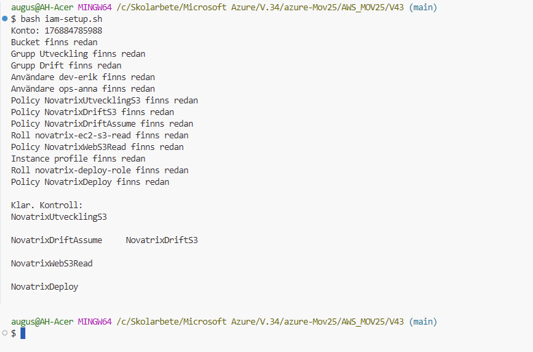

# V.43 IAM

**Repo: https://github.com/00aughar/AWS_MOV25**

**August Hartwig**
**MOV25**
**27/10**

## Delmoment 2, Användare och grupper

Under detta delmoment skapades följande upp Novatrix miljö:


| Användare | User Groups | Attached Policy |
| :--- | :---: | ---: |
| dev-erik | Utveckling | AmazonS3ReadOnlyAccess |
| ops-anna | Drift | AmazonS3FullAccess |


## Delmoment 3, Policies enligt least privilege


Motivering:

Drift har policyn *AmazonS3FullAccess* dem sköta om lagringen som driftavdelningen.

Utveckling har policyn *AmazonS3ReadOnlyAccess* då dem endast ska kunna läsa filinnehållet i lagringen som utvecklingsavdelning.

De AWS-hanterade policyerna AmazonS3FullAccess och AmazonS3ReadOnlyAccess gäller alla buckets i kontot och inte bara Novatrix bucket. De ger alltså mer åtkomst än vad som behövs. I VG-delen ersätts de därför med egna policyer som bara gäller *novatrix-data-00aughar-01*.

## Delmoment 4, Behörigheter mellan tjänster

En IAM-roll består av två delar. Trust policyn anger vem som får använda rollen, i det här fallet tjänsten EC2. Permissions policyn anger vad rollen får göra, i det här fallet AmazonS3ReadOnlyAccess, som ger läsrätt till S3. Det skapades upp följande IAM roll:

| Instans | S3 Bucket | IAM Roll | Attached policy
| :--- | :---: | :---: | ---: |
| novatrix-web | novatrix-data-00aughar-01 | novatrix-ec2-s3-read | AmazonS3ReadOnlyAccess

Konfigurationen via portalen:

- Skapa en S3-bucket via portalen under S3 Buckets. Namn global namespace "novatrix-data-00aughar-01". Testa ladda upp en fil som kan läsas i bucketen.


- Skapa IAM-roll under IAM Roles i portalen. 

*novatrix-ec2-s3-read* Konfiguration:
```
{
    "Version": "2012-10-17",
    "Statement": [
        {
            "Effect": "Allow",
            "Principal": {
                "Service": "ec2.amazonaws.com"
            },
            "Action": "sts:AssumeRole"
        }
    ]
}
```


- Koppla rollen till EC2 *novatrix-web*. 

Markera instansen och modify IAM role och koppla *novatrix-ec2-s3-read*.


- Verifiera att instansen kan läsa innehåll i bucketen. 

Anslut via terminal och testa läs innehållet med kommando:
```
aws s3 ls s3://novatrix-data-00aughar-01/
```


- Testa även att ta bort filen med (ska bli nekat då rollen endast ska kunna läsa):
```
aws s3 rm s3://novatrix-data-00aughar-01/test.txt
```


## Delmoment 5, Verifiera och dokumentera


Verifiera att attached policies gäller för user groups via användarna i portalen.

- dev-erik - testa ladda upp en fil i bucket (resulutat nekad): 
- ops-anna - testa ladda upp en fil i bucket (resulutat godkänd): 

- Kontrollera att filen laddats upp via konsolen:


# VG

För VG delen byggdes en mer komplex behörighetslösning som riktar behörigheten mer tydligt beroende på gruppen eller rollens syfte enligt least privilege. Tabellerna visar hela behörighetsmodellen, vilka policies som gör vad, vilka behörigheter anvnändare/instanser får och deras syfte. Hela lösningen deployas via AWS CLI med scriptet i veckans repo *iam-setup.sh*

## Behörighetskedjan 
Novatrix vill att driftpersonalen ska kunna driftsätta webbservrar utan att ha bred åtkomst till EC2. Därför är behörigheterna uppdelade i en kedja där varje del bara får göra det som krävs för nästa steg:

ops-anna (Drift) → novatrix-deploy-role → EC2-instansen med novatrix-ec2-s3-read → S3-bucketen

Assume role. Användarna i Drift har inga EC2-rättigheter direkt. I stället får de anta deploy-rollen (novatrix-deploy-role), vilket betyder att de får tillfälliga nycklar som gäller i en timme. Så länge nycklarna gäller arbetar användaren som rollen och inte som sig själv. EC2-behörigheten används alltså bara när den behövs, och det syns i loggarna vem som har använt rollen.

PassRole. När deploy-rollen startar en instans ger den instansen en roll. Rätten att göra det heter iam:PassRole. Utan begränsning skulle deploy-rollen kunna ge en instans vilken roll som helst, till exempel en med administratörsrättigheter, och på så sätt få mer behörighet än den själv har. Därför får deploy-rollen bara tilldela rollen *novatrix-ec2-s3-read*.

least privilege genom hela kedjan. Deploy-rollen får bara starta instanser i storlek t3.micro och bara hantera instanser taggade novatrix-web. Webbrollen får bara läsa från novatrix-data-00aughar-01, inte skriva eller radera. Testerna visar att det som ligger utanför behörigheterna nekas.

| Vem | Typ | Policy | Fil | Får göra | Får inte |
|---|---|---|---|---|---|
| **Utveckling** (dev-erik) | Grupp | `NovatrixUtvecklingS3` | `utveckling-s3.json` | Se bucketlistan, lista och läsa filer i `novatrix-data-00aughar-01` | Ladda upp, radera, läsa andra buckets |
| **Drift** (ops-anna) | Grupp | `NovatrixDriftS3` | `drift-s3.json` | Se bucketlistan, lista, läsa, ladda upp och radera filer i `novatrix-data-00aughar-01` | Radera bucketen, ändra bucketinställningar, röra andra buckets |
| **Drift** (ops-anna) | Grupp | `NovatrixDriftAssume` | `drift-assume-deploy.json` | Anta `novatrix-deploy-role`, använda CloudShell | Starta eller ändra EC2 direkt |
| **novatrix-deploy-role** | Roll | `NovatrixDeploy` | `deploy-permissions.json` | Starta t3.micro, starta/stoppa/terminera instanser taggade `novatrix-web`, kan endast tilldela `novatrix-ec2-s3-read` till EC2 | Andra instanstyper, andra instanser, tilldela andra roller |
| **novatrix-ec2-s3-read** (instansen novatrix-web) | Roll | `NovatrixWebS3Read` | `web-s3-read.json` | Lista och läsa filer i `novatrix-data-00aughar-01` | Ladda upp, radera, läsa andra buckets |

## Vem får använda rollerna (trust policies)

| Roll | Fil | Får användas av |
|---|---|---|
| `novatrix-deploy-role` | `deploy-trust.json` | Identiteter i kontot som har `sts:AssumeRole` på rollen, i praktiken bara gruppen Drift |
| `novatrix-ec2-s3-read` | `web-trust.json` | Tjänsten EC2 (via instance profile `novatrix-ec2-s3-read`) |

## Borttagna policyer från G-delen

| Vem | Borttagen policy | Ersatt av |
|---|---|---|
| Utveckling | `AmazonS3ReadOnlyAccess` (alla buckets) | `NovatrixUtvecklingS3` |
| Drift | `AmazonS3FullAccess` (alla buckets, full kontroll) | `NovatrixDriftS3` |
| novatrix-ec2-s3-read | `AmazonS3ReadOnlyAccess` (alla buckets) | `NovatrixWebS3Read` |


# Hur lösningen återskapas
- Klona repot och stå i mappen V43. Mappen policies/ måste finnas.
- Logga in med en admin-användare via aws configure
- Kör ```bash iam-setup.sh```, i Git Bash terminalen.
- Skriptet skapar en lokal mapp build/ där konto-ID:t fylls i. Mappen är undantagen i .gitignore, så konto-ID:t hamnar aldrig i det publika repot. AWS kräver det riktiga konto-ID:t i policyernas ARN:er, så skriptet kopierar policyerna till build/ och byter ut platshållaren ACCOUNT_ID där. Originalfilerna i policies/ ändras inte.

Testkörning av scriptet (Redan uppsatt miljö):



# Deploy scriptet 

```
#!/bin/bash
# iam-setup.sh - Sätter upp Novatrix IAM-kedja (v43)
# Kör i AWS CLI från mappen V43:  bash iam-setup.sh
# Kedja: ops-anna (Drift) -> novatrix-deploy-role -> EC2 med novatrix-ec2-s3-read -> läser S3

BUCKET="novatrix-data-00aughar-01"
REGION="eu-north-1"
ACCOUNT=$(aws sts get-caller-identity --query Account --output text | tr -d '\r')
echo "Konto: $ACCOUNT"

# Byt ut ACCOUNT_ID i policyfilerna mot det riktiga konto-ID:t (sparas i mappen build/)
mkdir -p build
for f in policies/*.json; do
  sed "s/ACCOUNT_ID/$ACCOUNT/g" "$f" > "build/$(basename "$f")"
done

# Hjälpfunktion: skapa en egen policy om den inte redan finns
skapa_policy () {
  aws iam create-policy --policy-name "$1" --policy-document "file://build/$2" >/dev/null 2>&1 \
    && echo "Skapade policy $1" || echo "Policy $1 finns redan"
}

# 1. Bucket, grupper och användare (finns redan från G-delen, skapas annars)
aws s3 mb "s3://$BUCKET" --region $REGION 2>/dev/null || echo "Bucket finns redan"
aws iam create-group --group-name Utveckling >/dev/null 2>&1 || echo "Grupp Utveckling finns redan"
aws iam create-group --group-name Drift      >/dev/null 2>&1 || echo "Grupp Drift finns redan"
aws iam create-user --user-name dev-erik >/dev/null 2>&1 || echo "Användare dev-erik finns redan"
aws iam create-user --user-name ops-anna >/dev/null 2>&1 || echo "Användare ops-anna finns redan"
aws iam add-user-to-group --group-name Utveckling --user-name dev-erik
aws iam add-user-to-group --group-name Drift      --user-name ops-anna

# 2. Ta bort de breda AWS-hanterade policyerna från G-delen
aws iam detach-group-policy --group-name Utveckling --policy-arn arn:aws:iam::aws:policy/AmazonS3ReadOnlyAccess 2>/dev/null
aws iam detach-group-policy --group-name Drift      --policy-arn arn:aws:iam::aws:policy/AmazonS3FullAccess 2>/dev/null

# 3. Egna, begränsade policyer för grupperna
skapa_policy NovatrixUtvecklingS3   utveckling-s3.json
skapa_policy NovatrixDriftS3        drift-s3.json
skapa_policy NovatrixDriftAssume    drift-assume-deploy.json
aws iam attach-group-policy --group-name Utveckling --policy-arn arn:aws:iam::$ACCOUNT:policy/NovatrixUtvecklingS3
aws iam attach-group-policy --group-name Drift      --policy-arn arn:aws:iam::$ACCOUNT:policy/NovatrixDriftS3
aws iam attach-group-policy --group-name Drift      --policy-arn arn:aws:iam::$ACCOUNT:policy/NovatrixDriftAssume

# 4. Webbrollen (EC2 -> S3): byt AmazonS3ReadOnlyAccess mot en policy för bara vår bucket
aws iam create-role --role-name novatrix-ec2-s3-read \
  --assume-role-policy-document file://build/web-trust.json >/dev/null 2>&1 || echo "Roll novatrix-ec2-s3-read finns redan"
aws iam detach-role-policy --role-name novatrix-ec2-s3-read --policy-arn arn:aws:iam::aws:policy/AmazonS3ReadOnlyAccess 2>/dev/null
skapa_policy NovatrixWebS3Read web-s3-read.json
aws iam attach-role-policy --role-name novatrix-ec2-s3-read --policy-arn arn:aws:iam::$ACCOUNT:policy/NovatrixWebS3Read

# Instance profile = det EC2 använder för att bära rollen
aws iam create-instance-profile --instance-profile-name novatrix-ec2-s3-read >/dev/null 2>&1 || echo "Instance profile finns redan"
aws iam add-role-to-instance-profile --instance-profile-name novatrix-ec2-s3-read --role-name novatrix-ec2-s3-read 2>/dev/null

# 5. Deploy-rollen (Drift -> EC2): får starta t3.micro och skicka ENDAST webbrollen
aws iam create-role --role-name novatrix-deploy-role \
  --assume-role-policy-document file://build/deploy-trust.json >/dev/null 2>&1 || echo "Roll novatrix-deploy-role finns redan"
skapa_policy NovatrixDeploy deploy-permissions.json
aws iam attach-role-policy --role-name novatrix-deploy-role --policy-arn arn:aws:iam::$ACCOUNT:policy/NovatrixDeploy

echo ""
echo "Klar. Kontroll:"
aws iam list-attached-group-policies --group-name Utveckling --query "AttachedPolicies[].PolicyName" --output text
aws iam list-attached-group-policies --group-name Drift      --query "AttachedPolicies[].PolicyName" --output text
aws iam list-attached-role-policies  --role-name novatrix-ec2-s3-read --query "AttachedPolicies[].PolicyName" --output text
aws iam list-attached-role-policies  --role-name novatrix-deploy-role --query "AttachedPolicies[].PolicyName" --output text

```
# Policies

Policyerna ligger i mappen policies/ i repot. ACCOUNT_ID är en platshållare som iam-setup.sh ersätter med kontots riktiga ID när skriptet körs, så att konto-ID:t inte syns i det publika repot.


- utveckling-s3.json – permissions policy för gruppen Utveckling
Ger rätt att se bucketlistan samt lista och läsa filer i novatrix-data-00aughar-01. Utvecklarna kan läsa innehållet men inte ladda upp eller radera.

```
{
  "Version": "2012-10-17",
  "Statement": [
    {
      "Sid": "KonsolNavigering",
      "Effect": "Allow",
      "Action": ["s3:ListAllMyBuckets", "s3:GetBucketLocation"],
      "Resource": "*"
    },
    {
      "Sid": "ListaNovatrixBucket",
      "Effect": "Allow",
      "Action": "s3:ListBucket",
      "Resource": "arn:aws:s3:::novatrix-data-00aughar-01"
    },
    {
      "Sid": "LasaObjekt",
      "Effect": "Allow",
      "Action": "s3:GetObject",
      "Resource": "arn:aws:s3:::novatrix-data-00aughar-01/*"
    }
  ]
}
```

- drift-s3.json – permissions policy för gruppen Drift
Ger rätt att lista, läsa, ladda upp och radera filer i novatrix-data-00aughar-01. Drift sköter innehållet i bucketen men kan inte radera själva bucketen eller röra andra buckets.

```
{
  "Version": "2012-10-17",
  "Statement": [
    {
      "Sid": "KonsolNavigering",
      "Effect": "Allow",
      "Action": ["s3:ListAllMyBuckets", "s3:GetBucketLocation"],
      "Resource": "*"
    },
    {
      "Sid": "ListaNovatrixBucket",
      "Effect": "Allow",
      "Action": "s3:ListBucket",
      "Resource": "arn:aws:s3:::novatrix-data-00aughar-01"
    },
    {
      "Sid": "HanteraObjekt",
      "Effect": "Allow",
      "Action": ["s3:GetObject", "s3:PutObject", "s3:DeleteObject"],
      "Resource": "arn:aws:s3:::novatrix-data-00aughar-01/*"
    }
  ]
}
```

- drift-assume-deploy.json – permissions policy för gruppen Drift
Ger rätt att anta novatrix-deploy-role och använda CloudShell. Det är den första länken i kedjan. Drift har inga EC2-rättigheter direkt utan måste gå via rollen.

```
{
  "Version": "2012-10-17",
  "Statement": [
    {
      "Sid": "AnvandDeployRollen",
      "Effect": "Allow",
      "Action": "sts:AssumeRole",
      "Resource": "arn:aws:iam::ACCOUNT_ID:role/novatrix-deploy-role"
    },
    {
      "Sid": "AnvandCloudShell",
      "Effect": "Allow",
      "Action": "cloudshell:*",
      "Resource": "*"
    }
  ]
}
```

- deploy-trust.json – trust policy för novatrix-deploy-role
Anger vem som får anta rollen: identiteter i kontot vars egen policy tillåter det. I praktiken är det gruppen Drift (och admin).

```
{
  "Version": "2012-10-17",
  "Statement": [
    {
      "Effect": "Allow",
      "Principal": { "AWS": "arn:aws:iam::ACCOUNT_ID:root" },
      "Action": "sts:AssumeRole"
    }
  ]
}
```

- deploy-permissions.json – permissions policy för novatrix-deploy-role
Anger vad rollen får göra: starta instanser av typen t3.micro, starta, stoppa och terminera instanser taggade novatrix-web, samt tilldela nya instanser enbart rollen novatrix-ec2-s3-read (iam:PassRole).

```
{
  "Version": "2012-10-17",
  "Statement": [
    {
      "Sid": "LasaEC2",
      "Effect": "Allow",
      "Action": "ec2:Describe*",
      "Resource": "*"
    },
    {
      "Sid": "HamtaAmazonLinuxAMI",
      "Effect": "Allow",
      "Action": "ssm:GetParameters",
      "Resource": "arn:aws:ssm:eu-north-1::parameter/aws/service/ami-amazon-linux-latest/*"
    },
    {
      "Sid": "StartaEndastT3Micro",
      "Effect": "Allow",
      "Action": "ec2:RunInstances",
      "Resource": "arn:aws:ec2:eu-north-1:ACCOUNT_ID:instance/*",
      "Condition": { "StringEquals": { "ec2:InstanceType": "t3.micro" } }
    },
    {
      "Sid": "ResurserSomInstansenBehover",
      "Effect": "Allow",
      "Action": "ec2:RunInstances",
      "Resource": [
        "arn:aws:ec2:eu-north-1::image/*",
        "arn:aws:ec2:eu-north-1:ACCOUNT_ID:volume/*",
        "arn:aws:ec2:eu-north-1:ACCOUNT_ID:network-interface/*",
        "arn:aws:ec2:eu-north-1:ACCOUNT_ID:security-group/*",
        "arn:aws:ec2:eu-north-1:ACCOUNT_ID:subnet/*",
        "arn:aws:ec2:eu-north-1:ACCOUNT_ID:key-pair/*"
      ]
    },
    {
      "Sid": "TaggaVidStart",
      "Effect": "Allow",
      "Action": "ec2:CreateTags",
      "Resource": "arn:aws:ec2:eu-north-1:ACCOUNT_ID:instance/*",
      "Condition": { "StringEquals": { "ec2:CreateAction": "RunInstances" } }
    },
    {
      "Sid": "HanteraEndastWebbservern",
      "Effect": "Allow",
      "Action": ["ec2:StartInstances", "ec2:StopInstances", "ec2:TerminateInstances"],
      "Resource": "arn:aws:ec2:eu-north-1:ACCOUNT_ID:instance/*",
      "Condition": { "StringEquals": { "aws:ResourceTag/Name": "novatrix-web" } }
    },
    {
      "Sid": "SkickaEndastWebbrollen",
      "Effect": "Allow",
      "Action": "iam:PassRole",
      "Resource": "arn:aws:iam::ACCOUNT_ID:role/novatrix-ec2-s3-read",
      "Condition": { "StringEquals": { "iam:PassedToService": "ec2.amazonaws.com" } }
    }
  ]
}
```
- web-trust.json – trust policy för novatrix-ec2-s3-read
Anger att tjänsten EC2 får använda rollen. Det är detta som gör att en instans kan bära rollen.

```
{
  "Version": "2012-10-17",
  "Statement": [
    {
      "Effect": "Allow",
      "Principal": { "Service": "ec2.amazonaws.com" },
      "Action": "sts:AssumeRole"
    }
  ]
}
```

- web-s3-read.json – permissions policy för novatrix-ec2-s3-read
Ger instansen rätt att lista och läsa filer i novatrix-data-00aughar-01. Instansen kan inte skriva, radera eller läsa andra buckets.

```
{
  "Version": "2012-10-17",
  "Statement": [
    {
      "Sid": "ListaNovatrixBucket",
      "Effect": "Allow",
      "Action": "s3:ListBucket",
      "Resource": "arn:aws:s3:::novatrix-data-00aughar-01"
    },
    {
      "Sid": "LasaObjekt",
      "Effect": "Allow",
      "Action": "s3:GetObject",
      "Resource": "arn:aws:s3:::novatrix-data-00aughar-01/*"
    }
  ]
}
```

# Tester av behörighet

## dev-erik kan läsa från bucketen och ladda ner filer:


## dev-erik kan inte ladda upp


## ops-anna har ingen direkt EC2-åtkomst


## ops-anna antar deploy-rollen

I CloudShell antar ops-anna novatrix-deploy-role. De tre export-raderna sparar de tillfälliga nycklarna så att följande kommandon körs som rollen:
```
CREDS=$(aws sts assume-role --role-arn arn:aws:iam::<KONTO-ID>:role/novatrix-deploy-role \
  --role-session-name anna-deploy --query Credentials --output json)
export AWS_ACCESS_KEY_ID=$(echo $CREDS | jq -r .AccessKeyId)
export AWS_SECRET_ACCESS_KEY=$(echo $CREDS | jq -r .SecretAccessKey)
export AWS_SESSION_TOKEN=$(echo $CREDS | jq -r .SessionToken)

aws sts get-caller-identity
```
Svaret visar assumed-role/novatrix-deploy-role/anna-deploy, alltså att ops-anna nu arbetar som rollen.


## ops-anna kan nu se instanser efter antagit deploy-rollen
```
aws ec2 describe-instances --region eu-north-1 \
  --query "Reservations[].Instances[].[InstanceId,State.Name]" --output table
```


## Deploy-rollen startar en instans med webbrollen

Först hämtas ID:t för säkerhetsgruppen *novatrix-web-sg*:

```
SG=$(aws ec2 describe-security-groups --group-names novatrix-web-sg \
  --query "SecurityGroups[0].GroupId" --output text --region eu-north-1)
echo $SG
```


Sedan startas instansen. Med ```--iam-instance-profile``` tilldelar deploy-rollen instansen rollen novatrix-ec2-s3-read. Det tillåts eftersom iam:PassRole i NovatrixDeploy gäller just den rollen.

```
aws ec2 run-instances \
  --image-id resolve:ssm:/aws/service/ami-amazon-linux-latest/al2023-ami-kernel-default-x86_64 \
  --instance-type t3.micro \
  --key-name aws_webserver \
  --security-group-ids $SG \
  --iam-instance-profile Name=novatrix-ec2-s3-read \
  --tag-specifications "ResourceType=instance,Tags=[{Key=Name,Value=novatrix-web}]" \
  --region eu-north-1 --query "Instances[0].InstanceId" --output text
```


## Deploy-rollen kan inte starta en större instans

```
aws ec2 run-instances \
  --image-id resolve:ssm:/aws/service/ami-amazon-linux-latest/al2023-ami-kernel-default-x86_64 \
  --instance-type t3.large --region eu-north-1
  ```
Försöket nekas med UnauthorizedOperation. NovatrixDeploy tillåter bara ec2:RunInstances när instanstypen är t3.micro, vilket skyddar mot oväntade kostnader.

  

## Instansen kan läsa men inte radera

Anslut till instans

  ```ssh -i ~/.ssh/aws_webserver.pem ec2-user@<PUBLIK-IP>```

Testa läsa/ta bort fil

```
aws sts get-caller-identity
aws s3 cp s3://novatrix-data-00aughar-01/test.txt -
aws s3 rm s3://novatrix-data-00aughar-01/test.txt
```
get-caller-identity visar assumed-role/novatrix-ec2-s3-read, alltså att instansen använder webbrollen. Filens innehåll ("test textdokument") skrivs ut, så läsningen fungerar. Raderingen nekas med AccessDenied eftersom NovatrixWebS3Read bara innehåller s3:ListBucket och s3:GetObject.


## Deploy-rollen terminerar instansen

```
aws ec2 terminate-instances --instance-ids <INSTANS-ID> --region eu-north-1

aws ec2 describe-instances --instance-ids <INSTANS-ID> --region eu-north-1 \
  --query "Reservations[0].Instances[0].State.Name" --output text
  ```
Det fungerar eftersom instansen är taggad novatrix-web och NovatrixDeploy bara tillåter start, stopp och terminering av instanser med den taggen. Status går från shutting-down till terminated.
  

## Test av deploy rollen *novatrix-deploy-role* via simulator

Policy Simulator visar att novatrix-deploy-role bara får tilldela rollen novatrix-ec2-s3-read. Försök att tilldela någon annan roll nekas, vilket hindrar att Drift ger en instans fler rättigheter än de själva har.

Rollen *novatrix-ec2-s3-read* är allowed


Rollen *novatrix-deploy-role* är denied
