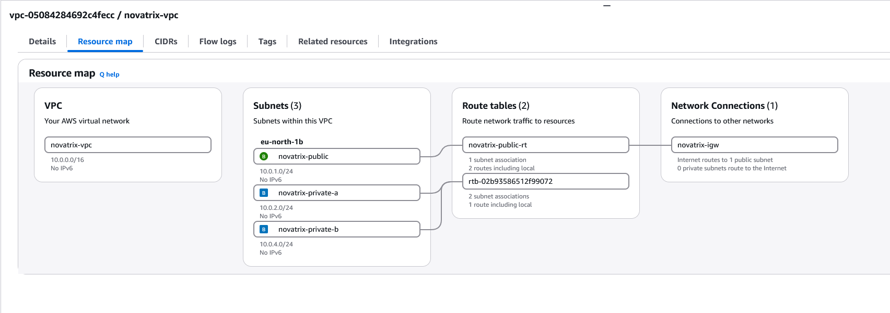

# V.44 AWS Uppgift 3, Nätverk och säkerhet

**Repo: https://github.com/00aughar/AWS_MOV25**

**August Hartwig**
**MOV25**
**x/x**

# Godkänt

- Du har byggt ett VPC med subnät och routing

## Skapa VPC genom portalen
Konfiguration:


VPC CLI Konfiguration:
```
aws ec2 create-vpc --no-amazon-provided-ipv6-cidr-block --instance-tenancy 'default' --cidr-block '10.0.0.0/16' --tag-specifications '{"ResourceType":"vpc","Tags":[{"Key":"Name","Value":"novatrix-vpc"}]}' 
```

## Skapa subnät genom portalen
Konfiguration "novatrix-public":


Konfiguration "novatrix-private-a":


Konfiguration "novatrix-private-b":


## Skapa Internet Gateway och Route Table genom portalen
# 1. Internet Gateway
Konfiguration Internet Gateway "novatrix-igw":


# 2. Koppla till VPC
Anslut novatrix-igw till VPC novatrix-vpc Portalen:


CLI anslut novatrix-igw till VPC novatrix-vpc:
```
aws ec2 attach-internet-gateway --vpc-id "vpc-05084284692c4fecc" --internet-gateway-id "igw-0dd681971aa62eec6" --region eu-north-1
```

# 3. Route Table
Konfigruation Route Table "novatrix-public-rt":


# 4. Koppla route table till internet gateway portalen

- Security groups och NACL:er begränsar trafiken

# 5. Anslut route table till subnät novatrix-publik portalen


- Security groups/NACL som begränsar trafiken till det nödvändiga
Webben nåbar på 80 och 443, admin begränsad

## Skapa säkerhetsgrupp via portalen
Konfiguration "novatrix-web-sg"


## Skapa AMI image av "novatrix-web-gammal"


## Starta Instans från AMI image Portalen


Starta Instans från AMI image CLI:
```
aws ec2 run-instances --image-id 'ami-0905273365bf5833c' --instance-type 't3.micro' --key-name 'aws_webserver' --ebs-optimized --network-interfaces '{"SubnetId":"subnet-0d52766ffcba51d29","AssociatePublicIpAddress":true,"DeviceIndex":0,"Groups":["sg-0ceee709423ffa088"]}' --credit-specification '{"CpuCredits":"unlimited"}' --tag-specifications '{"ResourceType":"instance","Tags":[{"Key":"Name","Value":"novatrix-web"}]}' --iam-instance-profile '{"Arn":"arn:aws:iam::176884785988:instance-profile/novatrix-ec2-s3-read"}' --private-dns-name-options '{"HostnameType":"ip-name","EnableResourceNameDnsARecord":false,"EnableResourceNameDnsAAAARecord":false}' --count '1' 
```

## Skapa network ACL (NACL) "novatrix-public-nacl"


## Skapa Inbound rules "novatrix-public-nacl"


## Skapa Outbound rules "novatrix-public-nacl"


## Upprensing

Efter att instansen har startats och verifierats att websidan går att nå terminera den gammla instansen "novatrix-web-gammal". Deregister AMI imagen "novatrix-web-v44" och snapshots.


- Du har placerat lösningen säkert i rätt subnät

- Du har verifierat vilken trafik som släpps eller blockeras

## Besök websidan lokal host IP


## SSH från hostens publika IP


## SSH från okänd IP


## Testa Portarna

Via powershell:
```
Test-NetConnection <novatrix-web Publika IP> -Port 22
Test-NetConnection <novatrix-web Publika IP> -Port 80
Test-NetConnection <novatrix-web Publika IP> -Port 443
Test-NetConnection <novatrix-web Publika IP> -Port 3306
```


- Allt dokumenterat med skiss, PDF med repo-länk

## Nätverksskissen:
