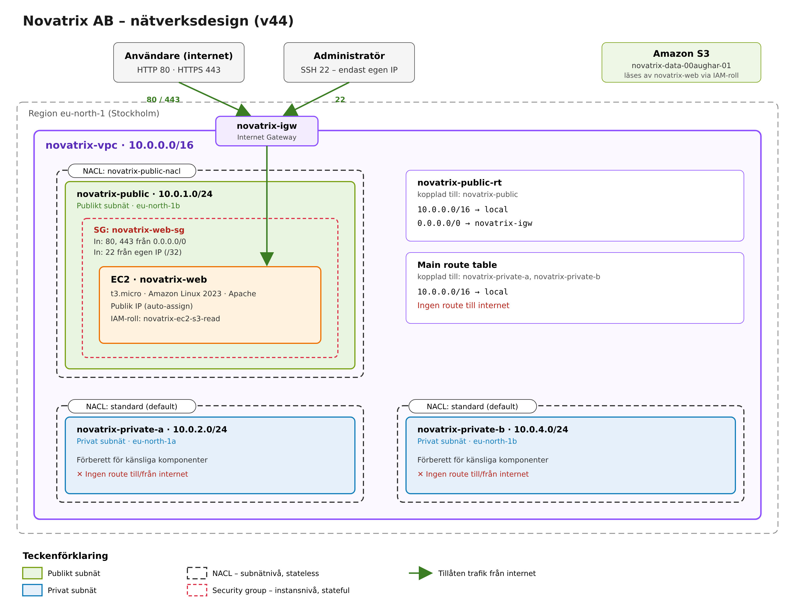
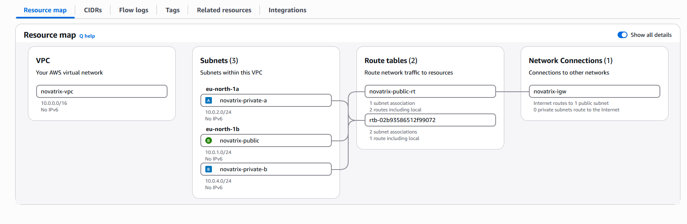
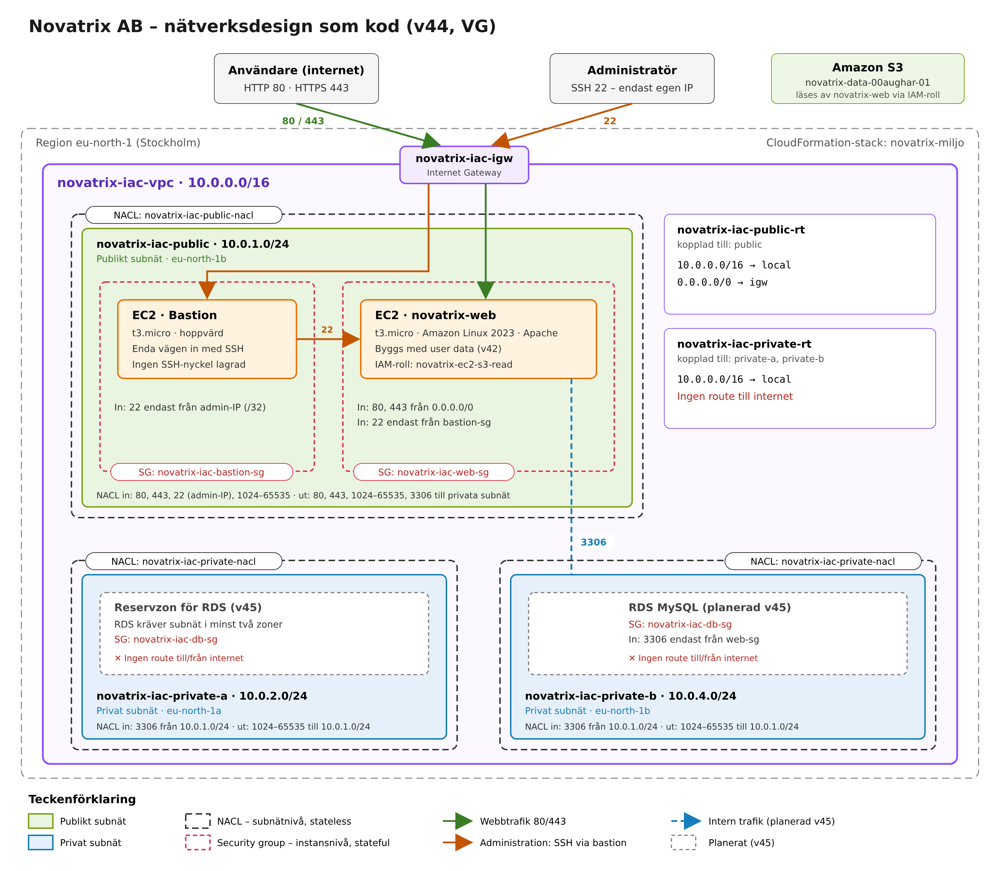
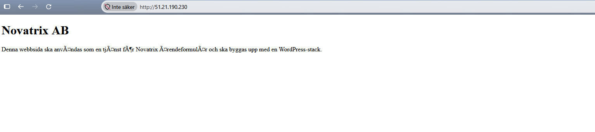

# V.44 AWS Uppgift 3, Nätverk och säkerhet

**Repo: https://github.com/00aughar/AWS_MOV25**

**August Hartwig**
**MOV25**
**3/11**

# Godkänt

## Förklaring av lösningen:

Lösningen bygger på defense in depth där flera lager av nätverkskompontenter, routing, security groups & NACL bygger en trygg och säkrad IT miljö, om ett av lagren brister står de andra kvar. Syftet med lösningen är att skydda de privata subnäten och i sin tur skydda webbservern och den framtida databasen som Novatrix ska bygga. 

Besökaren besöker serverns publika IP > Trafiken går igenom "novatrix-igw" > Routing tabellen "novatrix-public-rt" leder vidare till subnätet "novatrix-public" > NACL "novatrix-public-nacl" släpper vidare på port 80 > Security group "novatrix-web-sg" släpper vidare på port 80 > websidan visas för besökaren

Administratörens anslutning > SSH via terminalen mot serverns publika IP på port 22 > NACL "novatrix-public-nacl" tillåter trafik på port 22 endast från hostens publika IP adress > Security group "novatrix-web-sg" tillåter trafik på port 22 endast från hostens publika IP adress > SSH nyckeln måste matcha för tillåten anslutning.

# Lösningen

## Nätverkskomponenter

| Komponent | Namn | Värde | Syfte |
|---|---|---|---|
| VPC | `novatrix-vpc` | `10.0.0.0/16` | Novatrix eget isolerade nätverk i eu-north-1 |
| Publikt subnät | `novatrix-public` | `10.0.1.0/24`, eu-north-1b | Webbservern, nåbar från internet |
| Privat subnät | `novatrix-private-a` | `10.0.2.0/24`, eu-north-1a | Förberett för känsliga komponenter, ingen väg till internet |
| Privat subnät | `novatrix-private-b` | `10.0.4.0/24`, eu-north-1b | Förberett för känsliga komponenter, ingen väg till internet |
| Internet Gateway | `novatrix-igw` | Kopplad till `novatrix-vpc` | VPC:ts enda väg till och från internet |

## Routing

| Route table | Kopplad till | Destination | Mål | Effekt |
|---|---|---|---|---|
| `novatrix-public-rt` | `novatrix-public` | `10.0.0.0/16` | local | Trafik inom VPC:t |
| `novatrix-public-rt` | `novatrix-public` | `0.0.0.0/0` | `novatrix-igw` | Gör subnätet publikt |
| Main route table | `novatrix-private-a`, `novatrix-private-b` | `10.0.0.0/16` | local | Bara intern trafik, subnäten är privata |

## Security group – `novatrix-web-sg` (instansnivå, stateful)

| Riktning | Port | Protokoll | Källa | Syfte |
|---|---|---|---|---|
| Inbound | 80 | TCP | `0.0.0.0/0` | HTTP för besökare |
| Inbound | 443 | TCP | `0.0.0.0/0` | HTTPS för besökare |
| Inbound | 22 | TCP | Egen IP `/32` | SSH endast för administratören |
| Outbound | Alla | Alla | `0.0.0.0/0` | Standard. Svar och uppdateringar (`dnf`) |

## NACL – `novatrix-public-nacl` (subnätnivå, stateless)

| Riktning | Regel | Port | Källa/mål | Tillåt/Neka | Syfte |
|---|---|---|---|---|---|
| Inbound | 100 | 80 | `0.0.0.0/0` | Tillåt | HTTP |
| Inbound | 110 | 443 | `0.0.0.0/0` | Tillåt | HTTPS |
| Inbound | 120 | 22 | Egen IP `/32` | Tillåt | SSH för admin |
| Inbound | 130 | 1024–65535 | `0.0.0.0/0` | Tillåt | Svar på trafik som servern startat, t.ex. `dnf update` |
| Inbound | * | Alla | `0.0.0.0/0` | Neka | Allt annat |
| Outbound | 100 | 80 | `0.0.0.0/0` | Tillåt | Uppdateringar via HTTP |
| Outbound | 110 | 443 | `0.0.0.0/0` | Tillåt | Uppdateringar via HTTPS |
| Outbound | 120 | 22 | Egen IP `/32` | Tillåt | SSH för admin |
| Outbound | 130 | 1024–65535 | `0.0.0.0/0` | Tillåt | Svar till besökare och SSH-klient |
| Outbound | * | Alla | `0.0.0.0/0` | Neka | Allt annat |

De privata subnäten använder VPC:ts standard-NACL.

## Instans

| Namn | Subnät | Typ | Säkerhetsgrupp | IAM-roll | Källa |
|---|---|---|---|---|---|
| `novatrix-web` | `novatrix-public` | t3.micro | `novatrix-web-sg` | `novatrix-ec2-s3-read` | AMI av den gamla instansen, eftersom en instans inte kan flyttas mellan VPC:er |


## Skapa VPC genom portalen
Konfiguration:


VPC CLI Konfiguration:
```
aws ec2 create-vpc --no-amazon-provided-ipv6-cidr-block --instance-tenancy 'default' --cidr-block '10.0.0.0/16' --tag-specifications '{"ResourceType":"vpc","Tags":[{"Key":"Name","Value":"novatrix-vpc"}]}' 
```

## Skapa subnät genom portalen
Konfiguration "novatrix-public":


Konfiguration "novatrix-private-a":


Konfiguration "novatrix-private-b":


## Skapa Internet Gateway och Route Table genom portalen
# 1. Internet Gateway
Konfiguration Internet Gateway "novatrix-igw":


# 2. Koppla till VPC
Anslut novatrix-igw till VPC novatrix-vpc Portalen:


CLI anslut novatrix-igw till VPC novatrix-vpc:
```
aws ec2 attach-internet-gateway --vpc-id "vpc-05084284692c4fecc" --internet-gateway-id "igw-0dd681971aa62eec6" --region eu-north-1
```

# 3. Route Table
Konfigruation Route Table "novatrix-public-rt":


# 4. Koppla route table till internet gateway portalen


# 5. Anslut route table till subnät novatrix-publik portalen


## Skapa säkerhetsgrupp via portalen
Konfiguration "novatrix-web-sg"


## Skapa AMI image av "novatrix-web-gammal"


## Starta Instans från AMI image Portalen


Starta Instans från AMI image CLI:
```
aws ec2 run-instances --image-id 'ami-0905273365bf5833c' --instance-type 't3.micro' --key-name 'aws_webserver' --ebs-optimized --network-interfaces '{"SubnetId":"subnet-0d52766ffcba51d29","AssociatePublicIpAddress":true,"DeviceIndex":0,"Groups":["sg-0ceee709423ffa088"]}' --credit-specification '{"CpuCredits":"unlimited"}' --tag-specifications '{"ResourceType":"instance","Tags":[{"Key":"Name","Value":"novatrix-web"}]}' --iam-instance-profile '{"Arn":"arn:aws:iam::176884785988:instance-profile/novatrix-ec2-s3-read"}' --private-dns-name-options '{"HostnameType":"ip-name","EnableResourceNameDnsARecord":false,"EnableResourceNameDnsAAAARecord":false}' --count '1' 
```

## Skapa network ACL (NACL) "novatrix-public-nacl"


## Skapa Inbound rules "novatrix-public-nacl"


## Skapa Outbound rules "novatrix-public-nacl"


## Upprensing

Efter att instansen har startats och verifierats att websidan går att nå terminera den gammla instansen "novatrix-web-gammal". Deregister AMI imagen "novatrix-web-v44" och snapshots.


## Besök websidan lokal host IP


## SSH från hostens publika IP


## SSH från okänd IP


## Testa Portarna

## Verifiering av trafikflöden

| Test | Från | Port | Förväntat | Resultat | Förklaring |
|---|---|---|---|---|---|
| Besöka webbsidan | Egen dator | 80 | Sidan visas | Visas | Tillåten för alla i både `novatrix-public-nacl` och `novatrix-web-sg`, och Apache svarar |
| SSH | Egen IP | 22 | Anslutning lyckas | Ansluten | Port 22 är bara öppen för administratörens IP i både NACL och SG |
| SSH | Okänd IP | 22 | Anslutning nekas | Timeout | IP-adressen finns inte i reglerna och stoppas redan i NACL:en |
| `Test-NetConnection` | Egen dator | 22 | `True` | `True` | Samma regel som SSH-testet ovan |
| `Test-NetConnection` | Egen dator | 80 | `True` | `True` | HTTP är öppet för alla |
| `Test-NetConnection` | Egen dator | 443 | `False` | `False` | Porten är öppen i NACL och SG, men ingen HTTPS-tjänst körs på servern, så ingenting svarar |
| `Test-NetConnection` | Egen dator | 3306 | `False` | `False` | Blockeras av både NACL (`* Deny`) och SG, där regeln saknas |


Kommandon som användes:

```
Test-NetConnection <novatrix-web Publika IP> -Port 22
Test-NetConnection <novatrix-web Publika IP> -Port 80
Test-NetConnection <novatrix-web Publika IP> -Port 443
Test-NetConnection <novatrix-web Publika IP> -Port 3306
```


## Nätverksskissen:



## Resurskarta:


# VG

VG-lösningen lägger till två lager i varje del (NACL och SG även för det privata lagret), en kontrollerad väg för administration via bastionen, och definierar allt som kod.

## Nätverket som kod

Hela miljön för v44 är definierad som kod i en CloudFormation-mall. Mallen bygger också webbservern från v42 och använder IAM-rollen från v43, så att alla tre veckorna kan återskapas från repot.

### Filer i V44

| Fil | Vad den gör |
|---|---|
| `novatrix-miljo.yaml` | CloudFormation-mall som beskriver VPC, subnät, routing, NACL:er, security groups, bastion och webbserver |
| `bygg-allt.sh` | Kör IAM-uppsättningen från v43 och skapar sedan CloudFormation-stacken |
| `riv-allt.sh` | Tar bort stacken och allt den skapat |

### Förutsättningar

- AWS CLI inloggad med en admin-användare (`aws configure`)
- Nyckelparet `aws_webserver` finns i eu-north-1
- Mappen `V43` med `iam-setup.sh` och `policies/` ligger bredvid `V44` i repot
- Git Bash

### Bygga miljön

Kör från repots rot:

```
bash V44/bygg-allt.sh $(curl -s https://checkip.amazonaws.com)
```

`curl` hämtar administratörens publika IP och skickar den som argument till skriptet. IP:n används i reglerna för SSH till bastionen. Den skickas med vid körning i stället för att skrivas in i koden, så att den aldrig hamnar i det publika repot. Skriptet stoppar om ingen IP anges.

Skriptet gör två saker i ordning:

1. Kör `V43/iam-setup.sh`, som skapar eller kontrollerar grupper, policyer och roller från v43. Det som redan finns ändras inte.
2. Kör `aws cloudformation deploy` med mallen och skapar stacken `novatrix-miljo` i eu-north-1. Till sist skrivs IP-adresserna till webbservern och bastionen ut.

### Ta bort miljön

```
bash V44/riv-allt.sh
```

CloudFormation håller reda på vilka resurser stacken skapade och tar bort alla, i rätt ordning. Resurser som byggts i konsolen och IAM från v43 påverkas inte.

### Mallens uppbyggnad

Mallen är uppdelad i samma lager som i hottabellen:

| Block i mallen | Resurser | Lager |
|---|---|---|
| Parametrar | `MyIp`, `KeyName`, `InstanceProfileName`, senaste Amazon Linux-AMI | Gör mallen återanvändbar utan hårdkodade värden |
| Nätverk och segmentering | VPC, Internet Gateway, ett publikt och två privata subnät i två zoner | Lager 1 |
| Routing | Publik route table med väg till IGW, privat route table med bara `local` | Lager 1 |
| NACL | `public-nacl` och `private-nacl` med regler och kopplingar till subnäten | Lager 2 |
| Security groups | `bastion-sg`, `web-sg` och `db-sg`, där källorna är andra säkerhetsgrupper | Lager 3 |
| Instanser | Bastion och webbserver, där webbservern får user data från v42 och IAM-rollen från v43 | – |
| Outputs | Publika och privata IP-adresser, VPC-ID, db-sg och privata subnät | Används vid verifiering och nästa vecka |


- **Security groups refererar till varandra.** `web-sg` släpper in SSH från `bastion-sg`, och `db-sg` släpper in 3306 från `web-sg`. Reglerna gäller därför servrarnas roll, inte deras IP-adresser, och fortsätter fungera om en server byggs om och får en ny adress.

*novatrix-miljo.yaml*
```
AWSTemplateFormatVersion: "2010-09-09"
Description: >
  Novatrix AB - hela miljön som kod (v42 + v44).
  VPC med publikt och privata subnät, NACL:er och security groups i flera lager,
  bastion för administration och webbservern från v42.
  Kräver att IAM-rollen från v43 (novatrix-ec2-s3-read) redan finns.

Parameters:
  Prefix:
    Type: String
    Default: novatrix-iac
    Description: Namnprefix så att resurserna skiljer sig från de som byggts i konsolen
  MyIp:
    Type: String
    Description: Administratörens publika IP med /32, t.ex. 1.2.3.4/32
    AllowedPattern: '^(\d{1,3}\.){3}\d{1,3}/32$'
  KeyName:
    Type: AWS::EC2::KeyPair::KeyName
    Default: aws_webserver
  InstanceProfileName:
    Type: String
    Default: novatrix-ec2-s3-read
    Description: Instance profile från v43 (iam-setup.sh)
  LatestAmiId:
    Type: AWS::SSM::Parameter::Value<AWS::EC2::Image::Id>
    Default: /aws/service/ami-amazon-linux-latest/al2023-ami-kernel-default-x86_64

Resources:
  # ---------- Lager 1: nätverk och segmentering ----------
  Vpc:
    Type: AWS::EC2::VPC
    Properties:
      CidrBlock: 10.0.0.0/16
      EnableDnsSupport: true
      EnableDnsHostnames: true
      Tags: [{ Key: Name, Value: !Sub "${Prefix}-vpc" }]

  InternetGateway:
    Type: AWS::EC2::InternetGateway
    Properties:
      Tags: [{ Key: Name, Value: !Sub "${Prefix}-igw" }]

  IgwAttachment:
    Type: AWS::EC2::VPCGatewayAttachment
    Properties:
      VpcId: !Ref Vpc
      InternetGatewayId: !Ref InternetGateway

  PublicSubnet:
    Type: AWS::EC2::Subnet
    Properties:
      VpcId: !Ref Vpc
      CidrBlock: 10.0.1.0/24
      AvailabilityZone: !Select [1, !GetAZs ""]   # eu-north-1b
      MapPublicIpOnLaunch: true
      Tags: [{ Key: Name, Value: !Sub "${Prefix}-public" }]

  PrivateSubnetA:
    Type: AWS::EC2::Subnet
    Properties:
      VpcId: !Ref Vpc
      CidrBlock: 10.0.2.0/24
      AvailabilityZone: !Select [0, !GetAZs ""]   # eu-north-1a
      Tags: [{ Key: Name, Value: !Sub "${Prefix}-private-a" }]

  PrivateSubnetB:
    Type: AWS::EC2::Subnet
    Properties:
      VpcId: !Ref Vpc
      CidrBlock: 10.0.4.0/24
      AvailabilityZone: !Select [1, !GetAZs ""]   # eu-north-1b
      Tags: [{ Key: Name, Value: !Sub "${Prefix}-private-b" }]

  # ---------- Routing ----------
  PublicRouteTable:
    Type: AWS::EC2::RouteTable
    Properties:
      VpcId: !Ref Vpc
      Tags: [{ Key: Name, Value: !Sub "${Prefix}-public-rt" }]

  PublicDefaultRoute:
    Type: AWS::EC2::Route
    DependsOn: IgwAttachment
    Properties:
      RouteTableId: !Ref PublicRouteTable
      DestinationCidrBlock: 0.0.0.0/0
      GatewayId: !Ref InternetGateway

  PublicSubnetRta:
    Type: AWS::EC2::SubnetRouteTableAssociation
    Properties:
      SubnetId: !Ref PublicSubnet
      RouteTableId: !Ref PublicRouteTable

  # Privat route table: bara den lokala routen, ingen väg till internet
  PrivateRouteTable:
    Type: AWS::EC2::RouteTable
    Properties:
      VpcId: !Ref Vpc
      Tags: [{ Key: Name, Value: !Sub "${Prefix}-private-rt" }]

  PrivateSubnetARta:
    Type: AWS::EC2::SubnetRouteTableAssociation
    Properties:
      SubnetId: !Ref PrivateSubnetA
      RouteTableId: !Ref PrivateRouteTable

  PrivateSubnetBRta:
    Type: AWS::EC2::SubnetRouteTableAssociation
    Properties:
      SubnetId: !Ref PrivateSubnetB
      RouteTableId: !Ref PrivateRouteTable

  # ---------- Lager 2: NACL (subnätnivå, stateless) ----------
  PublicNacl:
    Type: AWS::EC2::NetworkAcl
    Properties:
      VpcId: !Ref Vpc
      Tags: [{ Key: Name, Value: !Sub "${Prefix}-public-nacl" }]

  PublicNaclInHttp:
    Type: AWS::EC2::NetworkAclEntry
    Properties: { NetworkAclId: !Ref PublicNacl, RuleNumber: 100, Protocol: 6, RuleAction: allow, Egress: false, CidrBlock: 0.0.0.0/0, PortRange: { From: 80, To: 80 } }
  PublicNaclInHttps:
    Type: AWS::EC2::NetworkAclEntry
    Properties: { NetworkAclId: !Ref PublicNacl, RuleNumber: 110, Protocol: 6, RuleAction: allow, Egress: false, CidrBlock: 0.0.0.0/0, PortRange: { From: 443, To: 443 } }
  PublicNaclInSsh:
    Type: AWS::EC2::NetworkAclEntry
    Properties: { NetworkAclId: !Ref PublicNacl, RuleNumber: 120, Protocol: 6, RuleAction: allow, Egress: false, CidrBlock: !Ref MyIp, PortRange: { From: 22, To: 22 } }
  PublicNaclInEphemeral:
    Type: AWS::EC2::NetworkAclEntry
    Properties: { NetworkAclId: !Ref PublicNacl, RuleNumber: 130, Protocol: 6, RuleAction: allow, Egress: false, CidrBlock: 0.0.0.0/0, PortRange: { From: 1024, To: 65535 } }

  PublicNaclOutHttp:
    Type: AWS::EC2::NetworkAclEntry
    Properties: { NetworkAclId: !Ref PublicNacl, RuleNumber: 100, Protocol: 6, RuleAction: allow, Egress: true, CidrBlock: 0.0.0.0/0, PortRange: { From: 80, To: 80 } }
  PublicNaclOutHttps:
    Type: AWS::EC2::NetworkAclEntry
    Properties: { NetworkAclId: !Ref PublicNacl, RuleNumber: 110, Protocol: 6, RuleAction: allow, Egress: true, CidrBlock: 0.0.0.0/0, PortRange: { From: 443, To: 443 } }
  PublicNaclOutEphemeral:
    Type: AWS::EC2::NetworkAclEntry
    Properties: { NetworkAclId: !Ref PublicNacl, RuleNumber: 120, Protocol: 6, RuleAction: allow, Egress: true, CidrBlock: 0.0.0.0/0, PortRange: { From: 1024, To: 65535 } }
  PublicNaclOutMysqlA:
    Type: AWS::EC2::NetworkAclEntry
    Properties: { NetworkAclId: !Ref PublicNacl, RuleNumber: 130, Protocol: 6, RuleAction: allow, Egress: true, CidrBlock: 10.0.2.0/24, PortRange: { From: 3306, To: 3306 } }
  PublicNaclOutMysqlB:
    Type: AWS::EC2::NetworkAclEntry
    Properties: { NetworkAclId: !Ref PublicNacl, RuleNumber: 140, Protocol: 6, RuleAction: allow, Egress: true, CidrBlock: 10.0.4.0/24, PortRange: { From: 3306, To: 3306 } }

  PublicNaclAssoc:
    Type: AWS::EC2::SubnetNetworkAclAssociation
    Properties: { SubnetId: !Ref PublicSubnet, NetworkAclId: !Ref PublicNacl }

  # Privat NACL: bara MySQL från det publika subnätet in, och svaren tillbaka ut
  PrivateNacl:
    Type: AWS::EC2::NetworkAcl
    Properties:
      VpcId: !Ref Vpc
      Tags: [{ Key: Name, Value: !Sub "${Prefix}-private-nacl" }]

  PrivateNaclInMysql:
    Type: AWS::EC2::NetworkAclEntry
    Properties: { NetworkAclId: !Ref PrivateNacl, RuleNumber: 100, Protocol: 6, RuleAction: allow, Egress: false, CidrBlock: 10.0.1.0/24, PortRange: { From: 3306, To: 3306 } }
  PrivateNaclOutEphemeral:
    Type: AWS::EC2::NetworkAclEntry
    Properties: { NetworkAclId: !Ref PrivateNacl, RuleNumber: 100, Protocol: 6, RuleAction: allow, Egress: true, CidrBlock: 10.0.1.0/24, PortRange: { From: 1024, To: 65535 } }

  PrivateNaclAssocA:
    Type: AWS::EC2::SubnetNetworkAclAssociation
    Properties: { SubnetId: !Ref PrivateSubnetA, NetworkAclId: !Ref PrivateNacl }
  PrivateNaclAssocB:
    Type: AWS::EC2::SubnetNetworkAclAssociation
    Properties: { SubnetId: !Ref PrivateSubnetB, NetworkAclId: !Ref PrivateNacl }

  # ---------- Lager 3: security groups (instansnivå, stateful) ----------
  BastionSg:
    Type: AWS::EC2::SecurityGroup
    Properties:
      VpcId: !Ref Vpc
      GroupDescription: Bastion - SSH endast fran administratorens IP
      SecurityGroupIngress:
        - { IpProtocol: tcp, FromPort: 22, ToPort: 22, CidrIp: !Ref MyIp, Description: SSH fran admin }
      Tags: [{ Key: Name, Value: !Sub "${Prefix}-bastion-sg" }]

  WebSg:
    Type: AWS::EC2::SecurityGroup
    Properties:
      VpcId: !Ref Vpc
      GroupDescription: Webbserver - HTTP/HTTPS fran alla, SSH endast fran bastion
      SecurityGroupIngress:
        - { IpProtocol: tcp, FromPort: 80, ToPort: 80, CidrIp: 0.0.0.0/0, Description: HTTP }
        - { IpProtocol: tcp, FromPort: 443, ToPort: 443, CidrIp: 0.0.0.0/0, Description: HTTPS }
        - { IpProtocol: tcp, FromPort: 22, ToPort: 22, SourceSecurityGroupId: !Ref BastionSg, Description: SSH endast via bastion }
      Tags: [{ Key: Name, Value: !Sub "${Prefix}-web-sg" }]

  # Förberedd för databasen v45: MySQL endast från webbservrar
  DbSg:
    Type: AWS::EC2::SecurityGroup
    Properties:
      VpcId: !Ref Vpc
      GroupDescription: Databas - MySQL endast fran webbservern
      SecurityGroupIngress:
        - { IpProtocol: tcp, FromPort: 3306, ToPort: 3306, SourceSecurityGroupId: !Ref WebSg, Description: MySQL fran web-sg }
      Tags: [{ Key: Name, Value: !Sub "${Prefix}-db-sg" }]

  # ---------- Instanser ----------
  Bastion:
    Type: AWS::EC2::Instance
    Properties:
      ImageId: !Ref LatestAmiId
      InstanceType: t3.micro
      KeyName: !Ref KeyName
      SubnetId: !Ref PublicSubnet
      SecurityGroupIds: [!Ref BastionSg]
      Tags: [{ Key: Name, Value: !Sub "${Prefix}-bastion" }]

  WebServer:
    Type: AWS::EC2::Instance
    DependsOn: PublicDefaultRoute   # internet måste fungera när user data kör dnf
    Properties:
      ImageId: !Ref LatestAmiId
      InstanceType: t3.micro
      KeyName: !Ref KeyName
      SubnetId: !Ref PublicSubnet
      SecurityGroupIds: [!Ref WebSg]
      IamInstanceProfile: !Ref InstanceProfileName
      Tags: [{ Key: Name, Value: novatrix-web }]   # taggen som deploy-rollen från v43 får hantera
      UserData:
        Fn::Base64: |
          #!/bin/bash
          dnf update -y
          dnf install -y httpd
          systemctl enable --now httpd
          cat > /var/www/html/index.html <<'EOF'
          <!DOCTYPE html>
          <html lang="sv"><head><meta charset="UTF-8"><title>Novatrix AB</title></head>
          <body><h1>Novatrix AB</h1><p>Denna webbsida ska användas som en tjänst för Novatrix ärendeformulär och ska byggas upp med en WordPress-stack.</p></body></html>
          EOF

Outputs:
  VpcId:
    Value: !Ref Vpc
  WebPublicIp:
    Value: !GetAtt WebServer.PublicIp
  WebPrivateIp:
    Value: !GetAtt WebServer.PrivateIp
  BastionPublicIp:
    Value: !GetAtt Bastion.PublicIp
  Webbsida:
    Value: !Sub "http://${WebServer.PublicIp}"
  DbSecurityGroupId:
    Description: Används för databasen v45
    Value: !Ref DbSg
  PrivateSubnetIds:
    Description: Används för DB subnet group v45
    Value: !Join [",", [!Ref PrivateSubnetA, !Ref PrivateSubnetB]]

```
*bygg-allt.sh*
```
#!/bin/bash
# bygg-allt.sh - Bygger hela Novatrix-miljön från repot (v42-v44)
# Ligger i V44/. Kör i Git Bash med din publika IP som argument:
#   bash V44/bygg-allt.sh $(curl -s https://checkip.amazonaws.com)
# eller skriv in IP:n själv:  bash V44/bygg-allt.sh 1.2.3.4
# IP:n skickas med vid körning, så den hamnar aldrig i det publika repot.
#   1. IAM från v43 (grupper, policyer, roller)
#   2. Nätverk, bastion och webbserver från v44 (CloudFormation, inkl. webbservern från v42)

MYIP="$(echo "$1" | tr -d '[:space:]')"   # Första argumentet: din publika IP
REGION="eu-north-1"
STACK="novatrix-miljo"

# Hitta mapparna utifrån skriptets egen plats, så att det går att köra från vilken mapp som helst
V44_DIR="$(cd "$(dirname "$0")" && pwd)"
REPO_DIR="$(dirname "$V44_DIR")"

if [ -z "$MYIP" ]; then
  echo "FEL: ange din publika IP, t.ex.:  bash V44/bygg-allt.sh \$(curl -s https://checkip.amazonaws.com)"
  exit 1
fi
echo "Admin-IP: $MYIP"

echo "=== 1/2 IAM (v43) ==="
(cd "$REPO_DIR/V43" && bash iam-setup.sh) || { echo "FEL: iam-setup.sh misslyckades"; exit 1; }

echo ""
echo "=== 2/2 Nätverk och servrar (v44) ==="
aws cloudformation deploy \
  --template-file "$V44_DIR/novatrix-miljo.yaml" \
  --stack-name "$STACK" \
  --region "$REGION" \
  --parameter-overrides MyIp="$MYIP/32" KeyName=aws_webserver \
  || { echo "FEL: CloudFormation misslyckades. Se Events på stacken i konsolen."; exit 1; }

echo ""
echo "=== Klar ==="
aws cloudformation describe-stacks --stack-name "$STACK" --region "$REGION" \
  --query "Stacks[0].Outputs[].[OutputKey,OutputValue]" --output table
echo "Vänta 1-2 minuter så att user data hinner installera Apache innan du öppnar webbsidan."
```
*riv-allt.sh*
```
#!/bin/bash
# riv-allt.sh - Tar bort nätverket och servrarna som bygg-allt.sh skapade
# IAM från v43 och S3-bucketen lämnas kvar (de kostar inget).

REGION="eu-north-1"
STACK="novatrix-miljo"

aws cloudformation delete-stack --stack-name "$STACK" --region "$REGION"
echo "Tar bort stacken $STACK, det tar några minuter..."
aws cloudformation wait stack-delete-complete --stack-name "$STACK" --region "$REGION" \
  && echo "Klar. Allt i stacken är borttaget."
```

## Hottabell – defense in depth

| Lager | Vad det gör | Hot det skyddar mot | Om lagret brister |
|---|---|---|---|
| **Routing och privata subnät** | De privata subnäten har ingen route till internet | Att någon utifrån når databasen direkt | Även om en route lades till av misstag stoppar privat NACL och db-sg trafiken |
| **NACL** | Brandvägg på subnätnivå som kontrollerar trafik in och ut ur varje subnät. Stateless, så även svarstrafiken måste tillåtas | Portskanning och trafik mot portar som inte ska vara öppna, t.ex. 3306 från internet. Trafiken stoppas vid subnätets gräns innan den når någon instans | Säkerhetsgrupperna begränsar fortfarande trafiken till varje instans. |
| **Security groups** | Brandvägg runt varje instans. Stateful, så svar släpps ut automatiskt. db-sg släpper bara in servrar som har web-sg, inte en IP-adress | Otillåten trafik till enskilda servrar, även inifrån VPC:t. Bara webbservern kan nå databasen, och bara bastionen kan nå webbservern med SSH | NACL:en stoppar fortfarande trafik på portar utanför sina regler, och de privata subnäten saknar route från internet |
| **Bastion** | Den enda servern som tar emot SSH från internet, och bara från administratörens IP. Webbservern tar bara emot SSH från bastion-sg | SSH-attacker mot webbservern, t.ex. lösenordsgissning eller sårbarheter i SSH. Attackytan minskar till en enda server som kan härdas och övervakas | Angriparen behöver fortfarande den privata SSH-nyckeln. Den finns aldrig lagrad på bastionen, eftersom den lånas från administratörens dator vid anslutning |
| **SSH-nyckel** | Nyckelpar där servern har den publika nyckeln och administratören den privata. Inloggning med lösenord är avstängd | Lösenordsgissning (brute force). Utan den privata nyckeln går det inte att logga in | Om nyckeln läcker släpper NACL och SG ändå bara in SSH från administratörens IP och via bastionen. Angriparen måste alltså också komma från rätt adress |
| **IAM-roll**  | Webbservern får bara lista och läsa filer i novatrix-data-00aughar-01 | Om webbservern komprometteras kan angriparen inte skriva, radera eller läsa andra buckets. Skadan begränsas | IAM är det innersta lagret. För att ens komma åt rollen måste en angripare först ha tagit sig förbi NACL, SG och inloggningen på webbservern |

## Nätverksskissen:



## Bild dokumentation och tester

### Körning av script *bygg-allt.sh*


### Cloud formation complete


### Instanser uppe i portalen


### Kontroll av security groups inbound


### Privat NACL


### Resurskarta


### Besök websidan



### Test av portar

Testet visar vilka portar som är öppna mot den publika webservern samt ifall port 22 kan nås från hostens IP adress.
```
Test-NetConnection <WebPublicIp> -Port 22 -InformationLevel Quiet
Test-NetConnection <WebPublicIp> -Port 80 -InformationLevel Quiet
Test-NetConnection <WebPublicIp> -Port 443 -InformationLevel Quiet
Test-NetConnection <WebPublicIp> -Port 3306 -InformationLevel Quiet
Test-NetConnection <BastionPublicIp> -Port 22 -InformationLevel Quiet
```


### Nekad SSH anslutning mot webserver utan bastion


### Anslutning SSH mot bastion vidare till webserver


### Test mot webserver

Efter inloggning på webbservern via bastionen verifierades att servern fungerar i den nya miljön. ```dnf check-update``` visar att servern är uppdaterad och att utgående trafik släpps igenom NACL:en. ```get-caller-identity``` visar att instansen använder rollen novatrix-ec2-s3-read från v43, och ```s3 ls``` visar att den kan läsa filerna i bucketen. IAM-modellen från förra veckan följer alltså med när miljön byggs som kod.


### Rivning av miljön

