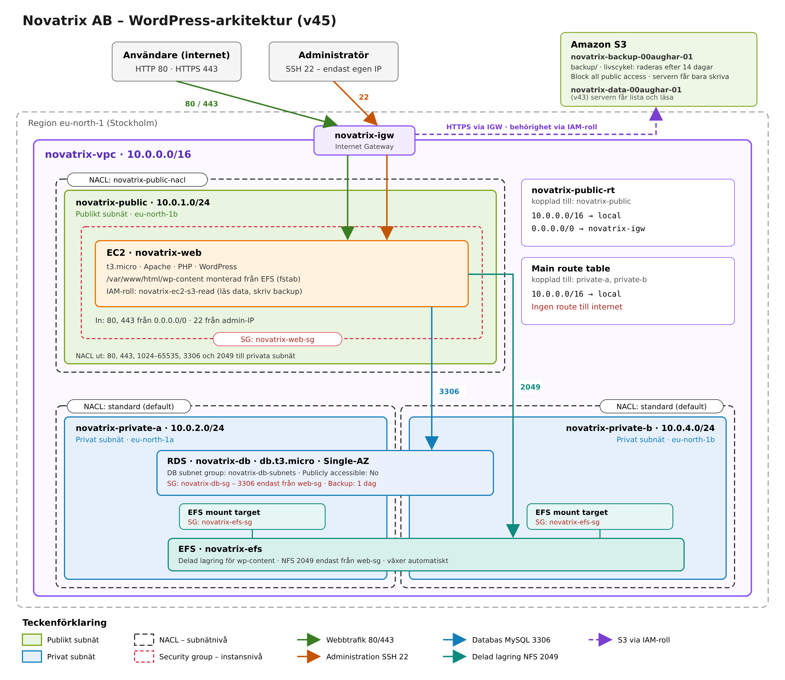

# V.45 AWS Uppgift 4, Databas och lagring

**Repo: https://github.com/00aughar/AWS_MOV25**

**August Hartwig**
**MOV25**
**10/11**

RDS (Relational Database Service) - Relationsdatabas som driftas av AWS (Backup,uppdateringar, patchar & övervakning). Endast motor,storlek & nätverk styrs av Novatrix. RDS ligger i VPC nätverket i det privata subnätet, ingen egen publik IP adress. Läckt databas innebär en stor säkerhetsrisk. RDS ger databasen en endpoint (intern adress) som används för att webbservern ska hitta databasen.

EFS är ett delat filsystem som monteras på EC2 instanser. Flera Servrar kan monteras mot samma EFS. Växer automatiskt ingen fast storlek. NFS är tekniken bakom och EFS är AWS färdiga tjänst. Istället för att WordPress teman, tillägg och uppladdningar hamnar på en lokal disk så hamnar hela wp-content på EFS i en delad yta, flera servar delar då innehållet. Byts en server ut så nås innehållet ändå. Databas och EFS gör att webbplatsen blir oberoende från servern.

WordPress behöver fyra saker för att fungera, och varje del har en egen tjänst:

- Programfilerna för WordPress ligger på webbservern (EC2).
- Innehållet, som inlägg och användare, ligger i en hanterad databas (RDS) i ett privat subnät utan publik IP.
- Uppladdade filer, teman och tillägg (wp-content) ligger på delad lagring (EFS), så att flera webbservrar kan dela samma innehåll och en server kan bytas ut utan att filerna försvinner.
- Backuper av databasen sparas i S3 och raderas automatiskt efter 14 dagar.

Tillsammans gör databasen och EFS att webbplatsen blir oberoende av den enskilda servern.

### Nätverksskiss



# Delmoment 2, Databas

DB subnet group är en namngiven samling av subnät i VPC. Gruppen definierar vilka subnät RDS databasen får använda, endast de privata subnäten.

### 1. Konfiguration av DB subnet group *novatrix-db-subnets*

*novatrix-db-subnets* VPC *novatrix-vpc* Subnets *novatrix-private-a* & *novatrix-private-b*


### 2. Konfiguration av Security Group för databasen *novatrix-db-sg*

*novatrix-db-sg* VPC *novatrix-vpc* Inbound rules Type *MYSQL/Aurora* (Port 3306) source *novatrix-web-sg*


### 3. Konfiguration av RDS databasen *novatrix-db*

RDS - Instansklassen db.t3.micro - Motivering liten klass räcker för Novatrix ändamål. Inte större än nödvändigt för att drifta en Wordpress sida - Kostnadstänk mindre kostnad per timme.


### 4. NACL *novatrix-public-nacl* lägg till nya regler 

Ny regel ut 140: TCP 3306 för databasen

Ny regel ut 150: TCP 2049 för EFS


### 5. Verifiera Databasen


# Delmoment 3, Delad lagring


### 6. Aktivera DNS hostnames för VPC

EFS monteras med DNS namn för att kunna slås upp.  Därav behöver DNS hostnames aktiveras på VPC.


### 7. Konfiguration av security groups *novatrix-efs-sg*

Mount Target sätts upp i VPC för att EFS ska få en ingång i subnätet. Mount target läggs på de privata subnäten *novatrix-private-a* & *novatrix-private-b*. Mount target ska skyddas av säkerhetsregel *novatrix-efs-sg*. 

Inbound Rules NFS (Port 2049) Source *novatrix-web-sg*


### 8. Konfiguration *novatrix-efs*


### 9. Montera EFS på webbservern

#### Installation av verktyget
1. SSH in på *novatrix-web*, ```sudo dnf install -y amazon-efs-utils```

#### Skapa mappen wp-content
2. ```sudo mkdir -p /var/www/html/wp-content; echo "mappen skapad"```

#### Montera filsystemet (ersätt <novatrix-efs ID> med riktigt ID)
3. ```sudo mount -t efs -o tls fs-<novatrix-efs ID>:/ /var/www/html/wp-content; echo "mount: kod $?"```

#### Redigera fstab
4. ```sudo nano /etc/fstab```

#### Lägg till i fstab (ersätt <novatrix-efs ID> med riktigt ID)
5. ```fs-<novatrix-efs ID>:/ /var/www/html/wp-content efs _netdev,noresvport,tls 0 0```

#### Kontrollera att EFS är mountad till wp-content
6. ```sudo umount /var/www/html/wp-content && sudo mount -a && df -h /var/www/html/wp-content```


# Delmoment 4, Objektlagring

Backup och återställning. RDS tar automatiska säkerhetskopior på schema. På Free plan är lagringstiden för automatisk backup satt till 1 dag. I drift hade jag valt 7 dagar. Med point-in-time recovery kan databasen då återställas till valfri tidpunkt under den senaste veckan, vilket täcker fel som upptäcks först efter en helg, till exempel ett raderat inlägg eller en misslyckad uppdatering. WordPress-databasen är liten, så kostnaden för 7 dagars backup blir låg. För längre tid tillbaka finns de manuella backuperna i S3, som sparas i 14 dagar och ligger kvar även om RDS-instansen tas bort. De två backuperna kompletterar alltså varandra: RDS för snabb återställning, S3 för längre lagring och som en oberoende kopia.

Kostnad EFS och S3 betalas per lagrad gigabyte. S3 billigare per GB, passar för backuper. EFS kostar mer men är ett riktigt filsystem.

### 10. Konfigurera S3-bucket för backup *novatrix-backup-00aughar-01*


### 11. Skapa mapp för backup i *novatrix-backup-00aughar-01*


### 12. Skapa livscykelregel på 14 dagar


### 13. Verifiera lagringen

#### Kontroll 1: Syns EFS-ytan i df -h på webbservern?

#### Kontroll 2: sudo touch en testfil i wp-content, och ta bort den

#### Kontroll 1 & 2 i ett script:
```df -h /var/www/html/wp-content; sudo touch /var/www/html/wp-content/test.txt && ls -l /var/www/html/wp-content && sudo rm /var/www/html/wp-content/test.txt && echo "testfilen borttagen"```


#### Kontroll 3: Mount targets Available, båda med novatrix-efs-sg?


#### Kontroll 4: Bucketen i Stockholm, Block all public access på?


#### Kontroll 5: Livscykelregeln backup-14-dagar Enabled?


#### Kontroll 6: Automatisk backup 1 dag Enabled?


# Delmoment 5, Koppla ihop WordPress

### 14. Installera WordPress

1. Installera PHP och de tillägg WordPress behöver, samt MariaDB-klienten för att kunna testa databasen från servern:

```
sudo dnf install -y php php-mysqlnd php-gd php-mbstring php-xml mariadb105
```

`php-mysqlnd` låter PHP prata med databasen, `php-gd` hanterar bilder, och `php-mbstring` och `php-xml` behövs för text och import/export i WordPress.

2. Ladda ner senaste WordPress till `/tmp` och packa upp det:

```
cd /tmp && wget https://wordpress.org/latest.tar.gz && tar -xzf latest.tar.gz
```

3. Kopiera WordPress-filerna till Apaches webbkatalog:

```
sudo cp -r /tmp/wordpress/* /var/www/html/
```

Eftersom `wp-content` redan är monterad på EFS hamnar teman och tillägg direkt på den delade lagringen.

4. Döp om den gamla Novatrix-sidan från v42, så att Apache visar WordPress `index.php` i stället för `index.html`:

```
sudo mv /var/www/html/index.html /var/www/html/index-v42.html
```

5. Ge Apache ägarskap över filerna och starta tjänsterna:

```
sudo chown -R apache:apache /var/www/html
sudo systemctl enable --now php-fpm
sudo systemctl restart httpd
```

### 15. Konfigurera WordPress sidan

#### 1. Surfa till http://(publik-ip), välj språk


#### 2. Database Name wordpress, Username admin, Password ditt lösenord. Database Host: RDS-endpointen, Table Prefix wp_


#### 3. Submit, Run the installation, sajtnamn Novatrix


#### 4. Logga in, skapa ett inlägg med en bild


# Delmoment 6, Säkra åtkomsten

Security Group runt databasen *novatrix-db-sg* tillåter endast inkommande trafik på databasporten 3306 från webserverns security group, inga IP-intervall används vilket gör att nya webbservrar som är med i säkerhetsgruppen får åtkomst till databasen.
- Databas motorer MySQL & MariaDB kräver port 3306.

## Säkerhetskedjan

| Komponent | Säkerhetsgrupp | Port | Släpper in från | Syfte |
|---|---|---|---|---|
| Webbserver | `novatrix-web-sg` | 80, 443 | `0.0.0.0/0` | Besökare når WordPress |
| Webbserver | `novatrix-web-sg` | 22 | Admin-IP `/32` | SSH endast för administratören |
| RDS | `novatrix-db-sg` | 3306 | `novatrix-web-sg` | Bara webbservern når databasen |
| EFS | `novatrix-efs-sg` | 2049 | `novatrix-web-sg` | Bara webbservern kan montera den delade lagringen |

Databasens och EFS säkerhetsgrupper använder webbserverns säkerhetsgrupp som källa i stället för IP-adresser. Nya webbservrar som får `novatrix-web-sg` får därmed automatiskt åtkomst, och ingen annan.

## Säkerhet i lager

| Lager | Inställning | Skyddar mot |
|---|---|---|
| Routing | De privata subnäten har ingen route till internet | Att databasen eller EFS nås utifrån |
| RDS | *Publicly accessible: No*, ingen publik IP | Att databasen exponeras direkt mot internet |
| NACL `novatrix-public-nacl` | Utgående 3306 (regel 140) och 2049 (regel 150) till de privata subnäten | Att webbservern kan nå andra portar i de privata subnäten |
| Security groups | `db-sg` och `efs-sg` släpper bara in `web-sg` | Att andra resurser i VPC:t når databasen eller filerna |
| EFS | Monteras med `tls` | Att filtrafiken mellan webbservern och EFS avlyssnas |
| S3 | *Block all public access* på backup-bucketen | Att backuper blir publikt åtkomliga |
| IAM | Rollen får bara `s3:PutObject` i `backup/` | Att en komprometterad server kan läsa, lista eller radera backuper |

### 16. Ge rollen *novatrix-ec2-s3-read* behörighet att skriva backup i S3

1. IAM, Roles, novatrix-ec2-s3-read, Add permissions, Create inline policy
JSON
2. Fyll i JSON
```
{
	"Version": "2012-10-17",
	"Statement": [
		{
			"Sid": "WriteBackupsOnly",
			"Effect": "Allow",
			"Action": "s3:PutObject",
			"Resource": "arn:aws:s3:::novatrix-backup-00aughar-01/backup/*"
		}
	]
}
```


3. Namn novatrix-s3-backup, Create policy


# Delmoment 7, Verifiera och dokumentera


### 17. Verifiera hela stacken

Kontroll 1 visar inlägget: ```mysql -h <endpoint> -u admin -p -e "SELECT post_title FROM wordpress.wp_posts;"```


Kontroll 2 visar bilden: ```ls -R /var/www/html/wp-content/uploads; df -h /var/www/html/wp-content``` 

Kontroll 3 visar att wp-content ligger på EFS: ```df -h``` 

Kontroll 2 & 3 i samma script:

```ls -R /var/www/html/wp-content/uploads; df -h /var/www/html/wp-content```


Kontroll 4: Publicly accessible är fortfarande No


### 18. Backup av databasen till S3

1. ```mysqldump --single-transaction -h novatrix-db.cvaykw2e4q13.eu-north-1.rds.amazonaws.com -u admin -p wordpress > wordpress-2026-11-08.sql```

2. ```aws s3 cp wordpress-2026-11-08.sql s3://novatrix-backup-00aughar-01/backup/```


3. ```aws s3 ls s3://novatrix-backup-00aughar-01/backup/```

Listningen görs från administratörens dator, eftersom webbserverns roll bara får skriva till bucketen och inte lista den.


4. ```rm wordpress-2026-11-08.sql```


# VG

## Nätverksskiss av VG miljön:


## Val av databas- och lagringsnivåer

Utgångspunkten för valen är att Novatrix webbplats är liten med låg och ojämn trafik. Valen ska därför ge tillräcklig prestanda till lägsta rimliga kostnad, och vara lätta att skala upp när behovet växer.

### Databas (RDS)

| Val | Valt | Alternativ | Motivering |
|---|---|---|---|
| Motor | MariaDB | MySQL, Aurora | MariaDB är kompatibel med WordPress och ingår i free tier. Aurora ger högre prestanda och tillgänglighet men kostar betydligt mer och behövs inte för en liten webbplats |
| Instansklass | db.t3.micro | db.t4g.micro, större klasser | Den minsta klassen räcker för en WordPress-sida med få besökare och ingår i free tier. Burstable-klasser (t) passar ojämn trafik. db.t4g.micro (Graviton) är ofta lite billigare per timme och är ett bra val i drift. Klassen kan bytas senare utan att data går förlorad |
| Tillgänglighet | Single-AZ | Multi-AZ | Multi-AZ håller en reservdatabas i en annan zon och tar över automatiskt vid fel, men dubblerar instanskostnaden. För en liten webbplats där ett kortare avbrott är acceptabelt räcker Single-AZ. Med krav på hög tillgänglighet hade Multi-AZ varit värt kostnaden |
| Kryptering | På | Av | Kryptering i vila med AWS-hanterad nyckel kostar inget extra och skyddar data om lagringen skulle komma på avvägar |
| Backup | 1 dag (7 dagar i drift) | 0–35 dagar | 1 dag är max på Free plan. I drift ger 7 dagar möjlighet att återställa till valfri tidpunkt under en vecka. Se motiveringen under Delmoment 4 |

### Delad lagring (EFS)

| Val | Valt | Alternativ | Motivering |
|---|---|---|---|
| Lagringsklass | Standard (flera zoner) | One Zone | One Zone är billigare men lagrar bara data i en zon. Standard lagrar redundant i flera zoner och har mount targets i båda privata subnäten, så filerna finns kvar om en zon går ner |
| Livscykel | Till Infrequent Access efter 30 dagar | Ingen livscykel | Gamla uppladdningar och oanvända tillägg flyttas till en billigare lagringsklass och tillbaka när de används igen. Det sänker kostnaden utan att något behöver göras manuellt |
| Throughput | Elastic | Bursting, Provisioned | Elastic betalas efter faktisk användning och klarar toppar automatiskt. Bursting ger låg grundprestanda för små filsystem som WordPress, och Provisioned kostar även när kapaciteten inte används |
| Kryptering | I vila och under överföring (TLS) | Av | Kostar inget extra. Filtrafiken mellan webbservern och EFS kan inte avlyssnas |

### Säkerhet i flera lager (VG)

| Lager | Inställning | Skyddar mot |
|---|---|---|
| Privat NACL | Bara 3306 och 2049 från `10.0.1.0/24` in, svarsportar ut | Att andra subnät eller tjänster når databasen och EFS, även om en säkerhetsgrupp blir för öppen |
| Bastion | Enda vägen in med SSH | Direkta SSH-attacker mot webbservern |
| TLS mot databasen | `MYSQL_CLIENT_FLAGS` i `wp-config.php` och RDS-certifikat på servern | Avlyssning av databastrafiken inne i VPC:t |

### Så körs skriptet

Hela stacken byggs med ett kommando i Git Bash från repots rot:

```
bash V45/bygg-allt.sh $(curl -s https://checkip.amazonaws.com)
```

#### 1. På administratörens dator

1. `curl` hämtar administratörens publika IP och skickar den som argument till skriptet. IP:n används i reglerna för SSH till bastionen. Skriptet stoppar om ingen IP anges.
2. Skriptet frågar efter ett databaslösenord. Det syns inte när det skrivs och kontrolleras mot reglerna 8–41 tecken, bara bokstäver och siffror.
3. `V43/iam-setup.sh` körs för att säkerställa att IAM-rollen `novatrix-ec2-s3-read` finns, eftersom webbservern behöver den. Det som redan finns ändras inte.
4. `aws cloudformation deploy` skickar mallen till AWS med IP:n och lösenordet som parametrar. `CAPABILITY_IAM` krävs eftersom mallen skapar en IAM-policy.
5. När stacken är klar skrivs adresserna till webbplatsen, bastionen, databasen, EFS och backup-bucketen ut.

Varken IP:n eller lösenordet sparas i repot. Lösenordet är en parameter med `NoEcho` och visas inte i CloudFormation-konsolen.

#### 2. I AWS

CloudFormation läser hur resurserna beror på varandra och skapar dem i rätt ordning. Resurser som inte beror på varandra skapas samtidigt.

| Ordning | Skapas | Väntar på |
|---|---|---|
| 1 | VPC, Internet Gateway, S3-bucket | – |
| 2 | Subnät, route tables, NACL:er, security groups | VPC |
| 3 | DB subnet group, EFS med mount targets, bastion, IAM-policy | Subnät och security groups |
| 4 | RDS-databasen (ca 10 minuter) | DB subnet group |
| 5 | Webbservern | Databasens endpoint, EFS mount targets och routen till internet |

Webbservern skapas sist, eftersom den behöver databasens adress och en färdig EFS för att kunna konfigurera WordPress.

#### 3. På webbservern

När webbservern startar första gången kör den user data-skriptet i mallen:

1. Installerar Apache, PHP, MariaDB-klienten och EFS-verktyget
2. Installerar AWS certifikat för RDS, så att den krypterade databasanslutningen kan verifieras
3. Monterar EFS på `wp-content` med TLS och lägger raden i `/etc/fstab`, så att monteringen finns kvar efter omstart
4. Laddar ner WordPress och kopierar filerna till webbkatalogen
5. Skapar `wp-config.php` med databasuppgifterna från stacken och krypterad anslutning
6. Hämtar unika säkerhetsnycklar från WordPress
7. Ger Apache ägarskap över filerna och startar om Apache

Det tar 2–3 minuter efter att stacken är klar. Därefter visar webbplatsen WordPress installationssida utan att fråga efter databasuppgifter.

#### 4. Rivning

```
bash V45/riv-allt.sh
```

Skriptet läser backup-bucketens namn från stackens outputs och tömmer den, eftersom CloudFormation inte kan ta bort en bucket som innehåller filer. Sedan tas stacken bort, och CloudFormation river resurserna i omvänd ordning. IAM från v43 och miljön som byggts i konsolen påverkas inte.

### Objektlagring (S3)

| Val | Valt | Alternativ | Motivering |
|---|---|---|---|
| Lagringsklass | Standard | Standard-IA, Glacier | Backuperna sparas bara i 14 dagar. Standard-IA debiterar minst 30 dagars lagring och Glacier minst 90 dagar, så de billigare klasserna hade blivit dyrare för filer som raderas efter 14 dagar. Glacier har dessutom fördröjning vid återställning |
| Livscykel | Radera efter 14 dagar | Spara för alltid | Gamla backuper raderas automatiskt så att kostnaden inte växer över tid. 14 dagar ger längre historik än RDS-backupen |
| Åtkomst | Block all public access, servern får bara skriva | Publik eller full åtkomst | Backuper innehåller hela databasen. Ingen ska kunna nå dem utifrån, och en komprometterad webbserver ska inte kunna läsa eller radera dem |

### Sammanfattning

Valen prioriterar låg kostnad där det inte påverkar säkerheten: minsta instansklass, Single-AZ och automatisk livscykel för både EFS och S3. Säkerheten prioriteras oavsett kostnad, eftersom kryptering, privata subnät och begränsade behörigheter inte kostar något extra. Lösningen kan växa genom att byta till en större instansklass eller slå på Multi-AZ, utan att arkitekturen behöver ändras.

### Bilddokumentation och körning

Miljön byggs:


Wordpress sida uppe:


Skapa inlägg på Wordpress:


Anslut till bastion > vidare till webserver & kontrollera innehåll i wp_posts


Testa skapa backup och kontrollera access. Backup-bucketen och rollens skrivbehörighet skapas av CloudFormation-mallen. Webbservern kan ladda upp backupen men nekas att lista bucketen, eftersom policyn bara ger s3:PutObject i backup/. Listningen görs i stället från administratörens dator.


Kontroll av kryptering. Anslutningen mellan webbservern och databasen är krypterad. Ssl_cipher visar att TLS används med chiffret TLS_AES_256_GCM_SHA384. Databastrafiken kan därför inte avlyssnas, inte ens inne i VPC:t:


Kontroll av backup från hostens dator:


Kontroll av instanser i portal:


Kontroll av databas i portal:


Automatiska backups 1 dag kontroll portal:


RDS endpoint i portal:


Kontroll av S3 bucket och inlägg i portal:


Kontroll av cloud formation körning i portal:


Bortagning av stack med: ```bash V45/riv-allt.sh```


*novatrix-wordpress.yaml*
```
AWSTemplateFormatVersion: "2010-09-09"
Description: >
  Novatrix AB - WordPress-stacken som kod (v42-v45).
  Natverk med bastion och flera sakerhetslager (v44), RDS MariaDB, EFS och
  S3 for backup (v45). Webbservern installerar och konfigurerar WordPress
  automatiskt. Kraver att IAM-rollen fran v43 (novatrix-ec2-s3-read) finns.

Parameters:
  Prefix:
    Type: String
    Default: novatrix-iac
    Description: Namnprefix sa att resurserna skiljer sig fran de som byggts i konsolen
  MyIp:
    Type: String
    Description: Administratorens publika IP med /32
    AllowedPattern: '^(\d{1,3}\.){3}\d{1,3}/32$'
  KeyName:
    Type: AWS::EC2::KeyPair::KeyName
    Default: aws_webserver
  InstanceRoleName:
    Type: String
    Default: novatrix-ec2-s3-read
    Description: IAM-roll och instance profile fran v43 (samma namn)
  DbInstanceClass:
    Type: String
    Default: db.t3.micro
    AllowedValues: [db.t3.micro, db.t4g.micro]
    Description: Minsta klasserna, ingar i free tier
  DbUser:
    Type: String
    Default: admin
  DbPassword:
    Type: String
    NoEcho: true
    MinLength: 8
    MaxLength: 41
    AllowedPattern: '^[A-Za-z0-9]+$'
    Description: Databaslosenord, 8-41 tecken, bara bokstaver och siffror
  LatestAmiId:
    Type: AWS::SSM::Parameter::Value<AWS::EC2::Image::Id>
    Default: /aws/service/ami-amazon-linux-latest/al2023-ami-kernel-default-x86_64

Resources:
  # ================= Lager 1: natverk och segmentering (v44) =================
  Vpc:
    Type: AWS::EC2::VPC
    Properties:
      CidrBlock: 10.0.0.0/16
      EnableDnsSupport: true
      EnableDnsHostnames: true          # kravs for att montera EFS via DNS-namn
      Tags: [{ Key: Name, Value: !Sub "${Prefix}-vpc" }]

  InternetGateway:
    Type: AWS::EC2::InternetGateway
    Properties:
      Tags: [{ Key: Name, Value: !Sub "${Prefix}-igw" }]

  IgwAttachment:
    Type: AWS::EC2::VPCGatewayAttachment
    Properties:
      VpcId: !Ref Vpc
      InternetGatewayId: !Ref InternetGateway

  PublicSubnet:
    Type: AWS::EC2::Subnet
    Properties:
      VpcId: !Ref Vpc
      CidrBlock: 10.0.1.0/24
      AvailabilityZone: !Select [1, !GetAZs ""]   # eu-north-1b
      MapPublicIpOnLaunch: true
      Tags: [{ Key: Name, Value: !Sub "${Prefix}-public" }]

  PrivateSubnetA:
    Type: AWS::EC2::Subnet
    Properties:
      VpcId: !Ref Vpc
      CidrBlock: 10.0.2.0/24
      AvailabilityZone: !Select [0, !GetAZs ""]   # eu-north-1a
      Tags: [{ Key: Name, Value: !Sub "${Prefix}-private-a" }]

  PrivateSubnetB:
    Type: AWS::EC2::Subnet
    Properties:
      VpcId: !Ref Vpc
      CidrBlock: 10.0.4.0/24
      AvailabilityZone: !Select [1, !GetAZs ""]   # eu-north-1b
      Tags: [{ Key: Name, Value: !Sub "${Prefix}-private-b" }]

  # ---------- Routing ----------
  PublicRouteTable:
    Type: AWS::EC2::RouteTable
    Properties:
      VpcId: !Ref Vpc
      Tags: [{ Key: Name, Value: !Sub "${Prefix}-public-rt" }]

  PublicDefaultRoute:
    Type: AWS::EC2::Route
    DependsOn: IgwAttachment
    Properties:
      RouteTableId: !Ref PublicRouteTable
      DestinationCidrBlock: 0.0.0.0/0
      GatewayId: !Ref InternetGateway

  PublicSubnetRta:
    Type: AWS::EC2::SubnetRouteTableAssociation
    Properties: { SubnetId: !Ref PublicSubnet, RouteTableId: !Ref PublicRouteTable }

  # Privat route table: bara local, ingen vag till internet
  PrivateRouteTable:
    Type: AWS::EC2::RouteTable
    Properties:
      VpcId: !Ref Vpc
      Tags: [{ Key: Name, Value: !Sub "${Prefix}-private-rt" }]

  PrivateSubnetARta:
    Type: AWS::EC2::SubnetRouteTableAssociation
    Properties: { SubnetId: !Ref PrivateSubnetA, RouteTableId: !Ref PrivateRouteTable }
  PrivateSubnetBRta:
    Type: AWS::EC2::SubnetRouteTableAssociation
    Properties: { SubnetId: !Ref PrivateSubnetB, RouteTableId: !Ref PrivateRouteTable }

  # ================= Lager 2: NACL (subnatniva, stateless) =================
  PublicNacl:
    Type: AWS::EC2::NetworkAcl
    Properties:
      VpcId: !Ref Vpc
      Tags: [{ Key: Name, Value: !Sub "${Prefix}-public-nacl" }]

  PublicNaclInHttp:
    Type: AWS::EC2::NetworkAclEntry
    Properties: { NetworkAclId: !Ref PublicNacl, RuleNumber: 100, Protocol: 6, RuleAction: allow, Egress: false, CidrBlock: 0.0.0.0/0, PortRange: { From: 80, To: 80 } }
  PublicNaclInHttps:
    Type: AWS::EC2::NetworkAclEntry
    Properties: { NetworkAclId: !Ref PublicNacl, RuleNumber: 110, Protocol: 6, RuleAction: allow, Egress: false, CidrBlock: 0.0.0.0/0, PortRange: { From: 443, To: 443 } }
  PublicNaclInSsh:
    Type: AWS::EC2::NetworkAclEntry
    Properties: { NetworkAclId: !Ref PublicNacl, RuleNumber: 120, Protocol: 6, RuleAction: allow, Egress: false, CidrBlock: !Ref MyIp, PortRange: { From: 22, To: 22 } }
  PublicNaclInEphemeral:
    Type: AWS::EC2::NetworkAclEntry
    Properties: { NetworkAclId: !Ref PublicNacl, RuleNumber: 130, Protocol: 6, RuleAction: allow, Egress: false, CidrBlock: 0.0.0.0/0, PortRange: { From: 1024, To: 65535 } }

  PublicNaclOutHttp:
    Type: AWS::EC2::NetworkAclEntry
    Properties: { NetworkAclId: !Ref PublicNacl, RuleNumber: 100, Protocol: 6, RuleAction: allow, Egress: true, CidrBlock: 0.0.0.0/0, PortRange: { From: 80, To: 80 } }
  PublicNaclOutHttps:
    Type: AWS::EC2::NetworkAclEntry
    Properties: { NetworkAclId: !Ref PublicNacl, RuleNumber: 110, Protocol: 6, RuleAction: allow, Egress: true, CidrBlock: 0.0.0.0/0, PortRange: { From: 443, To: 443 } }
  PublicNaclOutEphemeral:
    Type: AWS::EC2::NetworkAclEntry
    Properties: { NetworkAclId: !Ref PublicNacl, RuleNumber: 120, Protocol: 6, RuleAction: allow, Egress: true, CidrBlock: 0.0.0.0/0, PortRange: { From: 1024, To: 65535 } }
  PublicNaclOutMysqlA:
    Type: AWS::EC2::NetworkAclEntry
    Properties: { NetworkAclId: !Ref PublicNacl, RuleNumber: 130, Protocol: 6, RuleAction: allow, Egress: true, CidrBlock: 10.0.2.0/24, PortRange: { From: 3306, To: 3306 } }
  PublicNaclOutMysqlB:
    Type: AWS::EC2::NetworkAclEntry
    Properties: { NetworkAclId: !Ref PublicNacl, RuleNumber: 140, Protocol: 6, RuleAction: allow, Egress: true, CidrBlock: 10.0.4.0/24, PortRange: { From: 3306, To: 3306 } }
  PublicNaclOutNfsA:
    Type: AWS::EC2::NetworkAclEntry
    Properties: { NetworkAclId: !Ref PublicNacl, RuleNumber: 150, Protocol: 6, RuleAction: allow, Egress: true, CidrBlock: 10.0.2.0/24, PortRange: { From: 2049, To: 2049 } }
  PublicNaclOutNfsB:
    Type: AWS::EC2::NetworkAclEntry
    Properties: { NetworkAclId: !Ref PublicNacl, RuleNumber: 160, Protocol: 6, RuleAction: allow, Egress: true, CidrBlock: 10.0.4.0/24, PortRange: { From: 2049, To: 2049 } }

  PublicNaclAssoc:
    Type: AWS::EC2::SubnetNetworkAclAssociation
    Properties: { SubnetId: !Ref PublicSubnet, NetworkAclId: !Ref PublicNacl }

  # Privat NACL: bara MySQL och NFS fran det publika subnatet, svaren tillbaka ut
  PrivateNacl:
    Type: AWS::EC2::NetworkAcl
    Properties:
      VpcId: !Ref Vpc
      Tags: [{ Key: Name, Value: !Sub "${Prefix}-private-nacl" }]

  PrivateNaclInMysql:
    Type: AWS::EC2::NetworkAclEntry
    Properties: { NetworkAclId: !Ref PrivateNacl, RuleNumber: 100, Protocol: 6, RuleAction: allow, Egress: false, CidrBlock: 10.0.1.0/24, PortRange: { From: 3306, To: 3306 } }
  PrivateNaclInNfs:
    Type: AWS::EC2::NetworkAclEntry
    Properties: { NetworkAclId: !Ref PrivateNacl, RuleNumber: 110, Protocol: 6, RuleAction: allow, Egress: false, CidrBlock: 10.0.1.0/24, PortRange: { From: 2049, To: 2049 } }
  PrivateNaclOutEphemeral:
    Type: AWS::EC2::NetworkAclEntry
    Properties: { NetworkAclId: !Ref PrivateNacl, RuleNumber: 100, Protocol: 6, RuleAction: allow, Egress: true, CidrBlock: 10.0.1.0/24, PortRange: { From: 1024, To: 65535 } }

  PrivateNaclAssocA:
    Type: AWS::EC2::SubnetNetworkAclAssociation
    Properties: { SubnetId: !Ref PrivateSubnetA, NetworkAclId: !Ref PrivateNacl }
  PrivateNaclAssocB:
    Type: AWS::EC2::SubnetNetworkAclAssociation
    Properties: { SubnetId: !Ref PrivateSubnetB, NetworkAclId: !Ref PrivateNacl }

  # ================= Lager 3: security groups (instansniva, stateful) =================
  BastionSg:
    Type: AWS::EC2::SecurityGroup
    Properties:
      VpcId: !Ref Vpc
      GroupDescription: Bastion - SSH endast fran administratorens IP
      SecurityGroupIngress:
        - { IpProtocol: tcp, FromPort: 22, ToPort: 22, CidrIp: !Ref MyIp, Description: SSH fran admin }
      Tags: [{ Key: Name, Value: !Sub "${Prefix}-bastion-sg" }]

  WebSg:
    Type: AWS::EC2::SecurityGroup
    Properties:
      VpcId: !Ref Vpc
      GroupDescription: Webbserver - HTTP/HTTPS fran alla, SSH endast fran bastion
      SecurityGroupIngress:
        - { IpProtocol: tcp, FromPort: 80, ToPort: 80, CidrIp: 0.0.0.0/0, Description: HTTP }
        - { IpProtocol: tcp, FromPort: 443, ToPort: 443, CidrIp: 0.0.0.0/0, Description: HTTPS }
        - { IpProtocol: tcp, FromPort: 22, ToPort: 22, SourceSecurityGroupId: !Ref BastionSg, Description: SSH endast via bastion }
      Tags: [{ Key: Name, Value: !Sub "${Prefix}-web-sg" }]

  DbSg:
    Type: AWS::EC2::SecurityGroup
    Properties:
      VpcId: !Ref Vpc
      GroupDescription: Databas - MySQL endast fran webbservern
      SecurityGroupIngress:
        - { IpProtocol: tcp, FromPort: 3306, ToPort: 3306, SourceSecurityGroupId: !Ref WebSg, Description: MySQL fran web-sg }
      Tags: [{ Key: Name, Value: !Sub "${Prefix}-db-sg" }]

  EfsSg:
    Type: AWS::EC2::SecurityGroup
    Properties:
      VpcId: !Ref Vpc
      GroupDescription: EFS - NFS endast fran webbservern
      SecurityGroupIngress:
        - { IpProtocol: tcp, FromPort: 2049, ToPort: 2049, SourceSecurityGroupId: !Ref WebSg, Description: NFS fran web-sg }
      Tags: [{ Key: Name, Value: !Sub "${Prefix}-efs-sg" }]

  # ================= Databas: RDS MariaDB (v45) =================
  DbSubnetGroup:
    Type: AWS::RDS::DBSubnetGroup
    Properties:
      DBSubnetGroupDescription: Endast de privata subnaten
      SubnetIds: [!Ref PrivateSubnetA, !Ref PrivateSubnetB]
      Tags: [{ Key: Name, Value: !Sub "${Prefix}-db-subnets" }]

  Database:
    Type: AWS::RDS::DBInstance
    DeletionPolicy: Delete            # labbmiljo. I drift: Snapshot
    UpdateReplacePolicy: Delete
    Properties:
      DBInstanceIdentifier: !Sub "${Prefix}-db"
      Engine: mariadb
      DBInstanceClass: !Ref DbInstanceClass
      AllocatedStorage: "20"
      StorageType: gp3
      StorageEncrypted: true          # kryptering i vila
      MultiAZ: false                  # Single-AZ for kostnad, se motivering
      PubliclyAccessible: false       # ingen publik IP
      DBName: wordpress
      MasterUsername: !Ref DbUser
      MasterUserPassword: !Ref DbPassword
      DBSubnetGroupName: !Ref DbSubnetGroup
      VPCSecurityGroups: [!Ref DbSg]
      BackupRetentionPeriod: 1        # max pa Free plan, 7 dagar i drift
      DeletionProtection: false
      Tags: [{ Key: Name, Value: !Sub "${Prefix}-db" }]

  # ================= Delad lagring: EFS (v45) =================
  FileSystem:
    Type: AWS::EFS::FileSystem
    Properties:
      Encrypted: true                 # kryptering i vila
      PerformanceMode: generalPurpose
      ThroughputMode: elastic         # betala for faktisk anvandning
      LifecyclePolicies:
        - TransitionToIA: AFTER_30_DAYS                   # sallan anvanda filer till billigare klass
        - TransitionToPrimaryStorageClass: AFTER_1_ACCESS # tillbaka nar filen anvands igen
      FileSystemTags: [{ Key: Name, Value: !Sub "${Prefix}-efs" }]

  MountTargetA:
    Type: AWS::EFS::MountTarget
    Properties: { FileSystemId: !Ref FileSystem, SubnetId: !Ref PrivateSubnetA, SecurityGroups: [!Ref EfsSg] }
  MountTargetB:
    Type: AWS::EFS::MountTarget
    Properties: { FileSystemId: !Ref FileSystem, SubnetId: !Ref PrivateSubnetB, SecurityGroups: [!Ref EfsSg] }

  # ================= Objektlagring: S3 for backup (v45) =================
  BackupBucket:
    Type: AWS::S3::Bucket
    Properties:
      BucketName: !Sub "${Prefix}-backup-${AWS::AccountId}"
      PublicAccessBlockConfiguration:
        BlockPublicAcls: true
        BlockPublicPolicy: true
        IgnorePublicAcls: true
        RestrictPublicBuckets: true
      BucketEncryption:
        ServerSideEncryptionConfiguration:
          - ServerSideEncryptionByDefault: { SSEAlgorithm: AES256 }
      LifecycleConfiguration:
        Rules:
          - Id: radera-backup-14-dagar
            Status: Enabled
            Prefix: backup/
            ExpirationInDays: 14
      Tags: [{ Key: Name, Value: !Sub "${Prefix}-backup" }]

  # Webbserverns roll fran v43 far bara ladda upp backuper, inte lasa, lista eller radera
  WriteBackupsPolicy:
    Type: AWS::IAM::Policy
    Properties:
      PolicyName: !Sub "${Prefix}-write-backups-only"
      Roles: [!Ref InstanceRoleName]
      PolicyDocument:
        Version: "2012-10-17"
        Statement:
          - Sid: WriteBackupsOnly
            Effect: Allow
            Action: s3:PutObject
            Resource: !Sub "${BackupBucket.Arn}/backup/*"

  # ================= Instanser =================
  Bastion:
    Type: AWS::EC2::Instance
    Properties:
      ImageId: !Ref LatestAmiId
      InstanceType: t3.micro
      KeyName: !Ref KeyName
      SubnetId: !Ref PublicSubnet
      SecurityGroupIds: [!Ref BastionSg]
      Tags: [{ Key: Name, Value: !Sub "${Prefix}-bastion" }]

  WebServer:
    Type: AWS::EC2::Instance
    DependsOn: [PublicDefaultRoute, MountTargetA, MountTargetB]
    Properties:
      ImageId: !Ref LatestAmiId
      InstanceType: t3.micro
      KeyName: !Ref KeyName
      SubnetId: !Ref PublicSubnet
      SecurityGroupIds: [!Ref WebSg]
      IamInstanceProfile: !Ref InstanceRoleName
      Tags: [{ Key: Name, Value: novatrix-web }]
      UserData:
        Fn::Base64: !Sub |
          #!/bin/bash
          # 1. Programvara: Apache, PHP, MariaDB-klient och EFS-verktyg
          dnf install -y httpd php php-mysqlnd php-gd php-mbstring php-xml mariadb105 amazon-efs-utils
          systemctl enable --now httpd php-fpm

          # RDS certifikat, sa att servern kan verifiera databasen vid krypterad anslutning
          curl -s -o /etc/pki/ca-trust/source/anchors/rds-global-bundle.pem https://truststore.pki.rds.amazonaws.com/global/global-bundle.pem
          update-ca-trust

          # 2. Montera EFS pa wp-content, aven efter omstart (fstab)
          mkdir -p /var/www/html/wp-content
          echo "${FileSystem}:/ /var/www/html/wp-content efs _netdev,noresvport,tls,nofail 0 0" >> /etc/fstab
          for i in $(seq 1 30); do
            mount -a && mountpoint -q /var/www/html/wp-content && break
            sleep 10
          done

          # 3. WordPress. -n skriver inte over filer som redan finns pa EFS
          cd /tmp
          curl -sO https://wordpress.org/latest.tar.gz
          tar -xzf latest.tar.gz
          cp -rn /tmp/wordpress/. /var/www/html/

          # 4. wp-config.php med databasuppgifterna fran stacken
          cd /var/www/html
          cp wp-config-sample.php wp-config.php
          sed -i "s/database_name_here/wordpress/" wp-config.php
          sed -i "s/username_here/${DbUser}/" wp-config.php
          sed -i "s/password_here/${DbPassword}/" wp-config.php
          sed -i "s/'localhost'/'${Database.Endpoint.Address}'/" wp-config.php
          # RDS MariaDB kraver krypterad anslutning (require_secure_transport=ON)
          sed -i "/That's all, stop editing/i define( 'MYSQL_CLIENT_FLAGS', MYSQLI_CLIENT_SSL );" wp-config.php

          # 5. Unika sakerhetsnycklar fran WordPress
          curl -s https://api.wordpress.org/secret-key/1.1/salt/ -o /tmp/salt.txt
          python3 - <<'PY'
          path = "/var/www/html/wp-config.php"
          salt = open("/tmp/salt.txt").read().rstrip("\n")
          out, done = [], False
          for line in open(path).read().split("\n"):
              if "put your unique phrase here" in line:
                  if not done:
                      out.append(salt)
                      done = True
                  continue
              out.append(line)
          open(path, "w").write("\n".join(out))
          PY

          # 6. Behorigheter och omstart
          rm -f /var/www/html/index.html
          chown -R apache:apache /var/www/html
          systemctl restart httpd

Outputs:
  Webbsida:
    Value: !Sub "http://${WebServer.PublicIp}"
  WebPublicIp:
    Value: !GetAtt WebServer.PublicIp
  WebPrivateIp:
    Value: !GetAtt WebServer.PrivateIp
  BastionPublicIp:
    Value: !GetAtt Bastion.PublicIp
  DbEndpoint:
    Value: !GetAtt Database.Endpoint.Address
  EfsId:
    Value: !Ref FileSystem
  BackupBucket:
    Value: !Ref BackupBucket
```

*bygg-allt.sh*
```
#!/bin/bash
# bygg-allt.sh - Bygger hela WordPress-stacken från repot (v42-v45)
# Kör i Git Bash med din publika IP som argument:
#   bash V45/bygg-allt.sh $(curl -s https://checkip.amazonaws.com)
# Databaslösenordet frågas efter vid körning och sparas aldrig i repot.
#   1. IAM från v43 (grupper, policyer, roller)
#   2. Nätverk, bastion, RDS, EFS, S3 och webbserver med WordPress (CloudFormation)

MYIP="$(echo "$1" | tr -d '[:space:]')"
REGION="eu-north-1"
STACK="novatrix-wordpress"

V45_DIR="$(cd "$(dirname "$0")" && pwd)"
REPO_DIR="$(dirname "$V45_DIR")"

if [ -z "$MYIP" ]; then
  echo "FEL: ange din publika IP, t.ex.:  bash V45/bygg-allt.sh \$(curl -s https://checkip.amazonaws.com)"
  exit 1
fi
echo "Admin-IP: $MYIP"

read -s -p "Välj databaslösenord (8-41 tecken, bara bokstäver och siffror): " DBPASS
echo ""
if ! [[ "$DBPASS" =~ ^[A-Za-z0-9]{8,41}$ ]]; then
  echo "FEL: lösenordet måste vara 8-41 tecken och bara innehålla bokstäver och siffror."
  exit 1
fi

echo "=== 1/2 IAM (v43) ==="
(cd "$REPO_DIR/V43" && bash iam-setup.sh) || { echo "FEL: iam-setup.sh misslyckades"; exit 1; }

echo ""
echo "=== 2/2 WordPress-stacken (v44-v45) - tar ca 15 minuter, RDS är långsammast ==="
aws cloudformation deploy \
  --template-file "$V45_DIR/novatrix-wordpress.yaml" \
  --stack-name "$STACK" \
  --region "$REGION" \
  --capabilities CAPABILITY_IAM \
  --parameter-overrides MyIp="$MYIP/32" KeyName=aws_webserver DbPassword="$DBPASS" \
  || { echo "FEL: CloudFormation misslyckades. Se Events på stacken i konsolen."; exit 1; }

echo ""
echo "=== Klar ==="
aws cloudformation describe-stacks --stack-name "$STACK" --region "$REGION" \
  --query "Stacks[0].Outputs[].[OutputKey,OutputValue]" --output table
echo "Vänta 2-3 minuter så att user data hinner installera WordPress innan du öppnar webbsidan."
```

*riv-allt.sh*
```
#!/bin/bash
# riv-allt.sh - Tar bort WordPress-stacken som bygg-allt.sh skapade
# Backup-bucketen töms först, eftersom CloudFormation inte kan ta bort en bucket med filer i.
# IAM från v43 lämnas kvar.

REGION="eu-north-1"
STACK="novatrix-wordpress"

BUCKET=$(aws cloudformation describe-stacks --stack-name "$STACK" --region "$REGION" \
  --query "Stacks[0].Outputs[?OutputKey=='BackupBucket'].OutputValue" --output text 2>/dev/null | tr -d '\r')

if [ -n "$BUCKET" ] && [ "$BUCKET" != "None" ]; then
  echo "Tömmer bucketen $BUCKET..."
  aws s3 rm "s3://$BUCKET" --recursive --region "$REGION"
fi

aws cloudformation delete-stack --stack-name "$STACK" --region "$REGION"
echo "Tar bort stacken $STACK, det tar ca 10 minuter (RDS och EFS)..."
aws cloudformation wait stack-delete-complete --stack-name "$STACK" --region "$REGION" \
  && echo "Klar. Allt i stacken är borttaget."

```