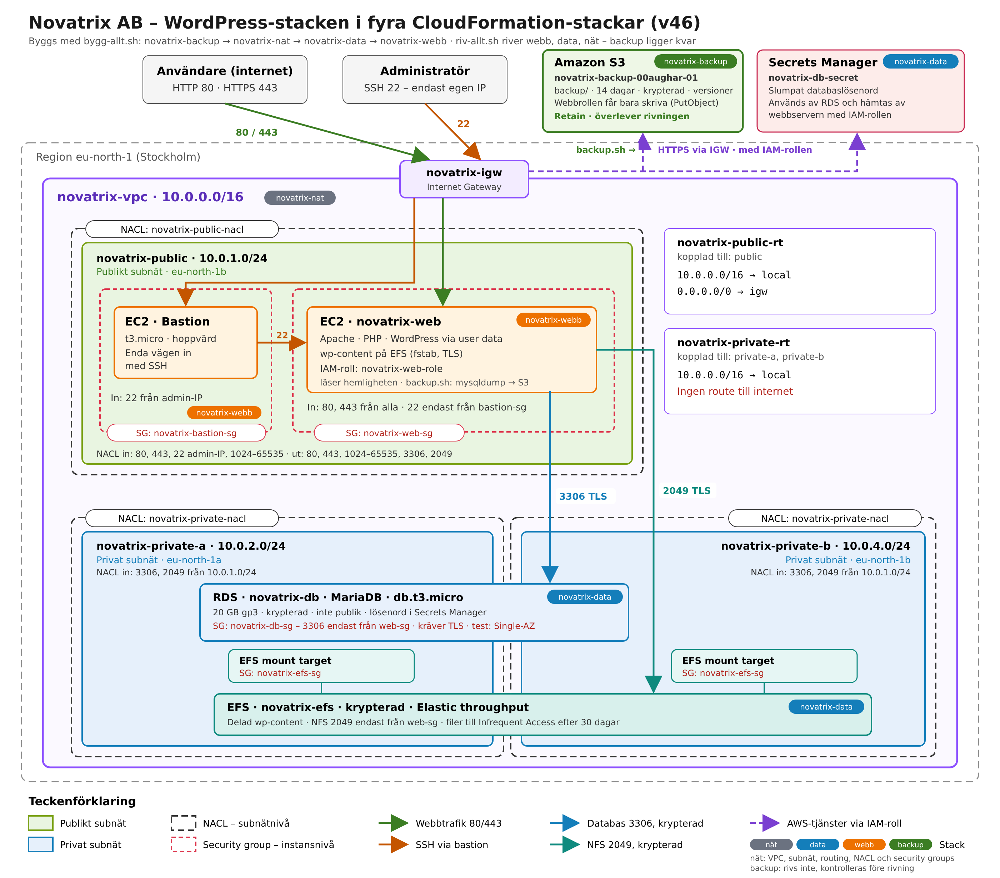

# V.46 AWS Uppgift 5, IaC med CloudFormation

**Repo: https://github.com/00aughar/AWS_MOV25**

**August Hartwig**
**MOV25**
**x/x**

Hittills har Novatrix WordPress-stack byggts bit för bit, delvis i konsolen och delvis med skript. Den här veckan samlas hela stacken som kod i fyra CloudFormation-mallar som är versionshanterade i GitHub. Den gamla miljön som byggts i konsolen har rivits, och hela lösningen återskapas från repot med ett kommando, utan manuella konsolsteg. Innan miljön rivs tas en kontrollerad backup av databasen till S3, och den backupen finns kvar efter rivningen.



# Delmoment 1, Repo

Mallarna och skripten ligger i mappen `V46` i kursrepot, och rotens README har en rad som länkar till veckan.

| Fil | Vad den gör |
|---|---|
| `novatrix-nat.yaml` | Nätstacken: VPC, subnät, routing, NACL:er och security groups |
| `novatrix-backup.yaml` | Backupstacken: S3-bucket för databasbackuper, rivs inte med miljön |
| `novatrix-data.yaml` | Datastacken: databaslösenord i Secrets Manager, RDS och EFS |
| `novatrix-webb.yaml` | Webbstacken: IAM-roll, bastion och webbserver med WordPress |
| `bygg-allt.sh` | Validerar mallarna och deployar stackarna i ordningen backup, nät, data, webb |
| `backup.sh` | Dumpar databasen på webbservern och laddar upp den till S3 |
| `riv-allt.sh` | Kontrollerar att det finns en backup och river sedan webb, data och nät |
| `andring.sh` | Skapar en change set som visar vad en ändring gör innan den körs |

# Delmoment 2, Templates

Stacken är uppdelad i fyra mallar efter hur länge delarna ska leva och hur ofta de ändras. Backuperna ska överleva miljön, nätet ändras sällan, datan måste skyddas och webbservern ändras oftast. Mallarna kopplas ihop med `Export` och `Fn::ImportValue`, så att datastacken använder nätstackens subnät och webbstacken använder databasen och EFS från datastacken.

| Stack | Skapar | Exporterar | Importerar |
|---|---|---|---|
| `novatrix-backup` | S3-bucket med versionshantering, lifecycle-regel och `DeletionPolicy: Retain` | Bucketens namn och ARN | – |
| `novatrix-nat` | VPC, publikt och två privata subnät, IGW, route tables, publik och privat NACL, security groups för bastion, webb, databas och EFS | VPC-ID, subnät-ID:n, security group-ID:n | – |
| `novatrix-data` | Hemlighet i Secrets Manager, DB subnet group, RDS MariaDB, EFS med mount targets | Databasens endpoint, hemlighetens ARN, EFS-ID | Privata subnät, db-sg, efs-sg |
| `novatrix-webb` | IAM-roll och instance profile, bastion, webbserver | Webbplatsens adress och IP-adresser | Publikt subnät, bastion-sg, web-sg, allt från datastacken, bucketens ARN |

### Parametrar: det som varierar

| Parameter | Stack | Standard | Varför den är en parameter |
|---|---|---|---|
| `Prefix` | Alla | `novatrix` | Samma mallar kan bygga en andra miljö med andra namn |
| `MyIp` | Nät | Skickas vid körning | Administratörens IP ändras och ska inte ligga i repot |
| `VpcCidr`, `PublicCidr`, `PrivateACidr`, `PrivateBCidr` | Nät | `10.0.0.0/16` osv. | Nätet kan placeras i ett annat adressintervall |
| `Environment` | Data | `test` | `prod` ger Multi-AZ och 7 dagars backup, `test` ger Single-AZ och 1 dag |
| `DbInstanceClass`, `DbStorageGb` | Data | `db.t3.micro`, `20` | Databasen kan skalas upp utan att mallen skrivs om |
| `BackupBucketName`, `BackupRetentionDays` | Backup | `novatrix-backup-00aughar-01`, `21` | Bucketnamn är globala och lagringstiden kan variera |
| `InstanceType`, `KeyName` | Webb | `t3.micro`, `aws_webserver` | Servern kan skalas upp och nyckelparet kan bytas |

### Säkerhet i koden

| Lager | I mallen |
|---|---|
| 1. IAM | `novatrix-web-role` får bara läsa databashemligheten och skriva backuper i `backup/` |
| 2. Nätet | Privata subnät utan route till internet, NACL:er som bara släpper igenom nödvändiga portar |
| 3. Security groups | `db-sg` och `efs-sg` har `web-sg` som källa, `web-sg` har `bastion-sg` som källa för SSH |
| 4. Databasen | Inte publik, krypterad, lösenordet slumpas fram och lagras i Secrets Manager |

Lösenordet syns aldrig i koden, i parametrarna eller i user data. CloudFormation genererar det i Secrets Manager, RDS använder det via en dynamisk referens, och webbservern hämtar det själv med sin IAM-roll när WordPress konfigureras.

*novatrix-backup.yaml*
```
AWSTemplateFormatVersion: "2010-09-09"
Description: >
  Novatrix AB - backupstacken (v46). S3-bucket for databasbackuper.
  Ligger i en egen stack eftersom backuperna ska overleva nar miljon rivs.
  riv-allt.sh ror inte den har stacken.

Parameters:
  Prefix:
    Type: String
    Default: novatrix
  BackupBucketName:
    Type: String
    Default: novatrix-backup-00aughar-01
    Description: Globalt unikt bucketnamn
  BackupRetentionDays:
    Type: Number
    Default: 21
    Description: Hur lange databasbackuper i S3 sparas

Resources:
  BackupBucket:
    Type: AWS::S3::Bucket
    DeletionPolicy: Retain          # bucketen och backuperna finns kvar aven om stacken tas bort
    UpdateReplacePolicy: Retain
    Properties:
      BucketName: !Ref BackupBucketName
      PublicAccessBlockConfiguration:
        BlockPublicAcls: true
        BlockPublicPolicy: true
        IgnorePublicAcls: true
        RestrictPublicBuckets: true
      BucketEncryption:
        ServerSideEncryptionConfiguration:
          - ServerSideEncryptionByDefault: { SSEAlgorithm: AES256 }
      VersioningConfiguration:
        Status: Enabled             # en overskriven eller raderad backup kan hamtas tillbaka
      LifecycleConfiguration:
        Rules:
          - Id: radera-gamla-backuper
            Status: Enabled
            Prefix: backup/
            ExpirationInDays: !Ref BackupRetentionDays
            NoncurrentVersionExpiration: { NoncurrentDays: 7 }
      Tags: [{ Key: Name, Value: !Sub "${Prefix}-backup" }]

Outputs:
  BackupBucketName:
    Value: !Ref BackupBucket
    Export: { Name: !Sub "${Prefix}-BackupBucketName" }
  BackupBucketArn:
    Value: !GetAtt BackupBucket.Arn
    Export: { Name: !Sub "${Prefix}-BackupBucketArn" }

```

*novatrix-nat.yaml*
```
AWSTemplateFormatVersion: "2010-09-09"
Description: >
  Novatrix AB - natstacken (v46). VPC, subnat, routing, NACL:er och
  security groups. Exporterar ID:n som data- och webbstacken importerar.

Parameters:
  Prefix:
    Type: String
    Default: novatrix
    Description: Namnprefix for resurser och exports, samma i alla tre stackar
  MyIp:
    Type: String
    Description: Administratorens publika IP med /32
    AllowedPattern: '^(\d{1,3}\.){3}\d{1,3}/32$'
  VpcCidr:
    Type: String
    Default: 10.0.0.0/16
  PublicCidr:
    Type: String
    Default: 10.0.1.0/24
  PrivateACidr:
    Type: String
    Default: 10.0.2.0/24
  PrivateBCidr:
    Type: String
    Default: 10.0.4.0/24

Resources:
  # ================= Lager 2: natet och segmentering =================
  Vpc:
    Type: AWS::EC2::VPC
    Properties:
      CidrBlock: !Ref VpcCidr
      EnableDnsSupport: true
      EnableDnsHostnames: true          # kravs for att montera EFS via DNS-namn
      Tags: [{ Key: Name, Value: !Sub "${Prefix}-vpc" }]

  InternetGateway:
    Type: AWS::EC2::InternetGateway
    Properties:
      Tags: [{ Key: Name, Value: !Sub "${Prefix}-igw" }]

  IgwAttachment:
    Type: AWS::EC2::VPCGatewayAttachment
    Properties: { VpcId: !Ref Vpc, InternetGatewayId: !Ref InternetGateway }

  PublicSubnet:
    Type: AWS::EC2::Subnet
    Properties:
      VpcId: !Ref Vpc
      CidrBlock: !Ref PublicCidr
      AvailabilityZone: !Select [1, !GetAZs ""]   # eu-north-1b
      MapPublicIpOnLaunch: true
      Tags: [{ Key: Name, Value: !Sub "${Prefix}-public" }]

  PrivateSubnetA:
    Type: AWS::EC2::Subnet
    Properties:
      VpcId: !Ref Vpc
      CidrBlock: !Ref PrivateACidr
      AvailabilityZone: !Select [0, !GetAZs ""]   # eu-north-1a
      Tags: [{ Key: Name, Value: !Sub "${Prefix}-private-a" }]

  PrivateSubnetB:
    Type: AWS::EC2::Subnet
    Properties:
      VpcId: !Ref Vpc
      CidrBlock: !Ref PrivateBCidr
      AvailabilityZone: !Select [1, !GetAZs ""]   # eu-north-1b
      Tags: [{ Key: Name, Value: !Sub "${Prefix}-private-b" }]

  # ---------- Routing ----------
  PublicRouteTable:
    Type: AWS::EC2::RouteTable
    Properties:
      VpcId: !Ref Vpc
      Tags: [{ Key: Name, Value: !Sub "${Prefix}-public-rt" }]

  PublicDefaultRoute:
    Type: AWS::EC2::Route
    DependsOn: IgwAttachment
    Properties: { RouteTableId: !Ref PublicRouteTable, DestinationCidrBlock: 0.0.0.0/0, GatewayId: !Ref InternetGateway }

  PublicSubnetRta:
    Type: AWS::EC2::SubnetRouteTableAssociation
    Properties: { SubnetId: !Ref PublicSubnet, RouteTableId: !Ref PublicRouteTable }

  PrivateRouteTable:                    # bara local, ingen vag till internet
    Type: AWS::EC2::RouteTable
    Properties:
      VpcId: !Ref Vpc
      Tags: [{ Key: Name, Value: !Sub "${Prefix}-private-rt" }]

  PrivateSubnetARta:
    Type: AWS::EC2::SubnetRouteTableAssociation
    Properties: { SubnetId: !Ref PrivateSubnetA, RouteTableId: !Ref PrivateRouteTable }
  PrivateSubnetBRta:
    Type: AWS::EC2::SubnetRouteTableAssociation
    Properties: { SubnetId: !Ref PrivateSubnetB, RouteTableId: !Ref PrivateRouteTable }

  # ---------- Publik NACL ----------
  PublicNacl:
    Type: AWS::EC2::NetworkAcl
    Properties:
      VpcId: !Ref Vpc
      Tags: [{ Key: Name, Value: !Sub "${Prefix}-public-nacl" }]

  PublicNaclInHttp:
    Type: AWS::EC2::NetworkAclEntry
    Properties: { NetworkAclId: !Ref PublicNacl, RuleNumber: 100, Protocol: 6, RuleAction: allow, Egress: false, CidrBlock: 0.0.0.0/0, PortRange: { From: 80, To: 80 } }
  PublicNaclInHttps:
    Type: AWS::EC2::NetworkAclEntry
    Properties: { NetworkAclId: !Ref PublicNacl, RuleNumber: 110, Protocol: 6, RuleAction: allow, Egress: false, CidrBlock: 0.0.0.0/0, PortRange: { From: 443, To: 443 } }
  PublicNaclInSsh:
    Type: AWS::EC2::NetworkAclEntry
    Properties: { NetworkAclId: !Ref PublicNacl, RuleNumber: 120, Protocol: 6, RuleAction: allow, Egress: false, CidrBlock: !Ref MyIp, PortRange: { From: 22, To: 22 } }
  PublicNaclInEphemeral:
    Type: AWS::EC2::NetworkAclEntry
    Properties: { NetworkAclId: !Ref PublicNacl, RuleNumber: 130, Protocol: 6, RuleAction: allow, Egress: false, CidrBlock: 0.0.0.0/0, PortRange: { From: 1024, To: 65535 } }

  PublicNaclOutHttp:
    Type: AWS::EC2::NetworkAclEntry
    Properties: { NetworkAclId: !Ref PublicNacl, RuleNumber: 100, Protocol: 6, RuleAction: allow, Egress: true, CidrBlock: 0.0.0.0/0, PortRange: { From: 80, To: 80 } }
  PublicNaclOutHttps:
    Type: AWS::EC2::NetworkAclEntry
    Properties: { NetworkAclId: !Ref PublicNacl, RuleNumber: 110, Protocol: 6, RuleAction: allow, Egress: true, CidrBlock: 0.0.0.0/0, PortRange: { From: 443, To: 443 } }
  PublicNaclOutEphemeral:
    Type: AWS::EC2::NetworkAclEntry
    Properties: { NetworkAclId: !Ref PublicNacl, RuleNumber: 120, Protocol: 6, RuleAction: allow, Egress: true, CidrBlock: 0.0.0.0/0, PortRange: { From: 1024, To: 65535 } }
  PublicNaclOutMysqlA:
    Type: AWS::EC2::NetworkAclEntry
    Properties: { NetworkAclId: !Ref PublicNacl, RuleNumber: 130, Protocol: 6, RuleAction: allow, Egress: true, CidrBlock: !Ref PrivateACidr, PortRange: { From: 3306, To: 3306 } }
  PublicNaclOutMysqlB:
    Type: AWS::EC2::NetworkAclEntry
    Properties: { NetworkAclId: !Ref PublicNacl, RuleNumber: 140, Protocol: 6, RuleAction: allow, Egress: true, CidrBlock: !Ref PrivateBCidr, PortRange: { From: 3306, To: 3306 } }
  PublicNaclOutNfsA:
    Type: AWS::EC2::NetworkAclEntry
    Properties: { NetworkAclId: !Ref PublicNacl, RuleNumber: 150, Protocol: 6, RuleAction: allow, Egress: true, CidrBlock: !Ref PrivateACidr, PortRange: { From: 2049, To: 2049 } }
  PublicNaclOutNfsB:
    Type: AWS::EC2::NetworkAclEntry
    Properties: { NetworkAclId: !Ref PublicNacl, RuleNumber: 160, Protocol: 6, RuleAction: allow, Egress: true, CidrBlock: !Ref PrivateBCidr, PortRange: { From: 2049, To: 2049 } }

  PublicNaclAssoc:
    Type: AWS::EC2::SubnetNetworkAclAssociation
    Properties: { SubnetId: !Ref PublicSubnet, NetworkAclId: !Ref PublicNacl }

  # ---------- Privat NACL: bara MySQL och NFS fran det publika subnatet ----------
  PrivateNacl:
    Type: AWS::EC2::NetworkAcl
    Properties:
      VpcId: !Ref Vpc
      Tags: [{ Key: Name, Value: !Sub "${Prefix}-private-nacl" }]

  PrivateNaclInMysql:
    Type: AWS::EC2::NetworkAclEntry
    Properties: { NetworkAclId: !Ref PrivateNacl, RuleNumber: 100, Protocol: 6, RuleAction: allow, Egress: false, CidrBlock: !Ref PublicCidr, PortRange: { From: 3306, To: 3306 } }
  PrivateNaclInNfs:
    Type: AWS::EC2::NetworkAclEntry
    Properties: { NetworkAclId: !Ref PrivateNacl, RuleNumber: 110, Protocol: 6, RuleAction: allow, Egress: false, CidrBlock: !Ref PublicCidr, PortRange: { From: 2049, To: 2049 } }
  PrivateNaclOutEphemeral:
    Type: AWS::EC2::NetworkAclEntry
    Properties: { NetworkAclId: !Ref PrivateNacl, RuleNumber: 100, Protocol: 6, RuleAction: allow, Egress: true, CidrBlock: !Ref PublicCidr, PortRange: { From: 1024, To: 65535 } }

  PrivateNaclAssocA:
    Type: AWS::EC2::SubnetNetworkAclAssociation
    Properties: { SubnetId: !Ref PrivateSubnetA, NetworkAclId: !Ref PrivateNacl }
  PrivateNaclAssocB:
    Type: AWS::EC2::SubnetNetworkAclAssociation
    Properties: { SubnetId: !Ref PrivateSubnetB, NetworkAclId: !Ref PrivateNacl }

  # ================= Lager 3: security groups med grupp som kalla =================
  BastionSg:
    Type: AWS::EC2::SecurityGroup
    Properties:
      VpcId: !Ref Vpc
      GroupDescription: Bastion - SSH endast fran administratorens IP
      SecurityGroupIngress:
        - { IpProtocol: tcp, FromPort: 22, ToPort: 22, CidrIp: !Ref MyIp, Description: SSH fran admin }
      Tags: [{ Key: Name, Value: !Sub "${Prefix}-bastion-sg" }]

  WebSg:
    Type: AWS::EC2::SecurityGroup
    Properties:
      VpcId: !Ref Vpc
      GroupDescription: Webbserver - HTTP/HTTPS fran alla, SSH endast fran bastion
      SecurityGroupIngress:
        - { IpProtocol: tcp, FromPort: 80, ToPort: 80, CidrIp: 0.0.0.0/0, Description: HTTP }
        - { IpProtocol: tcp, FromPort: 443, ToPort: 443, CidrIp: 0.0.0.0/0, Description: HTTPS }
        - { IpProtocol: tcp, FromPort: 22, ToPort: 22, SourceSecurityGroupId: !Ref BastionSg, Description: SSH endast via bastion }
      Tags: [{ Key: Name, Value: !Sub "${Prefix}-web-sg" }]

  DbSg:
    Type: AWS::EC2::SecurityGroup
    Properties:
      VpcId: !Ref Vpc
      GroupDescription: Databas - MySQL endast fran webbservern
      SecurityGroupIngress:
        - { IpProtocol: tcp, FromPort: 3306, ToPort: 3306, SourceSecurityGroupId: !Ref WebSg, Description: MySQL fran web-sg }
      Tags: [{ Key: Name, Value: !Sub "${Prefix}-db-sg" }]

  EfsSg:
    Type: AWS::EC2::SecurityGroup
    Properties:
      VpcId: !Ref Vpc
      GroupDescription: EFS - NFS endast fran webbservern
      SecurityGroupIngress:
        - { IpProtocol: tcp, FromPort: 2049, ToPort: 2049, SourceSecurityGroupId: !Ref WebSg, Description: NFS fran web-sg }
      Tags: [{ Key: Name, Value: !Sub "${Prefix}-efs-sg" }]

Outputs:
  VpcId:
    Value: !Ref Vpc
    Export: { Name: !Sub "${Prefix}-VpcId" }
  PublicSubnetId:
    Value: !Ref PublicSubnet
    Export: { Name: !Sub "${Prefix}-PublicSubnetId" }
  PrivateSubnetAId:
    Value: !Ref PrivateSubnetA
    Export: { Name: !Sub "${Prefix}-PrivateSubnetAId" }
  PrivateSubnetBId:
    Value: !Ref PrivateSubnetB
    Export: { Name: !Sub "${Prefix}-PrivateSubnetBId" }
  BastionSgId:
    Value: !Ref BastionSg
    Export: { Name: !Sub "${Prefix}-BastionSgId" }
  WebSgId:
    Value: !Ref WebSg
    Export: { Name: !Sub "${Prefix}-WebSgId" }
  DbSgId:
    Value: !Ref DbSg
    Export: { Name: !Sub "${Prefix}-DbSgId" }
  EfsSgId:
    Value: !Ref EfsSg
    Export: { Name: !Sub "${Prefix}-EfsSgId" }
```

*novatrix-data.yaml*
```
AWSTemplateFormatVersion: "2010-09-09"
Description: >
  Novatrix AB - datastacken (v46). RDS MariaDB med losenordet i Secrets Manager
  och EFS for wp-content. Importerar subnat och security groups fran natstacken.
  Backup-bucketen ligger i en egen stack (novatrix-backup) som inte rivs med miljon.

Parameters:
  Prefix:
    Type: String
    Default: novatrix
    Description: Samma prefix som i natstacken
  Environment:
    Type: String
    Default: test
    AllowedValues: [test, prod]
    Description: test = Single-AZ och backup 1 dag (Free plan). prod = Multi-AZ och backup 7 dagar
  DbInstanceClass:
    Type: String
    Default: db.t3.micro
    AllowedValues: [db.t3.micro, db.t4g.micro, db.t3.small, db.t4g.small]
  DbStorageGb:
    Type: Number
    Default: 20
    MinValue: 20
    MaxValue: 100

Conditions:
  IsProd: !Equals [!Ref Environment, prod]

Resources:
  # ================= Lager 4: losenordet i Secrets Manager =================
  # CloudFormation genererar ett slumpat losenord. Det syns aldrig i koden,
  # parametrarna eller user data. Webbservern hamtar det med sin IAM-roll.
  DbSecret:
    Type: AWS::SecretsManager::Secret
    Properties:
      Name: !Sub "${Prefix}-db-secret"
      Description: Inloggning till WordPress-databasen
      GenerateSecretString:
        SecretStringTemplate: '{"username": "admin"}'
        GenerateStringKey: password
        PasswordLength: 24
        ExcludePunctuation: true        # bara bokstaver och siffror

  DbSubnetGroup:
    Type: AWS::RDS::DBSubnetGroup
    Properties:
      DBSubnetGroupName: !Sub "${Prefix}-db-subnets"
      DBSubnetGroupDescription: Endast de privata subnaten
      SubnetIds:
        - !ImportValue { "Fn::Sub": "${Prefix}-PrivateSubnetAId" }
        - !ImportValue { "Fn::Sub": "${Prefix}-PrivateSubnetBId" }

  Database:
    Type: AWS::RDS::DBInstance
    DeletionPolicy: Delete              # labbmiljo. I drift: Snapshot
    UpdateReplacePolicy: Delete
    Properties:
      DBInstanceIdentifier: !Sub "${Prefix}-db"
      Engine: mariadb
      DBInstanceClass: !Ref DbInstanceClass
      AllocatedStorage: !Ref DbStorageGb
      StorageType: gp3
      StorageEncrypted: true            # kryptering i vila
      MultiAZ: !If [IsProd, true, false]
      PubliclyAccessible: false         # databasen privat
      DBName: wordpress
      MasterUsername: !Sub "{{resolve:secretsmanager:${DbSecret}:SecretString:username}}"
      MasterUserPassword: !Sub "{{resolve:secretsmanager:${DbSecret}:SecretString:password}}"
      DBSubnetGroupName: !Ref DbSubnetGroup
      VPCSecurityGroups:
        - !ImportValue { "Fn::Sub": "${Prefix}-DbSgId" }
      BackupRetentionPeriod: !If [IsProd, 7, 1]   # Free plan tillater max 1 dag
      DeletionProtection: false
      Tags: [{ Key: Name, Value: !Sub "${Prefix}-db" }]

  # ================= Delad lagring: EFS =================
  FileSystem:
    Type: AWS::EFS::FileSystem
    Properties:
      Encrypted: true
      PerformanceMode: generalPurpose
      ThroughputMode: elastic
      LifecyclePolicies:
        - TransitionToIA: AFTER_30_DAYS
        - TransitionToPrimaryStorageClass: AFTER_1_ACCESS
      FileSystemTags: [{ Key: Name, Value: !Sub "${Prefix}-efs" }]

  MountTargetA:
    Type: AWS::EFS::MountTarget
    Properties:
      FileSystemId: !Ref FileSystem
      SubnetId: !ImportValue { "Fn::Sub": "${Prefix}-PrivateSubnetAId" }
      SecurityGroups: [!ImportValue { "Fn::Sub": "${Prefix}-EfsSgId" }]
  MountTargetB:
    Type: AWS::EFS::MountTarget
    Properties:
      FileSystemId: !Ref FileSystem
      SubnetId: !ImportValue { "Fn::Sub": "${Prefix}-PrivateSubnetBId" }
      SecurityGroups: [!ImportValue { "Fn::Sub": "${Prefix}-EfsSgId" }]

Outputs:
  DbEndpoint:
    Value: !GetAtt Database.Endpoint.Address
    Export: { Name: !Sub "${Prefix}-DbEndpoint" }
  DbSecretArn:
    Value: !Ref DbSecret
    Export: { Name: !Sub "${Prefix}-DbSecretArn" }
  EfsId:
    Value: !Ref FileSystem
    Export: { Name: !Sub "${Prefix}-EfsId" }

```

*novatrix-webb.yaml*
```
AWSTemplateFormatVersion: "2010-09-09"
Description: >
  Novatrix AB - webbstacken (v46). IAM-roll med exakt de rattigheter som behovs,
  bastion och webbserver som installerar och konfigurerar WordPress.
  Importerar fran nat- och datastacken.

Parameters:
  Prefix:
    Type: String
    Default: novatrix
    Description: Samma prefix som i nat- och datastacken
  KeyName:
    Type: AWS::EC2::KeyPair::KeyName
    Default: aws_webserver
  InstanceType:
    Type: String
    Default: t3.micro
    AllowedValues: [t3.micro, t3.small, t4g.micro]
  LatestAmiId:
    Type: AWS::SSM::Parameter::Value<AWS::EC2::Image::Id>
    Default: /aws/service/ami-amazon-linux-latest/al2023-ami-kernel-default-x86_64

Resources:
  # ================= Lager 1: IAM, rollen med exakt de rattigheter som behovs =================
  WebRole:
    Type: AWS::IAM::Role
    Properties:
      RoleName: !Sub "${Prefix}-web-role"
      Description: Webbservern far lasa databashemligheten och skriva backuper, inget annat
      AssumeRolePolicyDocument:
        Version: "2012-10-17"
        Statement:
          - Effect: Allow
            Principal: { Service: ec2.amazonaws.com }
            Action: sts:AssumeRole
      Policies:
        - PolicyName: ReadDbSecret
          PolicyDocument:
            Version: "2012-10-17"
            Statement:
              - Effect: Allow
                Action: secretsmanager:GetSecretValue
                Resource: !ImportValue { "Fn::Sub": "${Prefix}-DbSecretArn" }
        - PolicyName: WriteBackupsOnly
          PolicyDocument:
            Version: "2012-10-17"
            Statement:
              - Effect: Allow
                Action: s3:PutObject
                Resource: !Sub
                  - "${BucketArn}/backup/*"
                  - BucketArn: !ImportValue { "Fn::Sub": "${Prefix}-BackupBucketArn" }

  WebInstanceProfile:
    Type: AWS::IAM::InstanceProfile
    Properties:
      InstanceProfileName: !Sub "${Prefix}-web-profile"
      Roles: [!Ref WebRole]

  # ================= Instanser =================
  Bastion:
    Type: AWS::EC2::Instance
    Properties:
      ImageId: !Ref LatestAmiId
      InstanceType: t3.micro
      KeyName: !Ref KeyName
      SubnetId: !ImportValue { "Fn::Sub": "${Prefix}-PublicSubnetId" }
      SecurityGroupIds: [!ImportValue { "Fn::Sub": "${Prefix}-BastionSgId" }]
      Tags: [{ Key: Name, Value: !Sub "${Prefix}-bastion" }]

  WebServer:
    Type: AWS::EC2::Instance
    Properties:
      ImageId: !Ref LatestAmiId
      InstanceType: !Ref InstanceType
      KeyName: !Ref KeyName
      SubnetId: !ImportValue { "Fn::Sub": "${Prefix}-PublicSubnetId" }
      SecurityGroupIds: [!ImportValue { "Fn::Sub": "${Prefix}-WebSgId" }]
      IamInstanceProfile: !Ref WebInstanceProfile
      Tags: [{ Key: Name, Value: !Sub "${Prefix}-web" }]
      UserData:
        Fn::Base64: !Sub
          - |
            #!/bin/bash
            # 1. Programvara
            dnf install -y httpd php php-mysqlnd php-gd php-mbstring php-xml mariadb105 amazon-efs-utils
            systemctl enable --now httpd php-fpm

            # RDS certifikat for krypterad och verifierad databasanslutning
            curl -s -o /etc/pki/ca-trust/source/anchors/rds-global-bundle.pem https://truststore.pki.rds.amazonaws.com/global/global-bundle.pem
            update-ca-trust

            # 2. Montera EFS pa wp-content, aven efter omstart
            mkdir -p /var/www/html/wp-content
            echo "${EfsId}:/ /var/www/html/wp-content efs _netdev,noresvport,tls,nofail 0 0" >> /etc/fstab
            for i in $(seq 1 30); do
              mount -a && mountpoint -q /var/www/html/wp-content && break
              sleep 10
            done

            # 3. WordPress, -n skriver inte over filer som redan finns pa EFS
            cd /tmp
            curl -sO https://wordpress.org/latest.tar.gz
            tar -xzf latest.tar.gz
            cp -rn /tmp/wordpress/. /var/www/html/

            # 4. Hamta inloggningen fran Secrets Manager med instansens IAM-roll
            SECRET=$(aws secretsmanager get-secret-value --secret-id "${SecretArn}" --region ${AWS::Region} --query SecretString --output text)
            DB_USER=$(echo "$SECRET" | python3 -c 'import sys, json; print(json.load(sys.stdin)["username"])')
            DB_PASS=$(echo "$SECRET" | python3 -c 'import sys, json; print(json.load(sys.stdin)["password"])')

            # 5. wp-config.php med krypterad databasanslutning
            cd /var/www/html
            cp wp-config-sample.php wp-config.php
            sed -i "s/database_name_here/wordpress/" wp-config.php
            sed -i "s/username_here/$DB_USER/" wp-config.php
            sed -i "s/password_here/$DB_PASS/" wp-config.php
            sed -i "s/'localhost'/'${DbEndpoint}'/" wp-config.php
            sed -i "/That's all, stop editing/i define( 'MYSQL_CLIENT_FLAGS', MYSQLI_CLIENT_SSL );" wp-config.php
            chmod 640 wp-config.php

            # 6. Unika sakerhetsnycklar fran WordPress
            curl -s https://api.wordpress.org/secret-key/1.1/salt/ -o /tmp/salt.txt
            python3 - <<'PY'
            path = "/var/www/html/wp-config.php"
            salt = open("/tmp/salt.txt").read().rstrip("\n")
            out, done = [], False
            for line in open(path).read().split("\n"):
                if "put your unique phrase here" in line:
                    if not done:
                        out.append(salt)
                        done = True
                    continue
                out.append(line)
            open(path, "w").write("\n".join(out))
            PY

            # 7. Behorigheter och omstart
            rm -f /var/www/html/index.html
            chown -R apache:apache /var/www/html
            systemctl restart httpd
          - EfsId: !ImportValue { "Fn::Sub": "${Prefix}-EfsId" }
            SecretArn: !ImportValue { "Fn::Sub": "${Prefix}-DbSecretArn" }
            DbEndpoint: !ImportValue { "Fn::Sub": "${Prefix}-DbEndpoint" }

Outputs:
  Webbsida:
    Value: !Sub "http://${WebServer.PublicIp}"
  WebPublicIp:
    Value: !GetAtt WebServer.PublicIp
  WebPrivateIp:
    Value: !GetAtt WebServer.PrivateIp
  BastionPublicIp:
    Value: !GetAtt Bastion.PublicIp

```

# Delmoment 3, Deploya från kod

```
bash V46/bygg-allt.sh $(curl -s https://checkip.amazonaws.com)
```

Skriptet validerar först alla fyra mallarna med `aws cloudformation validate-template` och stoppar om något är fel. Sedan deployas stackarna i ordningen backup, nät, data, webb. Ordningen behövs eftersom stackarna importerar värden från de föregående. Finns backupstacken redan sedan en tidigare körning lämnas den orörd.

Deploy med *bygg-allt.sh*:


Stackarna visas som complete efter deploy i CloudFormation portalen:


Kontroll av vad som byggts upp i varje stack via terminalen:

```aws cloudformation describe-stack-resources --stack-name <Stackens namn> --region eu-north-1 --query "StackResources[].[LogicalResourceId,ResourceType,ResourceStatus]" --output table```


Exports i CloudFormation:


Hemlighet finns för databasen *novatrix-db-secret* i Secrets Manager:


### Verifiering

| # | Test | Förväntat | Bevisar |
|---|---|---|---|
| 1 | De fyra stackarna | `CREATE_COMPLETE` | Allt byggdes från koden |
| 2 | WordPress installationssida | Frågar inte efter databasuppgifter | wp-config skapades med uppgifterna från Secrets Manager |
| 3 | Inlägg med bild | Publiceras | WordPress fungerar mot databas och EFS |
| 4 | `SHOW STATUS LIKE 'Ssl_cipher'` | Ett chiffer visas | Databasanslutningen är krypterad |
| 5 | `df -h /var/www/html/wp-content` | EFS monterad | Uppladdningar hamnar på delad lagring |
| 6 | Secrets Manager i konsolen | `novatrix-db-secret` finns | Lösenordet hanteras av Secrets Manager |
| 7 | `aws s3 cp` från servern | Uppladdning lyckas | Rollen får skriva backuper |
| 8 | `aws s3 ls` från servern | `AccessDenied` | Rollen får inte lista backuperna |

### 1


### 2


### 3


### 4


### 5


### 6


### 7


Kontroll om fil sparats från host:


### 8


# Delmoment 4, Versionshantering

### Historiken


### En ändring i mallen

Som exempel ändrades lagringstiden för backuper i S3 från 14 till 21 dagar i `novatrix-backup.yaml`.

```
git add V46/novatrix-backup.yaml
git commit -m "v46: spara backuper i 21 dagar i stället för 14"
git diff HEAD~1 -- V46/novatrix-backup.yaml
```


Innan ändringen kördes skapades en change set, som visar vad CloudFormation tänker ändra:

```
bash V46/andring.sh backup
```


Kontroll via portalen:


Change set visar att bara S3-bucketen påverkas (`Modify`, ingen `Replacement`). Bucketen och backuperna i den byts alltså inte ut, och resten av miljön berörs inte alls eftersom den ligger i andra stackar. Först när det var bekräftat kördes ändringen.

### Hur versionshantering hjälper drift och samarbete

- **Spårbarhet:** varje ändring har en commit med vem, när och varför. Vid ett fel går det att se vad som ändrades senast.
- **Återställning:** en ändring som orsakar problem kan backas med `git revert` och deployas igen, så att miljön går tillbaka till ett känt fungerande läge.
- **Granskning:** en ändring kan föreslås i en egen branch och granskas i en pull request innan den deployas. En säkerhetsmiss, till exempel en port som öppnas för `0.0.0.0/0`, syns direkt i `git diff`.
- **Samma miljö för alla:** alla bygger från samma kod, så test och drift blir likadana och ingen behöver komma ihåg manuella klick.
- **Change sets som extra skydd:** Git visar vad som ändrats i koden, och change set visar vad det betyder i AWS innan något händer.

# Kontrollerad backup före rivning

En backup som raderas tillsammans med miljön skyddar inte mot någonting. Därför ligger backup-bucketen i en egen stack, `novatrix-backup`, som `riv-allt.sh` inte rör. Bucketen har dessutom `DeletionPolicy: Retain`, så den finns kvar även om någon tar bort stacken, och versionshantering, så att en raderad backup kan hämtas tillbaka.

1. Hämta skriptet till webbservern via bastion och kör det:

```
ssh -A ec2-user@<bastionens publika IP>
ssh ec2-user@<webbserverns privata IP>
curl -sO https://raw.githubusercontent.com/00aughar/AWS_MOV25/main/V46/backup.sh
DB_HOST=<databasens endpoint> BUCKET=novatrix-backup-00aughar-01 bash backup.sh
```

2. Kontrollera från CloudShell eller Git Bash med admin-användaren:

```
aws s3 ls s3://novatrix-backup-00aughar-01/backup/
```

`backup.sh` hämtar lösenordet från Secrets Manager med serverns IAM-roll, dumpar databasen med `mysqldump` över krypterad anslutning, kontrollerar att filen inte är tom och laddar upp den till `backup/`. Webbserverns roll får skriva där men inte lista eller läsa, så kontrollen görs med admin-användaren. Om servern skulle komprometteras kan angriparen alltså inte läsa eller radera gamla backuper.

Backup gjord från webserver:


Backup av wordpress tagen och syns från hostens dator:


Först när backupen är kontrollerad rivs miljön. `riv-allt.sh` stoppar om det inte finns någon backup och visar annars den senaste filen med storlek och tid och frågar om den stämmer innan något rivs.


# Delmoment 5, Återskapa stacken från repot

Förutsättningar:
- AWS CLI inloggad med en admin-användare (`aws configure`)
- Nyckelparet `aws_webserver` finns i eu-north-1
- Git Bash

```
git clone https://github.com/00aughar/AWS_MOV25.git
cd AWS_MOV25
bash V46/bygg-allt.sh $(curl -s https://checkip.amazonaws.com)
```

Första gången skapas även backupstacken. Efter 15–20 minuter skrivs webbplatsens adress ut, och efter ytterligare 2–3 minuter visar den WordPress installationssida.

Riva:

```
bash V46/riv-allt.sh
```

Skriptet kontrollerar först att det finns en backup i S3. Sedan rivs stackarna i omvänd ordning, webb, data, nät, eftersom en stack inte kan tas bort så länge en annan importerar dess exports. Backupstacken lämnas kvar.


Kontroll i portalen. Stack *novatrix-backup* kvar resterande stackar borttagna:


Bucketen med backupen finns kvar:


# VG

Hela stacken, nätverk, compute, databas, lagring och säkerhet, provisioneras som kod och återskapas från repot utan manuella konsolsteg. Jämfört med v45 har fyra saker tillkommit:

| v45 | v46 |
|---|---|
| En mall | Fyra stackar kopplade med Export och ImportValue |
| Databaslösenordet som parameter, synligt i user data | Lösenordet slumpas och lagras i Secrets Manager, och webbservern hämtar det med IAM-rollen |
| IAM-rollen skapades av ett separat skript från v43 | IAM-rollen skapas i webbstacken, med bara de rättigheter som behövs |
| Bucketen revs med miljön | Backuperna ligger i en egen stack som överlever rivningen, och rivning kräver en kontrollerad backup |

### Kända begränsningar

- **`DeletionPolicy: Delete`** på databasen gör att ingen snapshot sparas när stacken rivs. Det passar en labbmiljö, men i drift hade `Snapshot` använts.
- **Lösenordet hamnar i `wp-config.php`** på webbservern, eftersom WordPress behöver det där. Filen är bara läsbar för root och Apache.
- **Ingen automatisk rotation av lösenordet.** Med rotation skulle wp-config behöva uppdateras automatiskt. Det hade varit nästa steg i drift.
- **HTTPS saknas.** Port 443 är förberedd, men ett certifikat för webbplatsen ingår inte.

*bygg-allt.sh*

```
#!/bin/bash
# bygg-allt.sh - Bygger Novatrix WordPress-stack: backup -> nat -> data -> webb
# Backupstacken skapas bara forsta gangen, darefter finns den kvar mellan rivningarna.
# Kor i Git Bash med din publika IP som argument:
#   bash V46/bygg-allt.sh $(curl -s https://checkip.amazonaws.com)
# Valfritt andra argument: miljo (test eller prod), standard test.

MYIP="$(echo "$1" | tr -d '[:space:]')"
ENV="${2:-test}"
REGION="eu-north-1"
PREFIX="novatrix"

V46_DIR="$(cd "$(dirname "$0")" && pwd)"
cd "$V46_DIR" || exit 1

if [ -z "$MYIP" ]; then
  echo "FEL: ange din publika IP, t.ex.:  bash V46/bygg-allt.sh \$(curl -s https://checkip.amazonaws.com)"
  exit 1
fi
echo "Admin-IP: $MYIP   Miljo: $ENV"

# Validera alla mallar innan nagot byggs
echo "=== Validerar mallarna ==="
for t in novatrix-backup.yaml novatrix-nat.yaml novatrix-data.yaml novatrix-webb.yaml; do
  aws cloudformation validate-template --template-body "file://$t" --region "$REGION" >/dev/null \
    && echo "OK  $t" || { echo "FEL i $t"; exit 1; }
done

deploy () {
  echo ""
  echo "=== $1 ==="
  aws cloudformation deploy --region "$REGION" --stack-name "$PREFIX-$1" --template-file "$2" --no-fail-on-empty-changeset "${@:3}" \
    || { echo "FEL: stacken $PREFIX-$1 misslyckades. Se Events i CloudFormation-konsolen."; exit 1; }
}

deploy backup novatrix-backup.yaml --parameter-overrides Prefix="$PREFIX"
deploy nat  novatrix-nat.yaml  --parameter-overrides Prefix="$PREFIX" MyIp="$MYIP/32"
deploy data novatrix-data.yaml --parameter-overrides Prefix="$PREFIX" Environment="$ENV"
deploy webb novatrix-webb.yaml --parameter-overrides Prefix="$PREFIX" --capabilities CAPABILITY_NAMED_IAM

echo ""
echo "=== Klar ==="
aws cloudformation describe-stacks --stack-name "$PREFIX-webb" --region "$REGION" \
  --query "Stacks[0].Outputs[].[OutputKey,OutputValue]" --output table
echo "Vanta 2-3 minuter sa att user data hinner installera WordPress innan du oppnar webbsidan."
```

*backup.sh*

```
#!/bin/bash
# backup.sh - Tar en backup av WordPress-databasen och laddar upp den till S3.
# Kors pa novatrix-web (servern har mysqldump och en IAM-roll som far skriva i backup/):
#   DB_HOST=<endpoint> BUCKET=<backupbucket> bash backup.sh
# Losenordet hamtas fran Secrets Manager med serverns IAM-roll.

REGION="eu-north-1"
SECRET_ID="${SECRET_ID:-novatrix-db-secret}"
DB_NAME="${DB_NAME:-wordpress}"

if [ -z "$DB_HOST" ] || [ -z "$BUCKET" ]; then
  echo "Anvandning: DB_HOST=<endpoint> BUCKET=<backupbucket> bash backup.sh"
  exit 1
fi

# 1. Inloggningen fran Secrets Manager
SECRET=$(aws secretsmanager get-secret-value --secret-id "$SECRET_ID" --region "$REGION" \
  --query SecretString --output text) || { echo "FEL: kunde inte lasa $SECRET_ID"; exit 1; }
DB_USER=$(echo "$SECRET" | python3 -c 'import sys, json; print(json.load(sys.stdin)["username"])')
export MYSQL_PWD=$(echo "$SECRET" | python3 -c 'import sys, json; print(json.load(sys.stdin)["password"])')

# 2. Dump over krypterad anslutning, komprimerad
FIL="wordpress-$(date +%Y%m%d-%H%M%S).sql.gz"
echo "Tar backup av $DB_NAME pa $DB_HOST..."
set -o pipefail
mysqldump -h "$DB_HOST" -u "$DB_USER" --ssl --single-transaction --routines "$DB_NAME" \
  | gzip > "/tmp/$FIL" || { echo "FEL: mysqldump misslyckades"; rm -f "/tmp/$FIL"; exit 1; }
unset MYSQL_PWD

# 3. Kontrollera att filen inte ar tom
STORLEK=$(stat -c %s "/tmp/$FIL")
if [ "$STORLEK" -lt 1000 ]; then
  echo "FEL: backupen ar bara $STORLEK byte, nagot gick fel"; rm -f "/tmp/$FIL"; exit 1
fi

# 4. Ladda upp till S3. Rollen far bara skriva i backup/, inte lista eller lasa
aws s3 cp "/tmp/$FIL" "s3://$BUCKET/backup/$FIL" --region "$REGION" \
  || { echo "FEL: uppladdningen misslyckades"; exit 1; }
rm -f "/tmp/$FIL"
echo "Klar: s3://$BUCKET/backup/$FIL ($STORLEK byte)"
echo "Kontrollera fran CloudShell:  aws s3 ls s3://$BUCKET/backup/"
```

*riv-allt.sh*

```
#!/bin/bash
# riv-allt.sh - River miljon i omvand ordning: webb -> data -> nat
# En stack kan inte tas bort sa lange en annan stack importerar dess exports.
# Backupstacken (novatrix-backup) rivs INTE, sa backuperna finns kvar.
# Skriptet kontrollerar forst att det finns en backup: forst backup, sedan rivning.

REGION="eu-north-1"
PREFIX="novatrix"

# 1. Kontrollerad backup
BUCKET=$(aws cloudformation describe-stacks --stack-name "$PREFIX-backup" --region "$REGION" \
  --query "Stacks[0].Outputs[?OutputKey=='BackupBucketName'].OutputValue" --output text 2>/dev/null | tr -d '\r')
SENASTE=$(aws s3api list-objects-v2 --bucket "$BUCKET" --prefix backup/ --region "$REGION" \
  --query "sort_by(Contents,&LastModified)[-1].[Key,Size,LastModified]" --output text 2>/dev/null | tr -d '\r')
read -r KEY SIZE TID <<< "$SENASTE"

if [ -z "$KEY" ] || [ "$KEY" = "None" ] || [ "${SIZE:-0}" -eq 0 ]; then
  echo "STOPP: ingen backup hittades i s3://$BUCKET/backup/"
  echo "Kor backup.sh pa novatrix-web forst. Inget har rivits."
  exit 1
fi
echo "Senaste backup: $KEY  ($SIZE byte, $TID)"
read -p "Ar det ratt backup? Riv miljon? (j/n) " SVAR
[ "$SVAR" = "j" ] || { echo "Avbrutet, inget har rivits."; exit 0; }

# 2. Rivning
riv () {
  echo "=== Tar bort $PREFIX-$1 ==="
  aws cloudformation delete-stack --stack-name "$PREFIX-$1" --region "$REGION"
  aws cloudformation wait stack-delete-complete --stack-name "$PREFIX-$1" --region "$REGION" \
    && echo "Borttagen: $PREFIX-$1" || { echo "FEL: kunde inte ta bort $PREFIX-$1"; exit 1; }
}

riv webb
riv data
riv nat
echo "Klar. Miljon ar riven. Backuperna finns kvar i s3://$BUCKET/backup/"
```

*andring.sh*

```
#!/bin/bash
# andring.sh - Visar vad en andring i en mall kommer att gora innan den kors (change set)
# Anvandning:  bash V46/andring.sh <backup|nat|data|webb> [parametrar...]
# Exempel:     bash V46/andring.sh data Environment=test
# Skriptet skapar en change set, visar den och fragar om den ska koras.

STACK_DEL="$1"; shift
REGION="eu-north-1"
PREFIX="novatrix"
STACK="$PREFIX-$STACK_DEL"
TEMPLATE="novatrix-$STACK_DEL.yaml"
CHANGESET="andring-$(date +%Y%m%d-%H%M%S)"

V46_DIR="$(cd "$(dirname "$0")" && pwd)"
cd "$V46_DIR" || exit 1
[ -f "$TEMPLATE" ] || { echo "Anvandning: bash V46/andring.sh <backup|nat|data|webb> [parametrar...]"; exit 1; }

PARAMS=""
for p in "Prefix=$PREFIX" "$@"; do
  PARAMS="$PARAMS ParameterKey=${p%%=*},ParameterValue=${p#*=}"
done
# Parametrar som inte anges behaller sitt nuvarande varde i stacken
for key in $(aws cloudformation describe-stacks --stack-name "$STACK" --region "$REGION" \
    --query "Stacks[0].Parameters[].ParameterKey" --output text | tr -d '\r'); do
  case " $PARAMS " in *"ParameterKey=$key,"*) ;; *) PARAMS="$PARAMS ParameterKey=$key,UsePreviousValue=true";; esac
done

CAPS=""
[ "$STACK_DEL" = "webb" ] && CAPS="--capabilities CAPABILITY_NAMED_IAM"

echo "=== Skapar change set $CHANGESET for $STACK ==="
aws cloudformation create-change-set --stack-name "$STACK" --change-set-name "$CHANGESET" \
  --template-body "file://$TEMPLATE" --parameters $PARAMS $CAPS --region "$REGION" >/dev/null || exit 1
aws cloudformation wait change-set-create-complete --stack-name "$STACK" --change-set-name "$CHANGESET" --region "$REGION" 2>/dev/null

echo ""
echo "=== Planerade andringar ==="
aws cloudformation describe-change-set --stack-name "$STACK" --change-set-name "$CHANGESET" --region "$REGION" \
  --query "Changes[].ResourceChange.[Action,LogicalResourceId,ResourceType,Replacement]" --output table
STATUS=$(aws cloudformation describe-change-set --stack-name "$STACK" --change-set-name "$CHANGESET" --region "$REGION" \
  --query "StatusReason" --output text | tr -d '\r')
[ "$STATUS" != "None" ] && echo "$STATUS"

read -p "Kor andringen? (j/n) " SVAR
if [ "$SVAR" = "j" ]; then
  aws cloudformation execute-change-set --stack-name "$STACK" --change-set-name "$CHANGESET" --region "$REGION"
  aws cloudformation wait stack-update-complete --stack-name "$STACK" --region "$REGION" && echo "Klar: $STACK uppdaterad."
else
  aws cloudformation delete-change-set --stack-name "$STACK" --change-set-name "$CHANGESET" --region "$REGION"
  echo "Avbruten, inget andrades."
fi
```