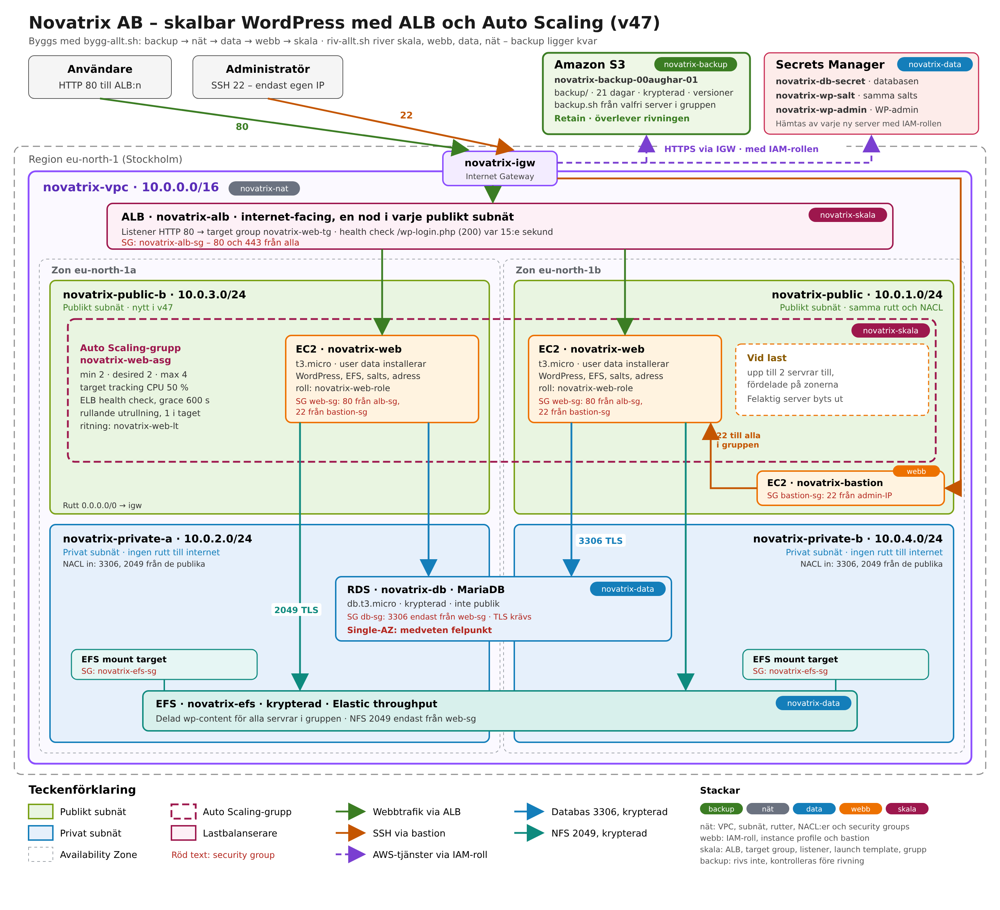
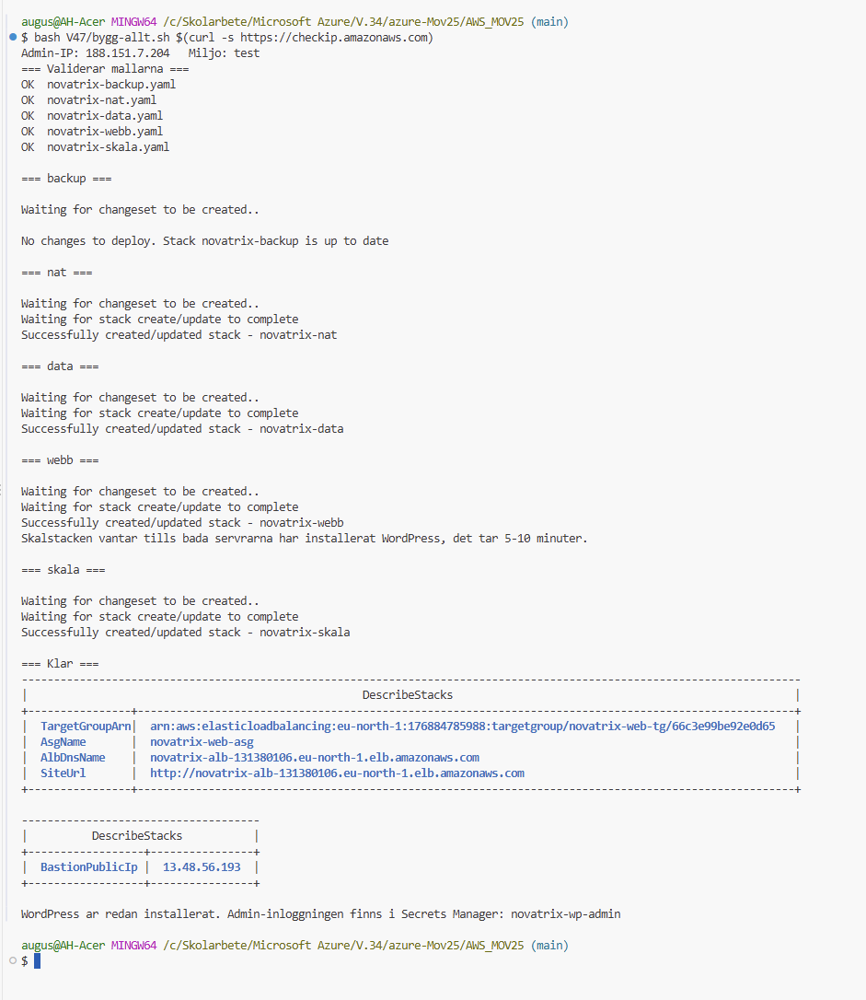
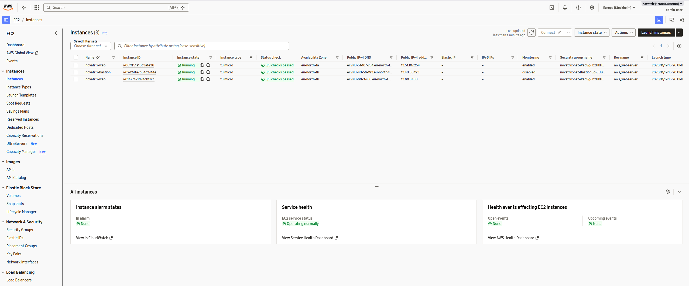
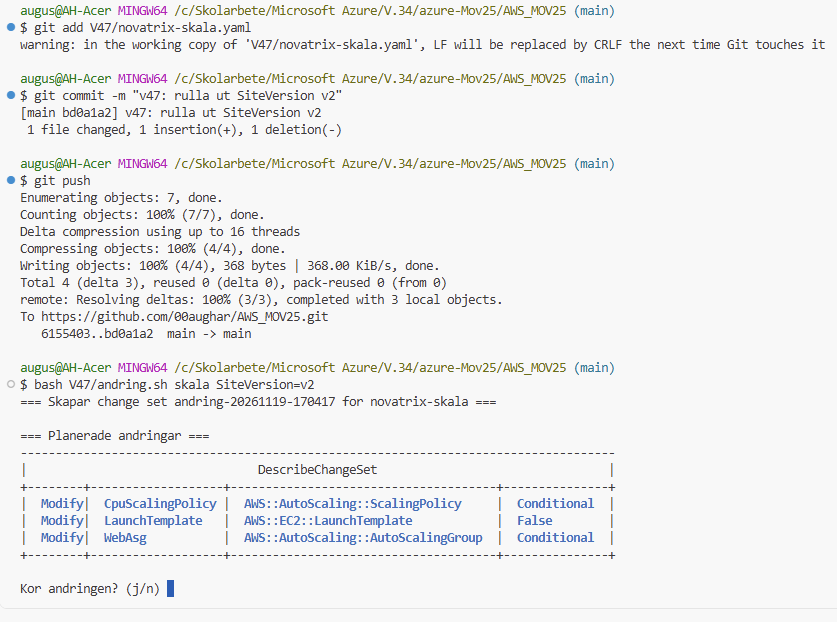
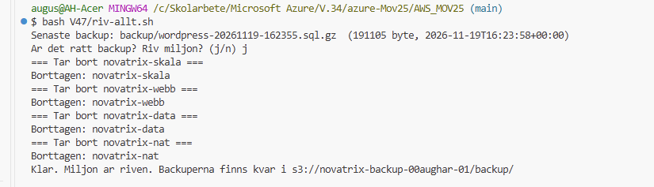

# V.47 AWS Uppgift 6, Skalbarhet och tillgänglighet

**Repo: https://github.com/00aughar/AWS_MOV25**

**August Hartwig**
**MOV25**
**x/x**

Fram till v46 körde Novatrix WordPress-sajt på en enda webbserver i en zon. Gick servern eller zonen ner var sajten borta, och en topp av besökare hamnade på samma maskin. Den här veckan ersätts servern av en Auto Scaling-grupp med minst två servrar i två Availability Zones, bakom en Application Load Balancer. Allt byggs som kod i en ny stack, `novatrix-skala`, och nya servrar installerar och konfigurerar sig själva utan handpåläggning.



# Delmoment 1, Repo

Mallarna och skripten ligger i mappen `V47`, och rotens README har en rad om veckan.

| Fil | Vad den gör |
|---|---|
| `novatrix-backup.yaml` | Backupstacken från v46, oförändrad |
| `novatrix-nat.yaml` | Nätstacken, nu med ett andra publikt subnät och en security group för lastbalanseraren |
| `novatrix-data.yaml` | Datastacken, nu med hemligheter för salts och WordPress-admin |
| `novatrix-webb.yaml` | Webbstacken, nu bara IAM-roll, instance profile och bastion |
| `novatrix-skala.yaml` | Ny: lastbalanserare, target group, listener, launch template, Auto Scaling-grupp och skalningsregel |
| `bygg-allt.sh` | Validerar och deployar backup, nät, data, webb, skala |
| `riv-allt.sh` | Kontrollerar backup och river skala, webb, data, nät |
| `andring.sh` | Change set innan en ändring körs |
| `backup.sh` | Databasbackup till S3 från valfri server i gruppen |
| `lasttest.sh` | Belastar CPU:n på en server för att testa skalningen |
| `testa-alb.sh` | Visar vilken server, zon och version som svarar via lastbalanseraren |

### Vad som ändrats sedan v46

| Stack | Ändring |
|---|---|
| `novatrix-nat` | `novatrix-public-b` (10.0.3.0/24) i zon a, eftersom en ALB kräver subnät i minst två zoner. `novatrix-public` ligger redan i zon b. Ny `novatrix-alb-sg` med 80 och 443 från alla. `novatrix-web-sg` släpper bara in port 80 från `novatrix-alb-sg`. NACL:erna utökade för det nya subnätet. |
| `novatrix-data` | `novatrix-wp-salt` och `novatrix-wp-admin` i Secrets Manager |
| `novatrix-webb` | Webbservern borttagen. Rollen får även läsa de nya hemligheterna och signalera till CloudFormation. |
| `novatrix-skala` | Ny stack, se Delmoment 2–4 |

# Delmoment 2, Förbered utrullning

Nya servrar startas från launch templaten `novatrix-web-lt`. Jag valde user data i stället för en AMI av den befintliga servern. En sådan AMI innehåller wp-config med lösenordet och EFS-ID från en viss datastack, och slutar fungera när datastacken byggs om. Med user data läser varje server alltid aktuella värden.

| Inställning | Värde |
|---|---|
| AMI | Senaste Amazon Linux 2023, hämtas via SSM-parameter |
| Instanstyp | `t3.micro` |
| Security group | `novatrix-web-sg` |
| Instance profile | `novatrix-web-profile` med rollen `novatrix-web-role` |
| Subnät | Inget, det väljer gruppen |
| Övervakning | Detailed monitoring, CPU varje minut |

### Det user data gör på varje ny server

1. Installerar Apache, PHP, MariaDB-klient, EFS-verktyg och RDS-certifikatet
2. Monterar EFS på `wp-content` med TLS, även efter omstart
3. Hämtar databasinloggning, salts och admin-inloggning från Secrets Manager med IAM-rollen
4. Skriver `wp-config.php` med databasens endpoint, krypterad anslutning och lastbalanserarens adress i `WP_HOME` och `WP_SITEURL`
5. Beräknar samma salts på alla servrar ur den gemensamma hemligheten, så att inloggningen fungerar oavsett vilken server lastbalanseraren väljer
6. Installerar WordPress med WP-CLI om det inte redan är gjort, så att ingen behöver köra installationsguiden
7. Skriver `version.html` med version, instans och zon
8. Signalerar till CloudFormation när `wp-login.php` svarar 200

Lösenorden syns aldrig i koden eller i user data. Bara ARN:erna till hemligheterna står där.

# Delmoment 3, Auto Scaling

| Inställning | Värde | Varför |
|---|---|---|
| Namn | `novatrix-web-asg` | |
| Subnät | `novatrix-public-b` (1a) och `novatrix-public` (1b) | En server i varje zon |
| Min / desired / max | 2 / 2 / 4 | Min 2 ger redundans, max 4 sätter taket för kostnaden |
| Skalningsregel | Target tracking, genomsnittlig CPU 50 % | Enkel att förstå, gruppen skapar larmen själv |
| Health check | ELB, grace period 600 s | Även servrar som lever men inte svarar byts ut. User data behöver några minuter. |
| Utrullning | `AutoScalingRollingUpdate`, en server i taget | En ändring i launch templaten rullas ut utan avbrott |

### Varför publika subnät

Servrarna ligger i de publika subnäten, eftersom de behöver internet när de startar: user data installerar paket och hämtar WordPress, och CLI:t pratar med Secrets Manager. Från de privata subnäten hade det krävt en NAT Gateway, som kostar per timme och per gigabyte. Servrarna skyddas i stället av `novatrix-web-sg`, som bara släpper in port 80 från lastbalanseraren och SSH från bastion.

# Delmoment 4, Load balancing

| Del | Inställning |
|---|---|
| Lastbalanserare | `novatrix-alb`, internet-facing, i båda publika subnäten, SG `novatrix-alb-sg` |
| Listener | HTTP 80, forward till `novatrix-web-tg` |
| Target group | `novatrix-web-tg`, HTTP 80, servrarna registreras av gruppen |
| Health check | `/wp-login.php`, svarskod 200, var 15:e sekund, 2 lyckade för frisk och 3 misslyckade för ofrisk |
| Deregistration delay | 30 sekunder |

Health checken frågar efter `/wp-login.php` och inte `/`, eftersom sidan laddar WordPress och ansluter till databasen. Den svarar 200 bara när PHP, `wp-config` och databasen fungerar. Startsidan kan svara med en omdirigering.

HTTPS saknas, eftersom ett certifikat kräver ett eget domännamn. Port 443 är öppen i `novatrix-alb-sg`, förberedd för det.

# Delmoment 3 och 4, bygge och grundtester

```
bash V47/bygg-allt.sh $(curl -s https://checkip.amazonaws.com)
```
Körning av deploy script:



Target groups i portal:


Instanser uppe:




# Delmoment 5, Beräkna kostnaden

Beräkningen är gjord i AWS Pricing Calculator för Europe (Stockholm).

### Antaganden

| Antagande | Värde |
|---|---|
| Region | Europe (Stockholm), eu-north-1 |
| Prismodell | On-Demand, inga reservationer, Free Tier ej medräknad |
| Drifttid | Alla timmar i månaden, 730 timmar |
| Webbservrar, normal belastning | 2 st t3.micro, Linux |
| Webbservrar, hög belastning | 4 st t3.micro hela månaden, gruppens max |
| Bastion | 1 st t3.micro |
| Publika IPv4-adresser | 5 vid normal belastning (2 webbservrar, bastion, 2 ALB-noder), 7 vid hög. Lastbalanserarens adresser debiteras som vanliga publika IPv4-adresser. |
| Lastbalanserare | 1 Application Load Balancer, låg trafik (1 GB per månad) |
| Databas | RDS for MariaDB, db.t3.micro, Single-AZ, 20 GB gp3, utan RDS Proxy och Database Insights |
| EFS | 1 GB Standard |
| S3 | 1 GB backuper |
| Secrets Manager | 3 hemligheter, cirka 100 API-anrop per månad |


### Resultat

| Del | Normal belastning (USD/mån) | Hög belastning (USD/mån) | Skillnad |
|---|---|---|---|
| EC2 webbservrar (2 → 4 st t3.micro) | 15,77 | 31,54 | +15,77 |
| EC2 bastion (1 st t3.micro) | 7,88 | 7,88 | 0 |
| Publika IPv4 (5 → 7 adresser) | 18,25 | 25,55 | +7,30 |
| Application Load Balancer | 23,03 | 23,03 | 0 |
| RDS MariaDB (db.t3.micro, Single-AZ, 20 GB gp3) | 14,81 | 14,81 | 0 |
| EFS (1 GB) | 0,30 | 0,30 | 0 |
| S3 (1 GB) | 0,02 | 0,02 | 0 |
| Secrets Manager (3 hemligheter) | 1,20 | 1,20 | 0 |
| **Totalt per månad** | **81,26** | **104,33** | **+23,07 (+28 %)** |
| **Totalt per år** | **975,12** | **1 251,96** | **+276,84** |

**Länk, normal last:** https://calculator.aws/#/estimate?id=b53e18af6f57933f454fe3ba44a8be1ed54d356d


**Länk, hög belastning:** https://calculator.aws/#/estimate?id=93bb671a46fe6fe011996b8208e08b9c294434fa


### Vad som kostar mest


**Lastbalanseraren är den största enskilda posten vid normal belastning.** Den kostar per timme oavsett trafik, alltså lika mycket en lugn natt som under dagen. Det är priset för en stabil adress och för att trafiken kan fördelas över två zoner.

**Publika IPv4-adresser kostar mer än webbservrarna själva.** Varje adress kostar cirka 3,65 USD i månaden, och lösningen har fem: två webbservrar, bastion och lastbalanserarens två noder. Det är en följd av att servrarna ligger i publika subnät. Alternativet, privata subnät med en NAT Gateway, hade tagit bort servrarnas adresser men kostat mer än det sparar för en så här liten miljö.

**Vid hög belastning blir webbservrarna den största posten**, eftersom de dubbleras. Kostnaden ökar ändå bara med 23,07 USD i månaden, eftersom lastbalanseraren, databasen och lagringen inte påverkas av antalet servrar. Max 4 i gruppen gör att en månad aldrig kan kosta mer än 104,33 USD. En verklig topp varar några timmar, så den faktiska kostnaden hamnar nära normal belastning.

**Lagring är nästan gratis.** EFS, S3 och Secrets Manager står tillsammans för under 2 %.

**Möjliga besparingar:** bastion med sin adress kostar cirka 11,50 USD i månaden, ungefär 14 % av totalen, och kunde stängas av när ingen behöver SSH. Reserverade instanser eller Savings Plans hade sänkt priset på EC2 och RDS vid ett års bindning.

### Vad som inte ingår

- Dataöverföring ut till internet
- NAT Gateway, som valdes bort (se Delmoment 3)
- Multi-AZ för RDS, som ungefär hade dubblat databasposten, till cirka 30 USD i månaden.
- CPU-krediter utöver baslinjen för t3 vid långvarig hög last

# Delmoment 6, Verifiera och dokumentera

### Verifiering

| # | Test | Förväntat | Bevisar |
|---|---|---|---|
| 1 | Stackarna | `CREATE_COMPLETE` | Allt byggdes från koden |
| 2 | Targets | 2 healthy, en i varje zon | Gruppen sprider servrarna över zonerna |
| 3 | WordPress via ALB | Sajten svarar utan installationsguide | User data installerade WordPress automatiskt |
| 4 | Inloggning och inlägg med bild | Förblir inloggad mellan servrarna | Gemensamma salts och EFS fungerar |
| 5 | `testa-alb.sh` | Svar från båda servrarna | Lastbalanseraren fördelar trafiken |
| 6 | Port 80 direkt mot en server | `False` | Webbtrafiken går bara via ALB |
| 7 | Lasttest | Gruppen skalar ut till 4 och in till 2 | Skalning efter last |
| 8 | Failover | Sajten svarar, ersättare startas | Tillgänglighet och self-healing |
| 9 | Rullande utrullning | v1 byts mot v2 utan avbrott | Automatisk utrullning från en commit |

### Test 3 och 4, WordPress

WP sida uppe utan konfiguration:


Lösenordet till `novatrixadmin` hämtades från Secrets Manager:

```
aws secretsmanager get-secret-value --secret-id novatrix-wp-admin --region eu-north-1 --query SecretString --output text
```
Lösenord till novatrixadmin hämtat i secret manager:


Inloggad som novatrixadmin:


WP inlägg skapat:


### Test 5 och 6, lastfördelning och direkt åtkomst

Test av lastbalanseraren:


Test port 80 nekad mot webservrar:


### Test 7, lasttest

`lasttest.sh` kördes på båda servrarna. Gruppen skalar på genomsnittlig CPU, så med bara en server belastad hade snittet hamnat nära målet på 50 % och ingenting hade hänt.

```
curl -sO https://raw.githubusercontent.com/00aughar/AWS_MOV25/main/V47/lasttest.sh
bash lasttest.sh
```
CPU ökning under last test:


Instanser skalar up under last test:


Desired capacity skalar upp till 4 från 2 under last test:


Registered targets visar 4 instanser under last test:


Test av lastbalans visar 4 instanser:


Instanser skalas ner efter last test:


**Förlopp:**

| Tid | Händelse |
|---|---|
| ca 16:00 | `lasttest.sh` startas på båda servrarna. CPU stiger mot 100 %. |
| 16:04:31 | Larmet `TargetTracking-novatrix-web-asg-AlarmHigh` går i läget ALARM och policyn `CpuScalingPolicy` höjer desired från 2 till 4. |
| 16:04:35 | Två nya servrar startas, `i-0c047df3bc4f14c70` (1b) och `i-0d28917b1783ac4db` (1a). |
| ca 16:09 | De nya servrarna har installerat WordPress, klarat health checken och tar emot trafik. Fyra servrar svarar i `testa-alb.sh` kl. 16:12. |
| ca 16:15 | Lasttestet tar slut och CPU sjunker. |
| 16:31:59 | Larmet `AlarmLow` löser ut och desired sänks från 4 till 3. `i-01477421d24cbf7cc` avslutas. |
| 16:37:19 | `AlarmLow` löser ut igen och desired sänks från 3 till 2. `i-0d28917b1783ac4db` avslutas. |

Gruppen gick direkt från 2 till 4 servrar och inte en i taget. Target tracking räknar ut hur många servrar som behövs för att snittet ska hamna på målvärdet. Med två servrar på nästan 100 % krävs ungefär fyra för att nå 50 %, och max är 4.

Inskalningen gick långsammare och i steg, 4 → 3 → 2, med start först cirka 15 minuter efter att lasten upphört. Det är avsiktligt: gruppen vill vara säker på att lasten verkligen har gått ner innan den tar bort kapacitet, så att den inte skalar in och ut om vartannat. Gruppen tog bort en server i varje zon, så att det fortfarande finns en server i både 1a och 1b.


### Test 8, failover

En server avslutades med Terminate kl. 16:51 för att simulera en server som kraschar, medan `testa-alb.sh 120 2` kördes.

Failover test körs:


Instans termineras manuellt under failover:


Ersättare startas:


Två healthy instanser uppe:


Historik under failover test:


Test efter failover visar att instanser fungerar som vanligt:


**Förlopp**

| Tid | Händelse |
|---|---|
| 16:50:43 | `testa-alb.sh 120 2` startas. Svaren växlar mellan `i-06fff51a10c3afe36` (1a) och `i-0c047df3bc4f14c70` (1b). |
| ca 16:51:32 | `i-06fff51a10c3afe36` avslutas med Terminate. |
| 16:51:34–16:52:03 | Ungefär hälften av anropen ger `502 Bad Gateway`, `000` eller inget svar. Lastbalanseraren skickar fortfarande en del av trafiken till den avstängda servern. |
| 16:52:03 | Auto Scaling-gruppen ser att instansen inte längre kör och tar den ur gruppen. |
| 16:52:05 | Gruppen startar ersättaren `i-07f207dd02349b30c` i samma zon, 1a. |
| från 16:52:06 | Alla anrop ger 200 från `i-0c047df3bc4f14c70`. |
| ca 16:56 | Ersättaren har installerat WordPress, klarat health checken och tar emot trafik. Två servrar svarar igen. |

Några anrop gav 502 eller inget svar i cirka 30 sekunder, tills health checken (var 15:e sekund, 3 misslyckade i rad) hade tagit servern ur trafik. `502` betyder att lastbalanseraren försökte nå servern medan den stängdes av, och "inget svar" att anropet tog längre tid än testets gräns på 5 sekunder. Därefter svarade den kvarvarande servern på alla anrop.

Gruppen startade ersättaren 2 sekunder efter att den upptäckt felet. Ersättaren stod som Unhealthy medan user data installerade WordPress, och fick trafik först när health checken hade godkänt den, efter cirka 4 minuter. Ingen behövde göra något efter att servern avslutats.


### Test 9, rullande utrullning

`SiteVersion` ändrades från `v1` till `v2` i `novatrix-skala.yaml`, committades och rullades ut med change set:

```
git add V47/novatrix-skala.yaml
git commit -m "v47: rulla ut SiteVersion v2"
git push
bash V47/andring.sh skala SiteVersion=v2
```

Change set görs:



CloudFormation visar update efter change set:


Test under change set visar utrullning från V1 till V2:


Aktivitet under utrullning:


CloudFormation visar stack complete efter utrullning:


Test körs efter utrullning visar endast V2:


CloudFormation höjde tillfälligt till 3, startade en v2-server, tog bort en v1-server när den nya signalerat klar, och upprepade. Alla anrop gav 200. 

# Backup och rivning

```
DB_HOST=<databasens endpoint> BUCKET=novatrix-backup-00aughar-01 bash backup.sh
bash V47/riv-allt.sh
```

Backup tagen:


Rivning av miljön:



# VG

### Vad som är automatiserat

Hela lösningen byggs från repot med ett kommando. Ingen loggar in på någon server och inget klickas i konsolen.

| Steg | Hur |
|---|---|
| Nät, data, roller, lastbalanserare och grupp | CloudFormation, fem stackar |
| Ny server blir identisk | Launch template med user data |
| WordPress konfigureras | User data skriver `wp-config` från Secrets Manager |
| WordPress installeras | WP-CLI i user data, första servern |
| Sajtens adress | `WP_HOME` och `WP_SITEURL` från lastbalanserarens DNS-namn |
| Samma salts | Beräknas ur `novatrix-wp-salt` |
| Stacken klar först när sajten fungerar | `CreationPolicy` och `cfn-signal` |
| Ny version ut | `AutoScalingRollingUpdate` från en commit |

### Så svarar lösningen på last och fel

| Händelse | Vad som händer, utan handpåläggning |
|---|---|
| **Last** | Genomsnittlig CPU går över 50 %, target tracking-larmet löser ut och gruppen höjer desired. Nya servrar installerar sig själva, klarar health checken och får trafik. |
| **Lugn** | CPU sjunker, larmet för inskalning löser ut och gruppen tar bort servrar ner till min 2, en per zon. |
| **En server slutar svara** | Health checken på `/wp-login.php` misslyckas och lastbalanseraren slutar skicka trafik dit. Gruppen ser via ELB-kollen att servern inte är frisk, avslutar den och startar en ersättare. |
| **En zon försvinner** | Lastbalanseraren skickar all trafik till servern i den andra zonen, och gruppen startar ersättare där. Databasen är kvar som felpunkt. |
| **Ny version** | En ändring i launch templaten rullas ut en server i taget. Misslyckas en ny server rullas ändringen tillbaka. |


# Kod

*novatrix-skala.yaml*
```yaml
AWSTemplateFormatVersion: "2010-09-09"
Description: >
  Novatrix AB - skalstacken (v47). Application Load Balancer, target group, listener,
  launch template med user data, Auto Scaling-grupp over tva zoner och target tracking.
  Nya servrar installerar och konfigurerar sig sjalva, utan handpalaggning.
  Importerar fran nat-, data- och webbstacken. Byggs sist och rivs forst.

Parameters:
  Prefix:
    Type: String
    Default: novatrix
  KeyName:
    Type: AWS::EC2::KeyPair::KeyName
    Default: aws_webserver
  InstanceType:
    Type: String
    Default: t3.micro
    AllowedValues: [t3.micro, t3.small]
  LatestAmiId:
    Type: AWS::SSM::Parameter::Value<AWS::EC2::Image::Id>
    Default: /aws/service/ami-amazon-linux-latest/al2023-ami-kernel-default-x86_64
  MinSize:
    Type: Number
    Default: 2
    Description: Golv, en server i varje zon
  MaxSize:
    Type: Number
    Default: 4
    Description: Tak for kostnaden
  DesiredCapacity:
    Type: Number
    Default: 2
  CpuTarget:
    Type: Number
    Default: 50
    Description: Malvarde for genomsnittlig CPU i procent
  SiteVersion:
    Type: String
    Default: v2
    Description: Visas pa /version.html. Andras for att visa en rullande utrullning

Resources:
  # ================= Lastbalanseraren =================
  TargetGroup:
    Type: AWS::ElasticLoadBalancingV2::TargetGroup
    Properties:
      Name: !Sub "${Prefix}-web-tg"
      VpcId: !ImportValue { "Fn::Sub": "${Prefix}-VpcId" }
      Protocol: HTTP
      Port: 80
      TargetType: instance
      HealthCheckPath: /wp-login.php        # svarar 200 nar PHP, wp-config och databasen fungerar
      Matcher: { HttpCode: "200" }
      HealthCheckIntervalSeconds: 15
      HealthyThresholdCount: 2
      UnhealthyThresholdCount: 3
      TargetGroupAttributes:
        - { Key: deregistration_delay.timeout_seconds, Value: "30" }

  LoadBalancer:
    Type: AWS::ElasticLoadBalancingV2::LoadBalancer
    Properties:
      Name: !Sub "${Prefix}-alb"
      Type: application
      Scheme: internet-facing
      IpAddressType: ipv4
      Subnets:
        - !ImportValue { "Fn::Sub": "${Prefix}-PublicSubnetId" }
        - !ImportValue { "Fn::Sub": "${Prefix}-PublicSubnetBId" }
      SecurityGroups: [!ImportValue { "Fn::Sub": "${Prefix}-AlbSgId" }]

  Listener:
    Type: AWS::ElasticLoadBalancingV2::Listener
    Properties:
      LoadBalancerArn: !Ref LoadBalancer
      Protocol: HTTP
      Port: 80
      DefaultActions:
        - Type: forward
          TargetGroupArn: !Ref TargetGroup

  # ================= Ritningen for varje ny server =================
  LaunchTemplate:
    Type: AWS::EC2::LaunchTemplate
    Properties:
      LaunchTemplateName: !Sub "${Prefix}-web-lt"
      LaunchTemplateData:
        ImageId: !Ref LatestAmiId
        InstanceType: !Ref InstanceType
        KeyName: !Ref KeyName
        SecurityGroupIds: [!ImportValue { "Fn::Sub": "${Prefix}-WebSgId" }]
        IamInstanceProfile:
          Arn: !ImportValue { "Fn::Sub": "${Prefix}-WebInstanceProfileArn" }
        Monitoring: { Enabled: true }       # CPU varje minut, sa att gruppen reagerar snabbare
        MetadataOptions: { HttpTokens: required }
        TagSpecifications:
          - ResourceType: instance
            Tags: [{ Key: Name, Value: !Sub "${Prefix}-web" }]
        UserData:
          Fn::Base64: !Sub
            - |
              #!/bin/bash
              export HOME=/root                     # WP-CLI behover en hemkatalog
              # 1. Programvara
              dnf install -y httpd php php-mysqlnd php-gd php-mbstring php-xml mariadb105 amazon-efs-utils aws-cfn-bootstrap
              systemctl enable --now httpd php-fpm
              curl -s -o /etc/pki/ca-trust/source/anchors/rds-global-bundle.pem https://truststore.pki.rds.amazonaws.com/global/global-bundle.pem
              update-ca-trust

              # 2. EFS pa wp-content, aven efter omstart
              mkdir -p /var/www/html/wp-content
              echo "${EfsId}:/ /var/www/html/wp-content efs _netdev,noresvport,tls,nofail 0 0" >> /etc/fstab
              for i in $(seq 1 30); do
                mount -a && mountpoint -q /var/www/html/wp-content && break
                sleep 10
              done

              # 3. WordPress, -n skriver inte over filer som redan finns pa EFS
              cd /tmp
              curl -sO https://wordpress.org/latest.tar.gz
              tar -xzf latest.tar.gz
              cp -rn /tmp/wordpress/. /var/www/html/

              # 4. Hemligheterna fran Secrets Manager med serverns IAM-roll
              hamta () { aws secretsmanager get-secret-value --secret-id "$1" --region ${AWS::Region} --query SecretString --output text; }
              falt () { python3 -c "import sys, json; print(json.load(sys.stdin)['$1'])"; }
              DB=$(hamta "${DbSecretArn}")
              DB_USER=$(echo "$DB" | falt username)
              DB_PASS=$(echo "$DB" | falt password)
              export SALT_SEED=$(hamta "${WpSaltSecretArn}")
              ADMIN=$(hamta "${WpAdminSecretArn}")
              WP_ADMIN_USER=$(echo "$ADMIN" | falt username)
              WP_ADMIN_PASS=$(echo "$ADMIN" | falt password)

              # 5. wp-config: databas, TLS och lastbalanserarens adress
              cd /var/www/html
              cp wp-config-sample.php wp-config.php
              sed -i "s/database_name_here/wordpress/" wp-config.php
              sed -i "s/username_here/$DB_USER/" wp-config.php
              sed -i "s/password_here/$DB_PASS/" wp-config.php
              sed -i "s/'localhost'/'${DbEndpoint}'/" wp-config.php
              sed -i "/That's all, stop editing/i define( 'MYSQL_CLIENT_FLAGS', MYSQLI_CLIENT_SSL );" wp-config.php
              sed -i "/That's all, stop editing/i define( 'WP_HOME', 'http://${LoadBalancer.DNSName}' );" wp-config.php
              sed -i "/That's all, stop editing/i define( 'WP_SITEURL', 'http://${LoadBalancer.DNSName}' );" wp-config.php

              # 6. Samma salts pa alla servrar, harledda fran den gemensamma hemligheten
              python3 - <<'PY'
              import hashlib, os, re
              seed = os.environ["SALT_SEED"]
              path = "/var/www/html/wp-config.php"
              out = []
              for line in open(path).read().split("\n"):
                  m = re.match(r"define\(\s*'(\w+)',\s*'put your unique phrase here'", line)
                  if m:
                      line = "define( '%s', '%s' );" % (m.group(1), hashlib.sha256((seed + m.group(1)).encode()).hexdigest())
                  out.append(line)
              open(path, "w").write("\n".join(out))
              PY
              unset SALT_SEED
              chmod 640 wp-config.php

              # 7. Installera WordPress om det inte redan ar gjort, sa att ingen behover kora guiden
              curl -s -o /usr/local/bin/wp https://raw.githubusercontent.com/wp-cli/builds/gh-pages/phar/wp-cli.phar
              chmod +x /usr/local/bin/wp
              sleep $((RANDOM % 20))                # tva servrar som startar samtidigt ska inte installera samtidigt
              wp core is-installed --path=/var/www/html --allow-root || \
                wp core install --path=/var/www/html --allow-root --url="http://${LoadBalancer.DNSName}" \
                  --title="Novatrix AB" --admin_user="$WP_ADMIN_USER" --admin_password="$WP_ADMIN_PASS" \
                  --admin_email="admin@example.com" --skip-email

              # 8. Versionssida som visar version, instans och zon
              TOKEN=$(curl -s -X PUT http://169.254.169.254/latest/api/token -H "X-aws-ec2-metadata-token-ttl-seconds: 300")
              IID=$(curl -s -H "X-aws-ec2-metadata-token: $TOKEN" http://169.254.169.254/latest/meta-data/instance-id)
              AZ=$(curl -s -H "X-aws-ec2-metadata-token: $TOKEN" http://169.254.169.254/latest/meta-data/placement/availability-zone)
              echo "Novatrix ${SiteVersion} - $IID - $AZ" > /var/www/html/version.html

              # 9. Behorigheter och omstart
              rm -f /var/www/html/index.html
              chown -R apache:apache /var/www/html
              systemctl restart php-fpm httpd

              # 10. Meddela CloudFormation att servern ar klar, forst nar wp-login.php svarar 200
              RC=1
              for i in $(seq 1 20); do
                [ "$(curl -s -o /dev/null -w '%{http_code}' http://localhost/wp-login.php)" = "200" ] && RC=0 && break
                sleep 15
              done
              /opt/aws/bin/cfn-signal -e $RC --stack ${AWS::StackName} --resource WebAsg --region ${AWS::Region}
            - EfsId: !ImportValue { "Fn::Sub": "${Prefix}-EfsId" }
              DbEndpoint: !ImportValue { "Fn::Sub": "${Prefix}-DbEndpoint" }
              DbSecretArn: !ImportValue { "Fn::Sub": "${Prefix}-DbSecretArn" }
              WpSaltSecretArn: !ImportValue { "Fn::Sub": "${Prefix}-WpSaltSecretArn" }
              WpAdminSecretArn: !ImportValue { "Fn::Sub": "${Prefix}-WpAdminSecretArn" }

  # ================= Gruppen som skoter antalet servrar =================
  WebAsg:
    Type: AWS::AutoScaling::AutoScalingGroup
    DependsOn: Listener
    CreationPolicy:                         # stacken ar klar forst nar servrarna signalerat att WordPress svarar
      ResourceSignal:
        Count: !Ref DesiredCapacity
        Timeout: PT20M
    UpdatePolicy:
      AutoScalingRollingUpdate:             # ny version av launch template rullas ut en server i taget
        MinInstancesInService: !Ref DesiredCapacity
        MaxBatchSize: 1
        PauseTime: PT20M
        WaitOnResourceSignals: true
        SuspendProcesses: [HealthCheck, ReplaceUnhealthy, AZRebalance, AlarmNotification, ScheduledActions]
      AutoScalingScheduledAction:
        IgnoreUnmodifiedGroupSizeProperties: true
    Properties:
      AutoScalingGroupName: !Sub "${Prefix}-web-asg"
      LaunchTemplate:
        LaunchTemplateId: !Ref LaunchTemplate
        Version: !GetAtt LaunchTemplate.LatestVersionNumber
      VPCZoneIdentifier:                    # ett publikt subnat per zon
        - !ImportValue { "Fn::Sub": "${Prefix}-PublicSubnetId" }
        - !ImportValue { "Fn::Sub": "${Prefix}-PublicSubnetBId" }
      TargetGroupARNs: [!Ref TargetGroup]
      MinSize: !Ref MinSize
      MaxSize: !Ref MaxSize
      DesiredCapacity: !Ref DesiredCapacity
      HealthCheckType: ELB                  # byt aven servrar som lever men inte svarar
      HealthCheckGracePeriod: 600           # user data installerar allt, det tar nagra minuter
      MetricsCollection:
        - Granularity: 1Minute

  CpuScalingPolicy:
    Type: AWS::AutoScaling::ScalingPolicy
    Properties:
      AutoScalingGroupName: !Ref WebAsg
      PolicyType: TargetTrackingScaling
      EstimatedInstanceWarmup: 300
      TargetTrackingConfiguration:
        PredefinedMetricSpecification:
          PredefinedMetricType: ASGAverageCPUUtilization
        TargetValue: !Ref CpuTarget

Outputs:
  SiteUrl:
    Value: !Sub "http://${LoadBalancer.DNSName}"
  AlbDnsName:
    Value: !GetAtt LoadBalancer.DNSName
  AsgName:
    Value: !Ref WebAsg
  TargetGroupArn:
    Value: !Ref TargetGroup

```

*novatrix-nat.yaml*
```yaml
AWSTemplateFormatVersion: "2010-09-09"
Description: >
  Novatrix AB - natstacken (v47). VPC, subnat, routing, NACL:er och
  security groups. Tva publika subnat i tva zoner for lastbalanseraren.
  Exporterar ID:n som data-, webb- och skalstacken importerar.

Parameters:
  Prefix:
    Type: String
    Default: novatrix
    Description: Namnprefix for resurser och exports, samma i alla stackar
  MyIp:
    Type: String
    Description: Administratorens publika IP med /32
    AllowedPattern: '^(\d{1,3}\.){3}\d{1,3}/32$'
  VpcCidr:
    Type: String
    Default: 10.0.0.0/16
  PublicCidr:
    Type: String
    Default: 10.0.1.0/24
  PublicBCidr:
    Type: String
    Default: 10.0.3.0/24
    Description: Andra publika subnatet, kravs for en ALB i tva zoner
  PrivateACidr:
    Type: String
    Default: 10.0.2.0/24
  PrivateBCidr:
    Type: String
    Default: 10.0.4.0/24

Resources:
  # ================= Lager 2: natet och segmentering =================
  Vpc:
    Type: AWS::EC2::VPC
    Properties:
      CidrBlock: !Ref VpcCidr
      EnableDnsSupport: true
      EnableDnsHostnames: true          # kravs for att montera EFS via DNS-namn
      Tags: [{ Key: Name, Value: !Sub "${Prefix}-vpc" }]

  InternetGateway:
    Type: AWS::EC2::InternetGateway
    Properties:
      Tags: [{ Key: Name, Value: !Sub "${Prefix}-igw" }]

  IgwAttachment:
    Type: AWS::EC2::VPCGatewayAttachment
    Properties: { VpcId: !Ref Vpc, InternetGatewayId: !Ref InternetGateway }

  PublicSubnet:
    Type: AWS::EC2::Subnet
    Properties:
      VpcId: !Ref Vpc
      CidrBlock: !Ref PublicCidr
      AvailabilityZone: !Select [1, !GetAZs ""]   # eu-north-1b
      MapPublicIpOnLaunch: true
      Tags: [{ Key: Name, Value: !Sub "${Prefix}-public" }]

  # Nytt i v47: ALB kraver subnat i minst tva zoner. novatrix-public ligger i zon b,
  # sa det andra publika subnatet laggs i zon a.
  PublicSubnetB:
    Type: AWS::EC2::Subnet
    Properties:
      VpcId: !Ref Vpc
      CidrBlock: !Ref PublicBCidr
      AvailabilityZone: !Select [0, !GetAZs ""]   # eu-north-1a
      MapPublicIpOnLaunch: true
      Tags: [{ Key: Name, Value: !Sub "${Prefix}-public-b" }]

  PrivateSubnetA:
    Type: AWS::EC2::Subnet
    Properties:
      VpcId: !Ref Vpc
      CidrBlock: !Ref PrivateACidr
      AvailabilityZone: !Select [0, !GetAZs ""]   # eu-north-1a
      Tags: [{ Key: Name, Value: !Sub "${Prefix}-private-a" }]

  PrivateSubnetB:
    Type: AWS::EC2::Subnet
    Properties:
      VpcId: !Ref Vpc
      CidrBlock: !Ref PrivateBCidr
      AvailabilityZone: !Select [1, !GetAZs ""]   # eu-north-1b
      Tags: [{ Key: Name, Value: !Sub "${Prefix}-private-b" }]

  # ---------- Routing ----------
  PublicRouteTable:
    Type: AWS::EC2::RouteTable
    Properties:
      VpcId: !Ref Vpc
      Tags: [{ Key: Name, Value: !Sub "${Prefix}-public-rt" }]

  PublicDefaultRoute:
    Type: AWS::EC2::Route
    DependsOn: IgwAttachment
    Properties: { RouteTableId: !Ref PublicRouteTable, DestinationCidrBlock: 0.0.0.0/0, GatewayId: !Ref InternetGateway }

  PublicSubnetRta:
    Type: AWS::EC2::SubnetRouteTableAssociation
    Properties: { SubnetId: !Ref PublicSubnet, RouteTableId: !Ref PublicRouteTable }

  PublicSubnetBRta:
    Type: AWS::EC2::SubnetRouteTableAssociation
    Properties: { SubnetId: !Ref PublicSubnetB, RouteTableId: !Ref PublicRouteTable }

  PrivateRouteTable:                    # bara local, ingen vag till internet
    Type: AWS::EC2::RouteTable
    Properties:
      VpcId: !Ref Vpc
      Tags: [{ Key: Name, Value: !Sub "${Prefix}-private-rt" }]

  PrivateSubnetARta:
    Type: AWS::EC2::SubnetRouteTableAssociation
    Properties: { SubnetId: !Ref PrivateSubnetA, RouteTableId: !Ref PrivateRouteTable }
  PrivateSubnetBRta:
    Type: AWS::EC2::SubnetRouteTableAssociation
    Properties: { SubnetId: !Ref PrivateSubnetB, RouteTableId: !Ref PrivateRouteTable }

  # ---------- Publik NACL ----------
  PublicNacl:
    Type: AWS::EC2::NetworkAcl
    Properties:
      VpcId: !Ref Vpc
      Tags: [{ Key: Name, Value: !Sub "${Prefix}-public-nacl" }]

  PublicNaclInHttp:
    Type: AWS::EC2::NetworkAclEntry
    Properties: { NetworkAclId: !Ref PublicNacl, RuleNumber: 100, Protocol: 6, RuleAction: allow, Egress: false, CidrBlock: 0.0.0.0/0, PortRange: { From: 80, To: 80 } }
  PublicNaclInHttps:
    Type: AWS::EC2::NetworkAclEntry
    Properties: { NetworkAclId: !Ref PublicNacl, RuleNumber: 110, Protocol: 6, RuleAction: allow, Egress: false, CidrBlock: 0.0.0.0/0, PortRange: { From: 443, To: 443 } }
  PublicNaclInSsh:
    Type: AWS::EC2::NetworkAclEntry
    Properties: { NetworkAclId: !Ref PublicNacl, RuleNumber: 120, Protocol: 6, RuleAction: allow, Egress: false, CidrBlock: !Ref MyIp, PortRange: { From: 22, To: 22 } }
  PublicNaclInSshBastion:             # bastion i novatrix-public till servrar i novatrix-public-b
    Type: AWS::EC2::NetworkAclEntry
    Properties: { NetworkAclId: !Ref PublicNacl, RuleNumber: 125, Protocol: 6, RuleAction: allow, Egress: false, CidrBlock: !Ref PublicCidr, PortRange: { From: 22, To: 22 } }
  PublicNaclInEphemeral:
    Type: AWS::EC2::NetworkAclEntry
    Properties: { NetworkAclId: !Ref PublicNacl, RuleNumber: 130, Protocol: 6, RuleAction: allow, Egress: false, CidrBlock: 0.0.0.0/0, PortRange: { From: 1024, To: 65535 } }

  PublicNaclOutHttp:
    Type: AWS::EC2::NetworkAclEntry
    Properties: { NetworkAclId: !Ref PublicNacl, RuleNumber: 100, Protocol: 6, RuleAction: allow, Egress: true, CidrBlock: 0.0.0.0/0, PortRange: { From: 80, To: 80 } }
  PublicNaclOutHttps:
    Type: AWS::EC2::NetworkAclEntry
    Properties: { NetworkAclId: !Ref PublicNacl, RuleNumber: 110, Protocol: 6, RuleAction: allow, Egress: true, CidrBlock: 0.0.0.0/0, PortRange: { From: 443, To: 443 } }
  PublicNaclOutEphemeral:
    Type: AWS::EC2::NetworkAclEntry
    Properties: { NetworkAclId: !Ref PublicNacl, RuleNumber: 120, Protocol: 6, RuleAction: allow, Egress: true, CidrBlock: 0.0.0.0/0, PortRange: { From: 1024, To: 65535 } }
  PublicNaclOutMysqlA:
    Type: AWS::EC2::NetworkAclEntry
    Properties: { NetworkAclId: !Ref PublicNacl, RuleNumber: 130, Protocol: 6, RuleAction: allow, Egress: true, CidrBlock: !Ref PrivateACidr, PortRange: { From: 3306, To: 3306 } }
  PublicNaclOutMysqlB:
    Type: AWS::EC2::NetworkAclEntry
    Properties: { NetworkAclId: !Ref PublicNacl, RuleNumber: 140, Protocol: 6, RuleAction: allow, Egress: true, CidrBlock: !Ref PrivateBCidr, PortRange: { From: 3306, To: 3306 } }
  PublicNaclOutNfsA:
    Type: AWS::EC2::NetworkAclEntry
    Properties: { NetworkAclId: !Ref PublicNacl, RuleNumber: 150, Protocol: 6, RuleAction: allow, Egress: true, CidrBlock: !Ref PrivateACidr, PortRange: { From: 2049, To: 2049 } }
  PublicNaclOutNfsB:
    Type: AWS::EC2::NetworkAclEntry
    Properties: { NetworkAclId: !Ref PublicNacl, RuleNumber: 160, Protocol: 6, RuleAction: allow, Egress: true, CidrBlock: !Ref PrivateBCidr, PortRange: { From: 2049, To: 2049 } }

  PublicNaclOutSshBastion:
    Type: AWS::EC2::NetworkAclEntry
    Properties: { NetworkAclId: !Ref PublicNacl, RuleNumber: 170, Protocol: 6, RuleAction: allow, Egress: true, CidrBlock: !Ref PublicBCidr, PortRange: { From: 22, To: 22 } }

  PublicNaclAssoc:
    Type: AWS::EC2::SubnetNetworkAclAssociation
    Properties: { SubnetId: !Ref PublicSubnet, NetworkAclId: !Ref PublicNacl }
  PublicBNaclAssoc:
    Type: AWS::EC2::SubnetNetworkAclAssociation
    Properties: { SubnetId: !Ref PublicSubnetB, NetworkAclId: !Ref PublicNacl }

  # ---------- Privat NACL: bara MySQL och NFS fran de publika subnaten ----------
  PrivateNacl:
    Type: AWS::EC2::NetworkAcl
    Properties:
      VpcId: !Ref Vpc
      Tags: [{ Key: Name, Value: !Sub "${Prefix}-private-nacl" }]

  PrivateNaclInMysql:
    Type: AWS::EC2::NetworkAclEntry
    Properties: { NetworkAclId: !Ref PrivateNacl, RuleNumber: 100, Protocol: 6, RuleAction: allow, Egress: false, CidrBlock: !Ref PublicCidr, PortRange: { From: 3306, To: 3306 } }
  PrivateNaclInNfs:
    Type: AWS::EC2::NetworkAclEntry
    Properties: { NetworkAclId: !Ref PrivateNacl, RuleNumber: 110, Protocol: 6, RuleAction: allow, Egress: false, CidrBlock: !Ref PublicCidr, PortRange: { From: 2049, To: 2049 } }
  PrivateNaclInMysqlB:
    Type: AWS::EC2::NetworkAclEntry
    Properties: { NetworkAclId: !Ref PrivateNacl, RuleNumber: 120, Protocol: 6, RuleAction: allow, Egress: false, CidrBlock: !Ref PublicBCidr, PortRange: { From: 3306, To: 3306 } }
  PrivateNaclInNfsB:
    Type: AWS::EC2::NetworkAclEntry
    Properties: { NetworkAclId: !Ref PrivateNacl, RuleNumber: 130, Protocol: 6, RuleAction: allow, Egress: false, CidrBlock: !Ref PublicBCidr, PortRange: { From: 2049, To: 2049 } }
  PrivateNaclOutEphemeral:
    Type: AWS::EC2::NetworkAclEntry
    Properties: { NetworkAclId: !Ref PrivateNacl, RuleNumber: 100, Protocol: 6, RuleAction: allow, Egress: true, CidrBlock: !Ref PublicCidr, PortRange: { From: 1024, To: 65535 } }
  PrivateNaclOutEphemeralB:
    Type: AWS::EC2::NetworkAclEntry
    Properties: { NetworkAclId: !Ref PrivateNacl, RuleNumber: 110, Protocol: 6, RuleAction: allow, Egress: true, CidrBlock: !Ref PublicBCidr, PortRange: { From: 1024, To: 65535 } }

  PrivateNaclAssocA:
    Type: AWS::EC2::SubnetNetworkAclAssociation
    Properties: { SubnetId: !Ref PrivateSubnetA, NetworkAclId: !Ref PrivateNacl }
  PrivateNaclAssocB:
    Type: AWS::EC2::SubnetNetworkAclAssociation
    Properties: { SubnetId: !Ref PrivateSubnetB, NetworkAclId: !Ref PrivateNacl }

  # ================= Lager 3: security groups med grupp som kalla =================
  BastionSg:
    Type: AWS::EC2::SecurityGroup
    Properties:
      VpcId: !Ref Vpc
      GroupDescription: Bastion - SSH endast fran administratorens IP
      SecurityGroupIngress:
        - { IpProtocol: tcp, FromPort: 22, ToPort: 22, CidrIp: !Ref MyIp, Description: SSH fran admin }
      Tags: [{ Key: Name, Value: !Sub "${Prefix}-bastion-sg" }]

  AlbSg:                                # nytt i v47: lastbalanseraren tar emot webbtrafiken
    Type: AWS::EC2::SecurityGroup
    Properties:
      VpcId: !Ref Vpc
      GroupDescription: Lastbalanserare - HTTP och HTTPS fran alla
      SecurityGroupIngress:
        - { IpProtocol: tcp, FromPort: 80, ToPort: 80, CidrIp: 0.0.0.0/0, Description: HTTP }
        - { IpProtocol: tcp, FromPort: 443, ToPort: 443, CidrIp: 0.0.0.0/0, Description: HTTPS forberett }
      Tags: [{ Key: Name, Value: !Sub "${Prefix}-alb-sg" }]

  WebSg:
    Type: AWS::EC2::SecurityGroup
    Properties:
      VpcId: !Ref Vpc
      GroupDescription: Webbservrar - HTTP endast fran lastbalanseraren, SSH endast fran bastion
      SecurityGroupIngress:
        - { IpProtocol: tcp, FromPort: 80, ToPort: 80, SourceSecurityGroupId: !Ref AlbSg, Description: HTTP endast fran ALB }
        - { IpProtocol: tcp, FromPort: 22, ToPort: 22, SourceSecurityGroupId: !Ref BastionSg, Description: SSH endast via bastion }
      Tags: [{ Key: Name, Value: !Sub "${Prefix}-web-sg" }]

  DbSg:
    Type: AWS::EC2::SecurityGroup
    Properties:
      VpcId: !Ref Vpc
      GroupDescription: Databas - MySQL endast fran webbservern
      SecurityGroupIngress:
        - { IpProtocol: tcp, FromPort: 3306, ToPort: 3306, SourceSecurityGroupId: !Ref WebSg, Description: MySQL fran web-sg }
      Tags: [{ Key: Name, Value: !Sub "${Prefix}-db-sg" }]

  EfsSg:
    Type: AWS::EC2::SecurityGroup
    Properties:
      VpcId: !Ref Vpc
      GroupDescription: EFS - NFS endast fran webbservern
      SecurityGroupIngress:
        - { IpProtocol: tcp, FromPort: 2049, ToPort: 2049, SourceSecurityGroupId: !Ref WebSg, Description: NFS fran web-sg }
      Tags: [{ Key: Name, Value: !Sub "${Prefix}-efs-sg" }]

Outputs:
  VpcId:
    Value: !Ref Vpc
    Export: { Name: !Sub "${Prefix}-VpcId" }
  PublicSubnetId:
    Value: !Ref PublicSubnet
    Export: { Name: !Sub "${Prefix}-PublicSubnetId" }
  PublicSubnetBId:
    Value: !Ref PublicSubnetB
    Export: { Name: !Sub "${Prefix}-PublicSubnetBId" }
  PrivateSubnetAId:
    Value: !Ref PrivateSubnetA
    Export: { Name: !Sub "${Prefix}-PrivateSubnetAId" }
  PrivateSubnetBId:
    Value: !Ref PrivateSubnetB
    Export: { Name: !Sub "${Prefix}-PrivateSubnetBId" }
  BastionSgId:
    Value: !Ref BastionSg
    Export: { Name: !Sub "${Prefix}-BastionSgId" }
  AlbSgId:
    Value: !Ref AlbSg
    Export: { Name: !Sub "${Prefix}-AlbSgId" }
  WebSgId:
    Value: !Ref WebSg
    Export: { Name: !Sub "${Prefix}-WebSgId" }
  DbSgId:
    Value: !Ref DbSg
    Export: { Name: !Sub "${Prefix}-DbSgId" }
  EfsSgId:
    Value: !Ref EfsSg
    Export: { Name: !Sub "${Prefix}-EfsSgId" }

```

*novatrix-data.yaml*
```yaml
AWSTemplateFormatVersion: "2010-09-09"
Description: >
  Novatrix AB - datastacken (v47). RDS MariaDB med losenordet i Secrets Manager
  och EFS for wp-content. Importerar subnat och security groups fran natstacken.
  Backup-bucketen ligger i en egen stack (novatrix-backup) som inte rivs med miljon.

Parameters:
  Prefix:
    Type: String
    Default: novatrix
    Description: Samma prefix som i natstacken
  Environment:
    Type: String
    Default: test
    AllowedValues: [test, prod]
    Description: test = Single-AZ och backup 1 dag (Free plan). prod = Multi-AZ och backup 7 dagar
  DbInstanceClass:
    Type: String
    Default: db.t3.micro
    AllowedValues: [db.t3.micro, db.t4g.micro, db.t3.small, db.t4g.small]
  DbStorageGb:
    Type: Number
    Default: 20
    MinValue: 20
    MaxValue: 100

Conditions:
  IsProd: !Equals [!Ref Environment, prod]

Resources:
  # ================= Lager 4: losenordet i Secrets Manager =================
  # CloudFormation genererar ett slumpat losenord. Det syns aldrig i koden,
  # parametrarna eller user data. Webbservern hamtar det med sin IAM-roll.
  DbSecret:
    Type: AWS::SecretsManager::Secret
    Properties:
      Name: !Sub "${Prefix}-db-secret"
      Description: Inloggning till WordPress-databasen
      GenerateSecretString:
        SecretStringTemplate: '{"username": "admin"}'
        GenerateStringKey: password
        PasswordLength: 24
        ExcludePunctuation: true        # bara bokstaver och siffror

  # Nytt i v47: samma salts och samma admin-inloggning for alla servrar i gruppen
  WpSaltSecret:
    Type: AWS::SecretsManager::Secret
    Properties:
      Name: !Sub "${Prefix}-wp-salt"
      Description: Gemensam grund for WordPress salts, sa att inloggningen fungerar oavsett server
      GenerateSecretString:
        PasswordLength: 64
        ExcludePunctuation: true

  WpAdminSecret:
    Type: AWS::SecretsManager::Secret
    Properties:
      Name: !Sub "${Prefix}-wp-admin"
      Description: WordPress administrator, skapas automatiskt av forsta servern
      GenerateSecretString:
        SecretStringTemplate: '{"username": "novatrixadmin"}'
        GenerateStringKey: password
        PasswordLength: 20
        ExcludePunctuation: true

  DbSubnetGroup:
    Type: AWS::RDS::DBSubnetGroup
    Properties:
      DBSubnetGroupName: !Sub "${Prefix}-db-subnets"
      DBSubnetGroupDescription: Endast de privata subnaten
      SubnetIds:
        - !ImportValue { "Fn::Sub": "${Prefix}-PrivateSubnetAId" }
        - !ImportValue { "Fn::Sub": "${Prefix}-PrivateSubnetBId" }

  Database:
    Type: AWS::RDS::DBInstance
    DeletionPolicy: Delete              # labbmiljo. I drift: Snapshot
    UpdateReplacePolicy: Delete
    Properties:
      DBInstanceIdentifier: !Sub "${Prefix}-db"
      Engine: mariadb
      DBInstanceClass: !Ref DbInstanceClass
      AllocatedStorage: !Ref DbStorageGb
      StorageType: gp3
      StorageEncrypted: true            # kryptering i vila
      MultiAZ: !If [IsProd, true, false]
      PubliclyAccessible: false         # databasen privat
      DBName: wordpress
      MasterUsername: !Sub "{{resolve:secretsmanager:${DbSecret}:SecretString:username}}"
      MasterUserPassword: !Sub "{{resolve:secretsmanager:${DbSecret}:SecretString:password}}"
      DBSubnetGroupName: !Ref DbSubnetGroup
      VPCSecurityGroups:
        - !ImportValue { "Fn::Sub": "${Prefix}-DbSgId" }
      BackupRetentionPeriod: !If [IsProd, 7, 1]   # Free plan tillater max 1 dag
      DeletionProtection: false
      Tags: [{ Key: Name, Value: !Sub "${Prefix}-db" }]

  # ================= Delad lagring: EFS =================
  FileSystem:
    Type: AWS::EFS::FileSystem
    Properties:
      Encrypted: true
      PerformanceMode: generalPurpose
      ThroughputMode: elastic
      LifecyclePolicies:
        - TransitionToIA: AFTER_30_DAYS
        - TransitionToPrimaryStorageClass: AFTER_1_ACCESS
      FileSystemTags: [{ Key: Name, Value: !Sub "${Prefix}-efs" }]

  MountTargetA:
    Type: AWS::EFS::MountTarget
    Properties:
      FileSystemId: !Ref FileSystem
      SubnetId: !ImportValue { "Fn::Sub": "${Prefix}-PrivateSubnetAId" }
      SecurityGroups: [!ImportValue { "Fn::Sub": "${Prefix}-EfsSgId" }]
  MountTargetB:
    Type: AWS::EFS::MountTarget
    Properties:
      FileSystemId: !Ref FileSystem
      SubnetId: !ImportValue { "Fn::Sub": "${Prefix}-PrivateSubnetBId" }
      SecurityGroups: [!ImportValue { "Fn::Sub": "${Prefix}-EfsSgId" }]

Outputs:
  DbEndpoint:
    Value: !GetAtt Database.Endpoint.Address
    Export: { Name: !Sub "${Prefix}-DbEndpoint" }
  DbSecretArn:
    Value: !Ref DbSecret
    Export: { Name: !Sub "${Prefix}-DbSecretArn" }
  EfsId:
    Value: !Ref FileSystem
    Export: { Name: !Sub "${Prefix}-EfsId" }
  WpSaltSecretArn:
    Value: !Ref WpSaltSecret
    Export: { Name: !Sub "${Prefix}-WpSaltSecretArn" }
  WpAdminSecretArn:
    Value: !Ref WpAdminSecret
    Export: { Name: !Sub "${Prefix}-WpAdminSecretArn" }

```

*novatrix-webb.yaml*
```yaml
AWSTemplateFormatVersion: "2010-09-09"
Description: >
  Novatrix AB - webbstacken (v47). IAM-roll och instance profile for webbservrarna
  samt bastion. Sjalva webbservrarna startas av Auto Scaling-gruppen i novatrix-skala.

Parameters:
  Prefix:
    Type: String
    Default: novatrix
    Description: Samma prefix som i de andra stackarna
  KeyName:
    Type: AWS::EC2::KeyPair::KeyName
    Default: aws_webserver
  LatestAmiId:
    Type: AWS::SSM::Parameter::Value<AWS::EC2::Image::Id>
    Default: /aws/service/ami-amazon-linux-latest/al2023-ami-kernel-default-x86_64

Resources:
  # ================= Lager 1: IAM, rollen med exakt de rattigheter som behovs =================
  WebRole:
    Type: AWS::IAM::Role
    Properties:
      RoleName: !Sub "${Prefix}-web-role"
      Description: Webbservrarna far lasa sina hemligheter, skriva backuper och signalera klar, inget annat
      AssumeRolePolicyDocument:
        Version: "2012-10-17"
        Statement:
          - Effect: Allow
            Principal: { Service: ec2.amazonaws.com }
            Action: sts:AssumeRole
      Policies:
        - PolicyName: ReadSecrets
          PolicyDocument:
            Version: "2012-10-17"
            Statement:
              - Effect: Allow
                Action: secretsmanager:GetSecretValue
                Resource:
                  - !ImportValue { "Fn::Sub": "${Prefix}-DbSecretArn" }
                  - !ImportValue { "Fn::Sub": "${Prefix}-WpSaltSecretArn" }
                  - !ImportValue { "Fn::Sub": "${Prefix}-WpAdminSecretArn" }
        - PolicyName: WriteBackupsOnly
          PolicyDocument:
            Version: "2012-10-17"
            Statement:
              - Effect: Allow
                Action: s3:PutObject
                Resource: !Sub
                  - "${BucketArn}/backup/*"
                  - BucketArn: !ImportValue { "Fn::Sub": "${Prefix}-BackupBucketArn" }
        - PolicyName: SignalReady           # servern meddelar CloudFormation nar WordPress svarar
          PolicyDocument:
            Version: "2012-10-17"
            Statement:
              - Effect: Allow
                Action: cloudformation:SignalResource
                Resource: !Sub "arn:aws:cloudformation:${AWS::Region}:${AWS::AccountId}:stack/${Prefix}-skala/*"

  WebInstanceProfile:
    Type: AWS::IAM::InstanceProfile
    Properties:
      InstanceProfileName: !Sub "${Prefix}-web-profile"
      Roles: [!Ref WebRole]

  # ================= Bastion, enda vagen in med SSH =================
  Bastion:
    Type: AWS::EC2::Instance
    Properties:
      ImageId: !Ref LatestAmiId
      InstanceType: t3.micro
      KeyName: !Ref KeyName
      SubnetId: !ImportValue { "Fn::Sub": "${Prefix}-PublicSubnetId" }
      SecurityGroupIds: [!ImportValue { "Fn::Sub": "${Prefix}-BastionSgId" }]
      Tags: [{ Key: Name, Value: !Sub "${Prefix}-bastion" }]

Outputs:
  WebInstanceProfileArn:
    Value: !GetAtt WebInstanceProfile.Arn
    Export: { Name: !Sub "${Prefix}-WebInstanceProfileArn" }
  BastionPublicIp:
    Value: !GetAtt Bastion.PublicIp

```

*novatrix-backup.yaml*
```yaml
AWSTemplateFormatVersion: "2010-09-09"
Description: >
  Novatrix AB - backupstacken (v47). S3-bucket for databasbackuper.
  Ligger i en egen stack eftersom backuperna ska overleva nar miljon rivs.
  riv-allt.sh ror inte den har stacken.

Parameters:
  Prefix:
    Type: String
    Default: novatrix
  BackupBucketName:
    Type: String
    Default: novatrix-backup-00aughar-01
    Description: Globalt unikt bucketnamn
  BackupRetentionDays:
    Type: Number
    Default: 21
    Description: Hur lange databasbackuper i S3 sparas

Resources:
  BackupBucket:
    Type: AWS::S3::Bucket
    DeletionPolicy: Retain          # bucketen och backuperna finns kvar aven om stacken tas bort
    UpdateReplacePolicy: Retain
    Properties:
      BucketName: !Ref BackupBucketName
      PublicAccessBlockConfiguration:
        BlockPublicAcls: true
        BlockPublicPolicy: true
        IgnorePublicAcls: true
        RestrictPublicBuckets: true
      BucketEncryption:
        ServerSideEncryptionConfiguration:
          - ServerSideEncryptionByDefault: { SSEAlgorithm: AES256 }
      VersioningConfiguration:
        Status: Enabled             # en overskriven eller raderad backup kan hamtas tillbaka
      LifecycleConfiguration:
        Rules:
          - Id: radera-gamla-backuper
            Status: Enabled
            Prefix: backup/
            ExpirationInDays: !Ref BackupRetentionDays
            NoncurrentVersionExpiration: { NoncurrentDays: 7 }
      Tags: [{ Key: Name, Value: !Sub "${Prefix}-backup" }]

Outputs:
  BackupBucketName:
    Value: !Ref BackupBucket
    Export: { Name: !Sub "${Prefix}-BackupBucketName" }
  BackupBucketArn:
    Value: !GetAtt BackupBucket.Arn
    Export: { Name: !Sub "${Prefix}-BackupBucketArn" }

```

*bygg-allt.sh*

```
#!/bin/bash
# bygg-allt.sh - Bygger Novatrix WordPress-stack: backup -> nat -> data -> webb -> skala
# Backupstacken skapas bara forsta gangen, darefter finns den kvar mellan rivningarna.
# Kor i Git Bash med din publika IP som argument:
#   bash V47/bygg-allt.sh $(curl -s https://checkip.amazonaws.com)
# Valfritt andra argument: miljo (test eller prod), standard test.

MYIP="$(echo "$1" | tr -d '[:space:]')"
ENV="${2:-test}"
REGION="eu-north-1"
PREFIX="novatrix"

V47_DIR="$(cd "$(dirname "$0")" && pwd)"
cd "$V47_DIR" || exit 1

if [ -z "$MYIP" ]; then
  echo "FEL: ange din publika IP, t.ex.:  bash V47/bygg-allt.sh \$(curl -s https://checkip.amazonaws.com)"
  exit 1
fi
echo "Admin-IP: $MYIP   Miljo: $ENV"

# Validera alla mallar innan nagot byggs
echo "=== Validerar mallarna ==="
for t in novatrix-backup.yaml novatrix-nat.yaml novatrix-data.yaml novatrix-webb.yaml novatrix-skala.yaml; do
  aws cloudformation validate-template --template-body "file://$t" --region "$REGION" >/dev/null \
    && echo "OK  $t" || { echo "FEL i $t"; exit 1; }
done

deploy () {
  echo ""
  echo "=== $1 ==="
  aws cloudformation deploy --region "$REGION" --stack-name "$PREFIX-$1" --template-file "$2" --no-fail-on-empty-changeset "${@:3}" \
    || { echo "FEL: stacken $PREFIX-$1 misslyckades. Se Events i CloudFormation-konsolen."; exit 1; }
}

deploy backup novatrix-backup.yaml --parameter-overrides Prefix="$PREFIX"
deploy nat    novatrix-nat.yaml    --parameter-overrides Prefix="$PREFIX" MyIp="$MYIP/32"
deploy data   novatrix-data.yaml   --parameter-overrides Prefix="$PREFIX" Environment="$ENV"
deploy webb   novatrix-webb.yaml   --parameter-overrides Prefix="$PREFIX" --capabilities CAPABILITY_NAMED_IAM
echo "Skalstacken vantar tills bada servrarna har installerat WordPress, det tar 5-10 minuter."
deploy skala  novatrix-skala.yaml  --parameter-overrides Prefix="$PREFIX"

echo ""
echo "=== Klar ==="
aws cloudformation describe-stacks --stack-name "$PREFIX-skala" --region "$REGION" \
  --query "Stacks[0].Outputs[].[OutputKey,OutputValue]" --output table
aws cloudformation describe-stacks --stack-name "$PREFIX-webb" --region "$REGION" \
  --query "Stacks[0].Outputs[?OutputKey=='BastionPublicIp'].[OutputKey,OutputValue]" --output table
echo "WordPress ar redan installerat. Admin-inloggningen finns i Secrets Manager: $PREFIX-wp-admin"

```

*riv-allt.sh*

```
#!/bin/bash
# riv-allt.sh - River miljon i omvand ordning: skala -> webb -> data -> nat
# En stack kan inte tas bort sa lange en annan stack importerar dess exports.
# Backupstacken (novatrix-backup) rivs INTE, sa backuperna finns kvar.
# Skriptet kontrollerar forst att det finns en backup: forst backup, sedan rivning.

REGION="eu-north-1"
PREFIX="novatrix"

# 1. Kontrollerad backup
BUCKET=$(aws cloudformation describe-stacks --stack-name "$PREFIX-backup" --region "$REGION" \
  --query "Stacks[0].Outputs[?OutputKey=='BackupBucketName'].OutputValue" --output text 2>/dev/null | tr -d '\r')
SENASTE=$(aws s3api list-objects-v2 --bucket "$BUCKET" --prefix backup/ --region "$REGION" \
  --query "sort_by(Contents,&LastModified)[-1].[Key,Size,LastModified]" --output text 2>/dev/null | tr -d '\r')
read -r KEY SIZE TID <<< "$SENASTE"

if [ -z "$KEY" ] || [ "$KEY" = "None" ] || [ "${SIZE:-0}" -eq 0 ]; then
  echo "STOPP: ingen backup hittades i s3://$BUCKET/backup/"
  echo "Kor backup.sh pa en av webbservrarna forst. Inget har rivits."
  exit 1
fi
echo "Senaste backup: $KEY  ($SIZE byte, $TID)"
read -p "Ar det ratt backup? Riv miljon? (j/n) " SVAR
[ "$SVAR" = "j" ] || { echo "Avbrutet, inget har rivits."; exit 0; }

# 2. Rivning
riv () {
  echo "=== Tar bort $PREFIX-$1 ==="
  aws cloudformation delete-stack --stack-name "$PREFIX-$1" --region "$REGION"
  aws cloudformation wait stack-delete-complete --stack-name "$PREFIX-$1" --region "$REGION" \
    && echo "Borttagen: $PREFIX-$1" || { echo "FEL: kunde inte ta bort $PREFIX-$1"; exit 1; }
}

riv skala
riv webb
riv data
riv nat
echo "Klar. Miljon ar riven. Backuperna finns kvar i s3://$BUCKET/backup/"


```

*andring.sh*

```
#!/bin/bash
# andring.sh - Visar vad en andring i en mall kommer att gora innan den kors (change set)
# Anvandning:  bash V47/andring.sh <backup|nat|data|webb|skala> [parametrar...]
# Exempel:     bash V47/andring.sh skala SiteVersion=v2
# Skriptet skapar en change set, visar den och fragar om den ska koras.

STACK_DEL="$1"; shift
REGION="eu-north-1"
PREFIX="novatrix"
STACK="$PREFIX-$STACK_DEL"
TEMPLATE="novatrix-$STACK_DEL.yaml"
CHANGESET="andring-$(date +%Y%m%d-%H%M%S)"

V47_DIR="$(cd "$(dirname "$0")" && pwd)"
cd "$V47_DIR" || exit 1
[ -f "$TEMPLATE" ] || { echo "Anvandning: bash V47/andring.sh <backup|nat|data|webb|skala> [parametrar...]"; exit 1; }

PARAMS=""
for p in "Prefix=$PREFIX" "$@"; do
  PARAMS="$PARAMS ParameterKey=${p%%=*},ParameterValue=${p#*=}"
done
# Parametrar som inte anges behaller sitt nuvarande varde i stacken
for key in $(aws cloudformation describe-stacks --stack-name "$STACK" --region "$REGION" \
    --query "Stacks[0].Parameters[].ParameterKey" --output text | tr -d '\r'); do
  case " $PARAMS " in *"ParameterKey=$key,"*) ;; *) PARAMS="$PARAMS ParameterKey=$key,UsePreviousValue=true";; esac
done

CAPS=""
[ "$STACK_DEL" = "webb" ] && CAPS="--capabilities CAPABILITY_NAMED_IAM"

echo "=== Skapar change set $CHANGESET for $STACK ==="
aws cloudformation create-change-set --stack-name "$STACK" --change-set-name "$CHANGESET" \
  --template-body "file://$TEMPLATE" --parameters $PARAMS $CAPS --region "$REGION" >/dev/null || exit 1
aws cloudformation wait change-set-create-complete --stack-name "$STACK" --change-set-name "$CHANGESET" --region "$REGION" 2>/dev/null

echo ""
echo "=== Planerade andringar ==="
aws cloudformation describe-change-set --stack-name "$STACK" --change-set-name "$CHANGESET" --region "$REGION" \
  --query "Changes[].ResourceChange.[Action,LogicalResourceId,ResourceType,Replacement]" --output table
STATUS=$(aws cloudformation describe-change-set --stack-name "$STACK" --change-set-name "$CHANGESET" --region "$REGION" \
  --query "StatusReason" --output text | tr -d '\r')
[ "$STATUS" != "None" ] && echo "$STATUS"

read -p "Kor andringen? (j/n) " SVAR
if [ "$SVAR" = "j" ]; then
  aws cloudformation execute-change-set --stack-name "$STACK" --change-set-name "$CHANGESET" --region "$REGION"
  aws cloudformation wait stack-update-complete --stack-name "$STACK" --region "$REGION" && echo "Klar: $STACK uppdaterad."
else
  aws cloudformation delete-change-set --stack-name "$STACK" --change-set-name "$CHANGESET" --region "$REGION"
  echo "Avbruten, inget andrades."
fi


```

*backup.sh*

```
#!/bin/bash
# backup.sh - Tar en backup av WordPress-databasen och laddar upp den till S3.
# Kors pa novatrix-web (servern har mysqldump och en IAM-roll som far skriva i backup/):
#   DB_HOST=<endpoint> BUCKET=<backupbucket> bash backup.sh
# Losenordet hamtas fran Secrets Manager med serverns IAM-roll.

REGION="eu-north-1"
SECRET_ID="${SECRET_ID:-novatrix-db-secret}"
DB_NAME="${DB_NAME:-wordpress}"

if [ -z "$DB_HOST" ] || [ -z "$BUCKET" ]; then
  echo "Anvandning: DB_HOST=<endpoint> BUCKET=<backupbucket> bash backup.sh"
  exit 1
fi

# 1. Inloggningen fran Secrets Manager
SECRET=$(aws secretsmanager get-secret-value --secret-id "$SECRET_ID" --region "$REGION" \
  --query SecretString --output text) || { echo "FEL: kunde inte lasa $SECRET_ID"; exit 1; }
DB_USER=$(echo "$SECRET" | python3 -c 'import sys, json; print(json.load(sys.stdin)["username"])')
export MYSQL_PWD=$(echo "$SECRET" | python3 -c 'import sys, json; print(json.load(sys.stdin)["password"])')

# 2. Dump over krypterad anslutning, komprimerad
FIL="wordpress-$(date +%Y%m%d-%H%M%S).sql.gz"
echo "Tar backup av $DB_NAME pa $DB_HOST..."
set -o pipefail
mysqldump -h "$DB_HOST" -u "$DB_USER" --ssl --single-transaction --routines "$DB_NAME" \
  | gzip > "/tmp/$FIL" || { echo "FEL: mysqldump misslyckades"; rm -f "/tmp/$FIL"; exit 1; }
unset MYSQL_PWD

# 3. Kontrollera att filen inte ar tom
STORLEK=$(stat -c %s "/tmp/$FIL")
if [ "$STORLEK" -lt 1000 ]; then
  echo "FEL: backupen ar bara $STORLEK byte, nagot gick fel"; rm -f "/tmp/$FIL"; exit 1
fi

# 4. Ladda upp till S3. Rollen far bara skriva i backup/, inte lista eller lasa
aws s3 cp "/tmp/$FIL" "s3://$BUCKET/backup/$FIL" --region "$REGION" \
  || { echo "FEL: uppladdningen misslyckades"; exit 1; }
rm -f "/tmp/$FIL"
echo "Klar: s3://$BUCKET/backup/$FIL ($STORLEK byte)"
echo "Kontrollera fran CloudShell:  aws s3 ls s3://$BUCKET/backup/"


```

*lasttest.sh*

```
#!/bin/bash
# lasttest.sh - Belastar CPU:n pa en webbserver sa att Auto Scaling-gruppen skalar ut.
# Kor pa VARJE server i gruppen (via bastion), annars hamnar snittet nara malet och inget hander:
#   bash lasttest.sh          (standard 15 minuter)
#   bash lasttest.sh 10       (10 minuter)
# Avbryt i forvag med:  pkill yes

MINUTER="${1:-15}"
KARNOR=$(nproc)
echo "Startar $KARNOR yes-processer i $MINUTER minuter pa $(hostname)..."
for i in $(seq 1 "$KARNOR"); do
  timeout "$((MINUTER * 60))" yes > /dev/null &
done
echo "Lasten kors i bakgrunden. Folj forloppet i Auto Scaling-gruppens Monitoring och Activity."
echo "Avbryt med:  pkill yes"

```

*testa-alb.sh*

```
#!/bin/bash
# testa-alb.sh - Visar vilken server och zon som svarar via lastbalanseraren.
# Kor i Git Bash pa din dator:
#   bash V47/testa-alb.sh            (10 anrop)
#   bash V47/testa-alb.sh 60 2       (60 anrop, 2 sekunder mellan, bra under failover)

ANTAL="${1:-10}"
PAUS="${2:-1}"
REGION="eu-north-1"
URL=$(aws cloudformation describe-stacks --stack-name novatrix-skala --region "$REGION" \
  --query "Stacks[0].Outputs[?OutputKey=='SiteUrl'].OutputValue" --output text | tr -d '\r')
echo "Lastbalanserare: $URL"
for i in $(seq 1 "$ANTAL"); do
  SVAR=$(curl -s -m 5 "$URL/version.html" || echo "INGET SVAR")
  KOD=$(curl -s -m 5 -o /dev/null -w '%{http_code}' "$URL/wp-login.php")
  echo "$(date +%H:%M:%S)  wp-login: $KOD  |  ${SVAR:-INGET SVAR}"
  sleep "$PAUS"
done


```