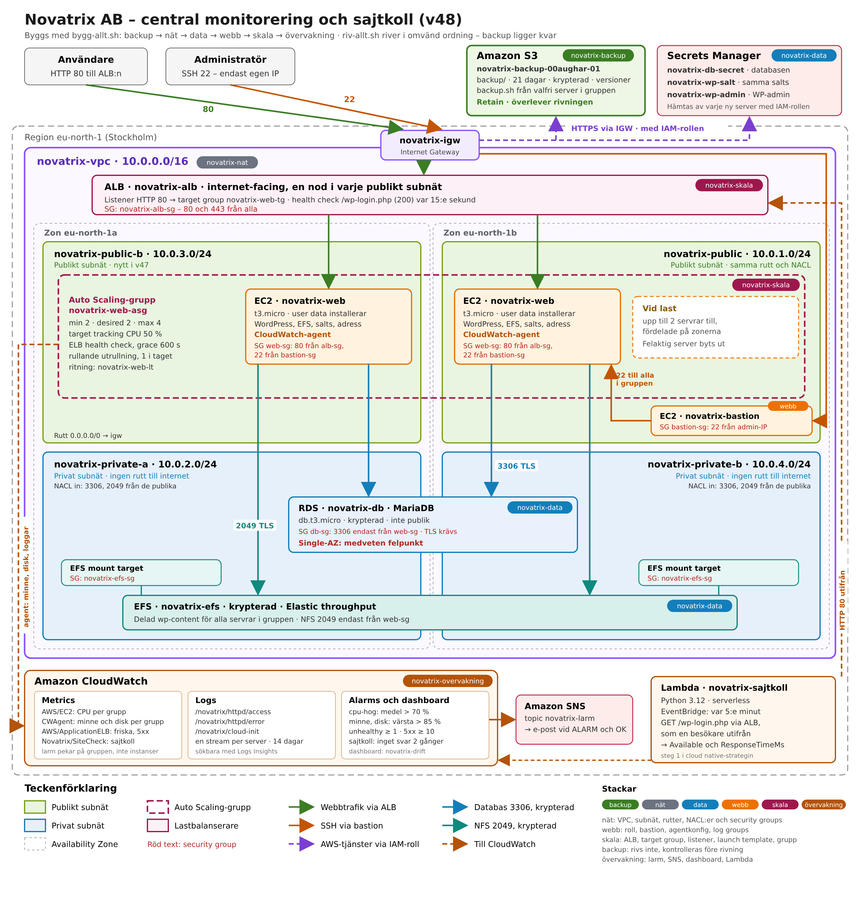

# V.48 AWS Uppgift 7, Monitorering och cloud native

**Repo: https://github.com/00aughar/AWS_MOV25**

**August Hartwig**
**MOV25**
**x/x**

Sedan v47 startar och avslutar en Auto Scaling-grupp Novatrix webbservrar själv. Det gör lösningen skalbar, men också svårare att se: en server som byts ut tar sina loggar med sig, och health checken säger bara att servrarna svarar, inte hur de mår. Den här veckan får lösningen central monitorering i CloudWatch av CPU, minne, disk och loggar, med larm som skickas med e-post. Allt är kod i en ny stack, `novatrix-overvakning`. En liten del körs dessutom serverless, en Lambda-funktion som kontrollerar sajten utifrån, och den är första steget i en cloud native-strategi för Novatrix.



# Delmoment 1, Repo

Mallarna och skripten ligger i mappen `V48`, och rotens README har en rad om veckan.

| Fil | Vad den gör |
|---|---|
| `novatrix-backup.yaml`, `novatrix-nat.yaml`, `novatrix-data.yaml` | Oförändrade från v47 |
| `novatrix-webb.yaml` | Nytt: agentens rättighet, agentens konfiguration i Parameter Store och tre log groups |
| `novatrix-skala.yaml` | Nytt: user data installerar och startar CloudWatch-agenten. Exporterar namnen som larmen behöver. |
| `novatrix-overvakning.yaml` | Ny stack: SNS, sex larm, dashboard, sparade loggfrågor och Lambda-funktionen `novatrix-sajtkoll` |
| `bygg-allt.sh` | Bygger sex stackar. E-postadressen för larmen skickas som argument. |
| `riv-allt.sh` | River övervakning, skala, webb, data och nät |
| `andring.sh` | Change set innan en ändring körs |
| `testa-larm.sh` | Testar larmkedjan med `set-alarm-state` |
| `overvakning-status.sh` | Skriver ut larm, prenumeration, minne, disk, loggar och sajtkoll som text |
| `logs-insights.txt` | Frågorna till Logs Insights |
| `backup.sh`, `lasttest.sh`, `testa-alb.sh` | Från tidigare veckor |

```
bash V48/bygg-allt.sh $(curl -s https://checkip.amazonaws.com) <min e-post>
```

E-postadressen fylls i manuellt vid körning och ligger inte i repot.


# Delmoment 2, Central monitorering

### Vad AWS ser själv och vad som saknas

| Mätvärde | Källa | Kräver agent |
|---|---|---|
| CPU per server och per grupp | `AWS/EC2` | Nej |
| Förfrågningar, svarstid, friska servrar, 5xx | `AWS/ApplicationELB` | Nej |
| Databasens CPU och lagring | `AWS/RDS` | Nej |
| **Minne** | `CWAgent` | **Ja** |
| **Disk** | `CWAgent` | **Ja** |
| Sajten svarar utifrån | `Novatrix/SiteCheck` | Nej, Lambda |

AWS ser den virtuella maskinen utifrån och vet därför inte hur mycket minne Linux använder eller hur full disken är. Det kräver CloudWatch-agenten, som installeras på varje server.

### CloudWatch-agenten

- **Rättighet:** rollen `novatrix-web-role` har fått den AWS-hanterade policyn `CloudWatchAgentServerPolicy` i `novatrix-webb.yaml`.
- **Konfiguration:** ligger i Parameter Store som `AmazonCloudWatch-novatrix`. Namnet måste börja med `AmazonCloudWatch-`, eftersom policyn bara får läsa sådana parametrar.
- **Installation:** user data i launch templaten installerar agenten och startar den med konfigurationen. Varje server som gruppen startar får alltså agenten automatiskt, även mitt i natten.

```
dnf install -y ... amazon-cloudwatch-agent
/opt/aws/amazon-cloudwatch-agent/bin/amazon-cloudwatch-agent-ctl -a fetch-config -m ec2 -s -c ssm:AmazonCloudWatch-novatrix
```

Det viktigaste i konfigurationen är att mätvärdena räknas ihop **per Auto Scaling-grupp**:

```json
"append_dimensions": {
  "AutoScalingGroupName": "${aws:AutoScalingGroupName}",
  "InstanceId": "${aws:InstanceId}"
},
"aggregation_dimensions": [["AutoScalingGroupName"]]
```

Varje ny server får ett nytt instans-ID. Ett larm på en enskild instans slutar gälla när gruppen byter ut servern, och då blir det tyst utan att någon märker det. Ett larm på dimensionen `AutoScalingGroupName` gäller alla servrar i gruppen, vilka de än är. Disken mäts bara för `/`, eftersom EFS-monteringen annars kommer med och den blir i praktiken aldrig full.

### Larmen

| Larm | Mätvärde | Statistik | Villkor | Varför |
|---|---|---|---|---|
| `novatrix-cpu-hog` | CPU för gruppen | Average | > 70 % i 5 min | Target tracking siktar på 50 %. Över 70 % hänger skalningen inte med, eller så står gruppen redan på max 4. |
| `novatrix-minne` | `mem_used_percent` för gruppen | Maximum | > 85 % i 5 min | En server med slut på minne ger fel för besökarna även om den andra mår bra. Ett medelvärde hade dolt det. |
| `novatrix-disk` | `disk_used_percent` för gruppen | Maximum | > 85 % i 5 min | Loggar och temporära filer fyller disken långsamt. Larmet ger tid att agera. |
| `novatrix-unhealthy` | `UnHealthyHostCount` | Maximum | ≥ 1 i 3 av 3 minuter | Gruppen ersätter en sjuk server, men om larmet återkommer är felet i templaten eller databasen |
| `novatrix-5xx` | `HTTPCode_Target_5XX_Count` | Sum | ≥ 10 på 5 min | WordPress svarar med serverfel, ofta på grund av databasen. Saknad data räknas som OK, eftersom inga fel ger inga datapunkter. |
| `novatrix-sajtkoll` | `Available` från Lambda | Minimum | < 1 två gånger i rad | Sajten svarar inte utifrån. Saknad data räknas som fel, eftersom en tyst kontroll också är ett problem. |

Alla larm skickar till SNS-topicet `novatrix-larm` både när de går till ALARM och när de går tillbaka till OK. Varje larm har en beskrivning som säger vad mottagaren ska göra, så att mailet leder till en åtgärd.

### Bevis som text

Utdata från `bash V48/overvakning-status.sh`:

```text
=== Larm och tillstand ===
+---------------------+-----+-----------------------------+----------+-------+
|  novatrix-5xx       |  OK |  HTTPCode_Target_5XX_Count  |  Sum     |  10.0 |
|  novatrix-cpu-hog   |  OK |  CPUUtilization             |  Average |  70.0 |
|  novatrix-disk      |  OK |  disk_used_percent          |  Maximum |  85.0 |
|  novatrix-minne     |  OK |  mem_used_percent           |  Maximum |  85.0 |
|  novatrix-sajtkoll  |  OK |  Available                  |  Minimum |  1.0  |
|  novatrix-unhealthy |  OK |  UnHealthyHostCount         |  Maximum |  1.0  |
+---------------------+-----+-----------------------------+----------+-------+

=== SNS-prenumeration (ska vara bekraftad, inte PendingConfirmation) ===
+-------+-------------------------------------------------------------------------------------------+
|  email|  arn:aws:sns:eu-north-1:xxxxxxxxxxxx:novatrix-larm:aaee528f-5fc0-42ed-842b-fc563c6b2565   |
+-------+-------------------------------------------------------------------------------------------+

=== Minne och disk for hela gruppen, senaste 15 minuterna (Maximum) ===
--- mem_used_percent
|  2026-11-25T09:19:00+01:00 |  31.276926170419397  |
|  2026-11-25T09:24:00+01:00 |  31.50880675619596   |
|  2026-11-25T09:29:00+01:00 |  31.537763859297858  |
--- disk_used_percent
|  2026-11-25T09:19:00+01:00 |  26.687654709001485  |
|  2026-11-25T09:24:00+01:00 |  26.687991621468253  |
|  2026-11-25T09:29:00+01:00 |  26.68828040358263   |
```


Alla sex larm står i OK. Prenumerationen är bekräftad, eftersom den har en riktig ARN och inte `PendingConfirmation`. Minne och disk kommer in för hela gruppen, inte per instans.

### Test av larmkedjan

```
bash V48/testa-larm.sh
```

Utdata:

```
novatrix-cpu-hog ar satt till ALARM. Ett mail fran AWS Notifications kommer inom nagon minut.
Vid nasta utvardering gar larmet tillbaka till OK och ett mail till kommer.
------------------------------------------------------------------------------------------------------------------------                                                      
|                                                 DescribeAlarmHistory                                                 |
+-----------------------------------+----------------------------------------------------------------------------------+
|  2026-11-25T09:52:28.661000+01:00 |  Successfully executed action arn:aws:sns:eu-north-1:xxxxxxxxxxxx:novatrix-larm  |
|  2026-11-25T09:52:28.614000+01:00 |  Alarm updated from OK to ALARM                                                  |
|  2026-11-25T09:16:48.300000+01:00 |  Successfully executed action arn:aws:sns:eu-north-1:xxxxxxxxxxxx:novatrix-larm  |
+-----------------------------------+----------------------------------------------------------------------------------+
```


Alarm Mail:


Alarm mail CPU status OK:


Mailet visar att larmet pekar på dimensionen AutoScalingGroupName, att beskrivningen talar om vad mottagaren ska göra, och att både ALARM och OK skickas till novatrix-larm.

`set-alarm-state` tvingar larmet till ALARM utan att röra servrarna. Mailet visar att larmet, topicet och prenumerationen fungerar. Vid nästa utvärdering räknar larmet på riktiga data, går tillbaka till OK och skickar ett mail till.

### Lasttest

`lasttest.sh` kördes på båda servrarna för att se att larmen, skalningen och agenten fungerar under riktig last.

| Tid | Händelse |
|---|---|
| 11:30 | `lasttest.sh` startas på båda servrarna |
| 11:34:39 | `novatrix-cpu-hog` går till ALARM, medel-CPU 80,6 % under perioden från 11:29. Mail skickas. |
| ca 11:35 | Target tracking skalar ut gruppen från 2 till 4 servrar |
| ca 11:40 | De nya servrarna skickar minne, disk och loggar, och fyra log streams syns |
| ca 11:42 | Lasttestet tar slut, CPU sjunker |
| 11:43 | `novatrix-cpu-hog` går till OK, och mail skickas |
| 12:05 | Gruppen skalar in till 2 servrar |

Larmmailet för `novatrix-cpu-hog` kommer kl. 11:34


Dashboard visar att CPU användning skalar upp, instanser skalar upp från 2 till 4, nya log streams syns.


Övervakning via *overvakning-status.sh* visar tydligt belastning på miljön under testet.


Dashboarden visar att miljön skalas ner i realtid efter testet körts klart.


Notis att CPU belastningen är tillbaka på OK nivå under 70%.


### Dashboard

`novatrix-drift` är byggd för en fråga: mår Novatrix bra just nu? Larmen ligger överst, och står alla i OK är svaret ja. Graferna under förklarar varför när svaret är nej: CPU för gruppen, minne och disk på den värsta servern, friska och sjuka servrar, förfrågningar och 5xx, svarstid utifrån och från servrarna, antal servrar i gruppen och statuskoder från access-loggen.


# Delmoment 3, Central loggning

| Log group | Innehåll | Lagring |
|---|---|---|
| `/novatrix/httpd/access` | Apaches access-logg, alla besök och health checks | 14 dagar |
| `/novatrix/httpd/error` | Apaches och PHP:s fel | 14 dagar |
| `/novatrix/cloud-init` | User data-loggen, hur servern installerade sig själv | 14 dagar |
| `/aws/lambda/novatrix-sajtkoll` | Sajtkollens utskrifter | 14 dagar |

Log groups skapas i webbstacken, innan första servern startar. Om agenten hinner skapa dem själv får de ingen lagringstid, och då sparas loggarna för alltid och kostar. Varje server skriver till en egen log stream, döpt efter instans-ID.

`/novatrix/cloud-init` finns med för att user data-loggen annars försvinner med servern. När en ny server inte blev healthy i v47 var det just den loggen som behövdes, men servern var redan borta.

```text
=== Log groups med lagringstid ===
+--------------------------------+-----+
|  /aws/lambda/novatrix-sajtkoll |  14 |
|  /novatrix/cloud-init          |  14 |
|  /novatrix/httpd/access        |  14 |
|  /novatrix/httpd/error         |  14 |
+--------------------------------+-----+

=== Log streams i access-loggen, en per server ===
+-----------------------+
|  i-07e15a775a2f7af33  |
|  i-070cfea6879c95cc7  |
+-----------------------+
```

Loggarna från båda servrarna finns på ett ställe och ligger kvar när servrarna byts ut.

### Söka med Logs Insights

Tre frågor är sparade som kod (`AWS::Logs::QueryDefinition`) och finns under **Saved queries** i CloudWatch.

**Svar per statuskod, utan lastbalanserarens health checks:**
```
filter @message not like /ELB-HealthChecker/
| parse @message '* - - [*] "* * *" * * *' as ip, time, method, path, proto, status, bytes, rest
| stats count(*) as antal by status
| sort antal desc
```

**Förfrågningar per server**, som visar att lastbalanseraren fördelar trafiken:
```
filter @message not like /ELB-HealthChecker/
| stats count(*) as antal by @logStream
| sort antal desc
```

**Fel den senaste timmen:**
```
fields @timestamp, @logStream, @message
| filter @message like /error|fatal|warn/
| sort @timestamp desc
| limit 50
```


Frågorna är sparade som kod och söker i alla servrars loggar på en gång. Förfrågningarna fördelas jämnt mellan de två servrarna, 17 och 15, vilket visar att lastbalanseraren sprider trafiken. Utan health checks svarade sajten 200 på 31 förfrågningar och 404 på en.

# Delmoment 4, Cloud native

### Det Novatrix redan har lämnat över till AWS

| Del | Tidigare | Nu |
|---|---|---|
| Databas | MariaDB på servern | RDS |
| Filer | Disk på servern | EFS |
| Lösenord | I wp-config på servern | Secrets Manager |
| Lastbalansering | – | ALB |
| Skalning och självläkning | För hand | Auto Scaling |
| **Webbservrarna** | **EC2 med Amazon Linux, Apache, PHP** | **Kvar att sköta själva** |

Novatrix har alltså redan tagit flera steg mot cloud native. Det som återstår att drifta på servernivå är webbservrarna: operativsystemet, paketen och agenten.

### Steg 1 genomfört: sajtkoll som Lambda

`novatrix-sajtkoll` är en Lambda-funktion i Python som EventBridge startar var femte minut. Den hämtar `/wp-login.php` via lastbalanseraren, som en besökare utifrån, och skickar `Available` (1 eller 0) och `ResponseTimeMs` till namespacet `Novatrix/SiteCheck`.

| Val | Motivering |
|---|---|
| Serverless | Ett kort jobb, under en sekund, var femte minut. Ingen server behöver stå och vänta mellan körningarna. |
| Rättighet | Får bara skriva loggar och skicka mätvärden till `Novatrix/SiteCheck`, minsta möjliga rättighet |
| Timeout 20 s | Standardvärdet 3 s hade fått en långsam sajt att se ut som en nere sajt |
| Kostnad | 8 640 anrop per månad ryms i Lambdas gratisnivå. Mätvärdena och loggen kostar som andra. |

Kontrollen ser något som servrarna inte ser själva: om hela kedjan fungerar utifrån, med DNS, lastbalanserare, server och databas.

```text
=== Senaste sajtkollen (Lambda) ===
{"ok": 1, "ms": 68, "url": "http://novatrix-alb-630468273.eu-north-1.elb.amazonaws.com/wp-login.php"}
```


### Strategi i steg

| Steg | Vad | Tjänster | Status |
|---|---|---|---|
| 0 | Data, filer, lösenord, lastbalansering och skalning lämnas till AWS | RDS, EFS, Secrets Manager, ALB, Auto Scaling | Klart |
| 1 | Nya, små jobb körs serverless | Lambda, EventBridge | Klart: sajtkollen |
| 2 | WordPress körs som container | ECR, ECS, Fargate | Nästa steg, se nedan |
| 3 | Mer per händelse, till exempel bildbehandling vid uppladdning | Lambda, S3 | Kräver att uppladdningar hamnar i S3 |

Varje steg tas först när det föregående har mätvärden, loggar och larm.

### Nästa steg jag rekommenderar är att flytta WordPress till containrar på ECS Fargate

**Varför webbservrarna:** de är den enda del Novatrix fortfarande driftar på servernivå. Varje server ska patchas, startas från en launch template och installera sig själv med ett user data-skript på några minuter.

**Varför container och inte Lambda:** WordPress tar emot trafik hela dagen, och en befintlig PHP-applikation kan packas i en container nästan som den är. Att köra WordPress som Lambda-funktioner hade krävt att den skrevs om. Lambda passar korta jobb som körs sällan, som sajtkollen.

**Så skulle flytten gå till:**

1. **Avbild:** en Dockerfile utgår från den officiella avbilden `wordpress` (PHP och Apache). Plugins och tema byggs in i avbilden i stället för att installeras i wp-admin. Avbilden lagras i **ECR** som `novatrix-wordpress`.
2. **Task definition:** 0,5 vCPU och 1 GB minne, port 80. `wp-content` monteras från **samma EFS**. Databasens lösenord hämtas från **samma hemlighet** i Secrets Manager via `secrets`, och endpointen och `WP_HOME` sätts som miljövariabler. Loggarna skickas till CloudWatch Logs med loggdrivern `awslogs`, så agenten behövs inte.
3. **Service:** två tasks i två zoner, med `web-sg`, som bara släpper in port 80 från `alb-sg`. En ny target group med target type `ip`, eftersom Fargate-tasks registreras med IP-adress. **Samma ALB.**
4. **Skalning:** Application Auto Scaling med target tracking på `ECSServiceAverageCPUUtilization` 50 %, min 2 och max 4, samma princip som idag.
5. **Övergång utan avbrott:** listenern får viktad routing mellan den gamla och den nya target groupen, först 90/10 och sedan 0/100. När containrarna fungerar tas Auto Scaling-gruppen, launch templaten och bastion bort. Felsökning görs med ECS Exec i stället för SSH.
6. **Monitorering:** Container Insights ger CPU och minne per service och task. Larmen pekar om till dimensionerna `ClusterName` och `ServiceName`. ALB-larmen och sajtkollen fungerar som de är.

Databasen i RDS och filerna på EFS påverkas inte. Det är bara webbservrarna som byts.

### Vad det ger, och vad som blir svårare

| | Bättre | Sämre eller svårare |
|---|---|---|
| **Skalbarhet** | En container startar på sekunder, mot cirka 5 minuter för en EC2-server som installerar sig själv. Skalningen hinner med snabbare, och marginalen i target tracking kan bli mindre. | Varje task har ett fast minne och en fast CPU. Fel storlek märks först under last. |
| **Kostnad** | Betalning per sekund för tilldelad CPU och tilldelat minne. Bastion behövs inte. | Fargate är inte automatiskt billigare än två t3.micro, se beräkningen nedan. Varje task i ett publikt subnät behöver fortfarande en publik IPv4-adress. |
| **Drift** | Inget operativsystem att patcha, ingen AMI som blir gammal och ingen agent att installera. Samma avbild körs i test och i drift. | Nytt att lära och sköta: Dockerfiler, ECR och en bygg- och utrullningskedja för avbilder. Felsökning sker i containrar i stället för på servrar. |

### Kostnad, EC2 mot Fargate

Beräknat i AWS Pricing Calculator med samma antaganden som i v47: Stockholm, On-Demand, 24 timmar om dygnet och normal belastning. Bara webbdelen skiljer sig.

| Del | EC2 (v47) | Fargate |
|---|---|---|
| Webbservrar, 2 st t3.micro | 15,77 | – |
| Fargate, 2 tasks, 0,5 vCPU, 1 GB, Linux/x86 | – | 39,63 |
| ECR, lagring av avbilden (cirka 0,25 GB) | – | 0,03 |
| Bastion | 7,88 | – (ECS Exec) |
| Publika IPv4 (v47: 5 st, Fargate: 2 tasks och 2 ALB-noder) | 18,25 | 14,60 |
| ALB, RDS, EFS, S3, Secrets Manager | 39,36 | 39,36 |
| **Totalt per månad** | **81,26** | **93,62** |

**Länk till beräkningen för Fargate:** 
https://calculator.aws/#/estimate?id=7ab68a701d54be9d63a95abb2fdd4999c1201df1

**Länk, normal last (V47):** https://calculator.aws/#/estimate?id=b53e18af6f57933f454fe3ba44a8be1ed54d356d

Som tabellen ovan visar blir Fargate-lösningen cirka 12 USD (cirka 15 %) dyrare per månad, 93,62 USD mot 81,26 USD för dagens EC2-lösning. Detta beror på att instansstorleken t3.micro är billig eftersom den är burstable: den har låg baskapacitet och sparar CPU-krediter till toppar, medan Fargate tar betalt för en fast mängd CPU och minne, oavsett hur mycket som används. Däremot sparar Fargate-lösningen in en del, eftersom bastionen inte behövs och en IPv4-adress försvinner.

Fördelarna Novatrix hade fått jämfört med den nuvarande EC2-lösningen gäller främst skalbarhet, drift, säkerhet och kostnad.

Den största vinsten är skalbarheten. Under lasttestet tog det flera minuter innan nya servrar var redo (boot, dnf och CloudWatch-agenten). En ny Fargate-task startar på sekunder, så toppar hanteras snabbare.

Driftunderhållet minskar markant: inget operativsystem att patcha, ingen AMI som blir gammal och ingen agent att installera. Samma avbild körs i test och drift.

Säkerheten förbättras också, eftersom varken bastion eller SSH-port behövs. ECS Exec används i stället.

Det finns också en dold kostnad som kalkylatorn inte visar: tiden det tar att sköta servrarna. Om en tekniker sparar några timmar per månad på patchning och felsökning är de 12 dollarna snabbt intjänade.

Kostnaden går också att påverka. Med ett Compute Savings Plan får Novatrix rabatt mot att binda sig i ett eller tre år. I testmiljön kan Fargate Spot användas, eller så kan tasks stängas av på kvällar och helger när det är få besökare på sidan.

Rekommendationen att flytta webbdelen till Fargate står kvar, främst för driften och möjligheten att skala i framtiden, även om EC2-lösningen är något billigare på pappret med Novatrix nuvarande miljö och storlek.

# Delmoment 5, Varför central monitorering är väsentlig

**Servrarna är tillfälliga.** I Novatrix lösning bestämmer Auto Scaling-gruppen när servrar startas och avslutas, vid last, vid fel och vid utrullning. Allt som bara finns på en server, till exempel Apaches loggar, försvinner när servern avslutas. Det enda som finns kvar är det som skickats till ett centralt ställe.

**Att logga in på servrarna fungerar inte längre.** Med fyra servrar som byts ut ibland går det inte att logga in med SSH och titta. Servern som hade felet finns kanske inte kvar. Med central loggning går ett fel klockan tre att undersöka klockan åtta.

**CPU, minne och disk varnar i förväg.** Health checken säger bara att servern svarar. En disk som fylls under en vecka eller ett minne som tar slut syns i mätvärdena långt innan WordPress slutar fungera.

**Skalningen bygger på samma mätvärden.** Target tracking är två CloudWatch-larm på CPU. Utan mätvärden finns ingen automatisk skalning, så monitorering och skalbarhet hör ihop.

**Larm ersätter att någon tittar hela tiden.** Ju mer som sker automatiskt, desto viktigare är det att få veta när automatiken inte räcker, till exempel när gruppen står på max och CPU ändå är hög. Ett larm som når rätt person med en tydlig åtgärd är det som gör att man kan lita på automatiken.

**Larmen måste peka på gruppen.** I en skalbar miljö blir ett larm på en enskild instans tyst när instansen byts ut. Därför räknas minne och disk ihop per Auto Scaling-grupp.

# VG

### Monitoreringen som kod

Allt i monitoreringen återskapas med `bygg-allt.sh`, utan klick i konsolen.

| Del | Stack | Resurstyp |
|---|---|---|
| Agentens rättighet | `novatrix-webb` | `ManagedPolicyArns` på rollen |
| Agentens konfiguration | `novatrix-webb` | `AWS::SSM::Parameter` |
| Log groups med lagringstid | `novatrix-webb` | `AWS::Logs::LogGroup` |
| Agenten på varje server | `novatrix-skala` | User data i launch templaten |
| SNS-topic och prenumeration | `novatrix-overvakning` | `AWS::SNS::Topic`, `AWS::SNS::Subscription` |
| Sex larm | `novatrix-overvakning` | `AWS::CloudWatch::Alarm` |
| Dashboard | `novatrix-overvakning` | `AWS::CloudWatch::Dashboard` |
| Sparade loggfrågor | `novatrix-overvakning` | `AWS::Logs::QueryDefinition` |
| Sajtkoll med schema | `novatrix-overvakning` | `AWS::Lambda::Function`, `AWS::Events::Rule` |

**Ordning:** backup, nät, data, webb, skala och övervakning. Agentens konfiguration och log groups ligger i webbstacken, så att de finns innan första servern i skalstacken startar. Övervakningsstacken byggs sist, eftersom den pekar på gruppen och lastbalanseraren, och rivs först.

**Dimensionerna för lastbalanseraren:** larmen på ALB:n och target groupen behöver värden som `app/novatrix-alb/…` och `targetgroup/novatrix-web-tg/…`. Skalstacken exporterar dem med `LoadBalancerFullName` och `TargetGroupFullName`, och övervakningsstacken importerar dem.

**`${aws:...}` i en `!Sub`:** agentens konfiguration innehåller `${aws:AutoScalingGroupName}`, som agenten själv ska fylla i. I en `!Sub` hade CloudFormation försökt ersätta den, så den skrivs `${!aws:AutoScalingGroupName}`. Utropstecknet gör att CloudFormation lämnar texten orörd.

**E-postadressen** är en parameter och ligger inte i repot.

### Kända begränsningar

- **E-post Prenumerationen måste bekräftas efter varje ny byggning**, eftersom SNS-topicet skapas på nytt.
- **Loggarna rivs med webbstacken.** De överlever att servrar byts ut, men inte att hela miljön rivs.
- **Sajtkoll-larmet kan gå till ALARM direkt efter bygget**, innan Lambda hunnit köra första gången. Det går tillbaka till OK inom tio minuter.
- **Mätvärden per instans finns kvar efter att servrar avslutats.** Varje ny server ger nya egna mätvärden, som kostar per mätvärde och månad.
- **Databasen larmas inte.** RDS-mätvärdena finns, men ett larm på databasens CPU och lediga lagring hade varit nästa steg.

# Kod

*novatrix-overvakning.yaml*
```yaml
AWSTemplateFormatVersion: "2010-09-09"
Description: >
  Novatrix AB - overvakningsstacken (v48). SNS-topic for larm, larm pa CPU, minne,
  disk, unhealthy servrar, 5xx-fel och en sajtkoll utifran, dashboarden novatrix-drift,
  sparade Logs Insights-fragor och Lambda-funktionen novatrix-sajtkoll.
  Importerar fran webb- och skalstacken. Byggs sist och rivs forst.

Parameters:
  Prefix:
    Type: String
    Default: novatrix
  AlarmEmail:
    Type: String
    Description: E-postadressen som far larmen. Skickas vid korning, ligger inte i repot
    AllowedPattern: '^[^@\s]+@[^@\s]+\.[^@\s]+$'
  CpuThreshold:
    Type: Number
    Default: 70
    Description: Medel-CPU i gruppen. Target tracking siktar pa 50, over 70 hanger skalningen inte med
  MemDiskThreshold:
    Type: Number
    Default: 85
    Description: Minne och disk i procent pa den server som har mest

Resources:
  # ================= Kanalen for larm =================
  AlarmTopic:
    Type: AWS::SNS::Topic
    Properties:
      TopicName: !Sub "${Prefix}-larm"
      DisplayName: Novatrix larm

  AlarmSubscription:                        # maste bekraftas med lanken i mailet
    Type: AWS::SNS::Subscription
    Properties:
      TopicArn: !Ref AlarmTopic
      Protocol: email
      Endpoint: !Ref AlarmEmail

  # ================= Larm pa gruppen, inte pa enskilda instanser =================
  CpuAlarm:
    Type: AWS::CloudWatch::Alarm
    Properties:
      AlarmName: !Sub "${Prefix}-cpu-hog"
      AlarmDescription: >
        Medel-CPU i gruppen over troskeln i 5 minuter. Skalningen hanger inte med eller
        gruppen star pa max. Titta pa gruppens Activity och om desired ar 4.
      Namespace: AWS/EC2
      MetricName: CPUUtilization
      Dimensions:
        - Name: AutoScalingGroupName
          Value: !ImportValue { "Fn::Sub": "${Prefix}-AsgName" }
      Statistic: Average
      Period: 300
      EvaluationPeriods: 1
      Threshold: !Ref CpuThreshold
      ComparisonOperator: GreaterThanThreshold
      AlarmActions: [!Ref AlarmTopic]
      OKActions: [!Ref AlarmTopic]

  MemoryAlarm:
    Type: AWS::CloudWatch::Alarm
    Properties:
      AlarmName: !Sub "${Prefix}-minne"
      AlarmDescription: >
        Minst en server anvander mer minne an troskeln. Sok i error-loggen efter PHP-fel
        och overvag en storre instanstyp.
      Namespace: CWAgent
      MetricName: mem_used_percent
      Dimensions:
        - Name: AutoScalingGroupName
          Value: !ImportValue { "Fn::Sub": "${Prefix}-AsgName" }
      Statistic: Maximum                    # varsta servern, ett medel doljer en server med slut pa minne
      Period: 300
      EvaluationPeriods: 1
      Threshold: !Ref MemDiskThreshold
      ComparisonOperator: GreaterThanThreshold
      AlarmActions: [!Ref AlarmTopic]
      OKActions: [!Ref AlarmTopic]

  DiskAlarm:
    Type: AWS::CloudWatch::Alarm
    Properties:
      AlarmName: !Sub "${Prefix}-disk"
      AlarmDescription: >
        Rotdisken pa minst en server ar fullare an troskeln. Kontrollera loggar och
        temporara filer. Servern kan bytas ut med instance refresh.
      Namespace: CWAgent
      MetricName: disk_used_percent
      Dimensions:
        - Name: AutoScalingGroupName
          Value: !ImportValue { "Fn::Sub": "${Prefix}-AsgName" }
      Statistic: Maximum
      Period: 300
      EvaluationPeriods: 1
      Threshold: !Ref MemDiskThreshold
      ComparisonOperator: GreaterThanThreshold
      AlarmActions: [!Ref AlarmTopic]
      OKActions: [!Ref AlarmTopic]

  UnhealthyAlarm:
    Type: AWS::CloudWatch::Alarm
    Properties:
      AlarmName: !Sub "${Prefix}-unhealthy"
      AlarmDescription: >
        Minst en server har varit unhealthy i 3 minuter. Gruppen ersatter den, men om
        larmet aterkommer ar felet i launch templaten eller databasen. Las Reason i Targets.
      Namespace: AWS/ApplicationELB
      MetricName: UnHealthyHostCount
      Dimensions:
        - Name: TargetGroup
          Value: !ImportValue { "Fn::Sub": "${Prefix}-TargetGroupFullName" }
        - Name: LoadBalancer
          Value: !ImportValue { "Fn::Sub": "${Prefix}-AlbFullName" }
      Statistic: Maximum
      Period: 60
      EvaluationPeriods: 3
      DatapointsToAlarm: 3
      Threshold: 1
      ComparisonOperator: GreaterThanOrEqualToThreshold
      TreatMissingData: notBreaching
      AlarmActions: [!Ref AlarmTopic]
      OKActions: [!Ref AlarmTopic]

  Target5xxAlarm:
    Type: AWS::CloudWatch::Alarm
    Properties:
      AlarmName: !Sub "${Prefix}-5xx"
      AlarmDescription: >
        WordPress svarar med serverfel. Ofta databasen. Sok i error-loggen med
        Logs Insights-fragan novatrix/fel-senaste-timmen.
      Namespace: AWS/ApplicationELB
      MetricName: HTTPCode_Target_5XX_Count
      Dimensions:
        - Name: LoadBalancer
          Value: !ImportValue { "Fn::Sub": "${Prefix}-AlbFullName" }
      Statistic: Sum
      Period: 300
      EvaluationPeriods: 1
      Threshold: 10
      ComparisonOperator: GreaterThanOrEqualToThreshold
      TreatMissingData: notBreaching        # inga fel ger inga datapunkter
      AlarmActions: [!Ref AlarmTopic]
      OKActions: [!Ref AlarmTopic]

  SiteCheckAlarm:
    Type: AWS::CloudWatch::Alarm
    Properties:
      AlarmName: !Sub "${Prefix}-sajtkoll"
      AlarmDescription: >
        Sajten svarade inte utifran tva kontroller i rad, eller sa har kontrollen slutat
        koras. Surfa till sajten och titta pa Targets och novatrix-sajtkolls logg.
      Namespace: Novatrix/SiteCheck
      MetricName: Available
      Dimensions:
        - Name: Site
          Value: !Ref Prefix
      Statistic: Minimum
      Period: 300
      EvaluationPeriods: 2
      DatapointsToAlarm: 2
      Threshold: 1
      ComparisonOperator: LessThanThreshold
      TreatMissingData: breaching           # en tyst kontroll ar ocksa ett fel
      AlarmActions: [!Ref AlarmTopic]
      OKActions: [!Ref AlarmTopic]

  # ================= Serverless: sajtkoll utifran med Lambda =================
  SiteCheckLogGroup:                        # skapas forst sa att loggen far lagringstid
    Type: AWS::Logs::LogGroup
    Properties:
      LogGroupName: !Sub "/aws/lambda/${Prefix}-sajtkoll"
      RetentionInDays: 14

  SiteCheckRole:
    Type: AWS::IAM::Role
    Properties:
      AssumeRolePolicyDocument:
        Version: "2012-10-17"
        Statement:
          - Effect: Allow
            Principal: { Service: lambda.amazonaws.com }
            Action: sts:AssumeRole
      Policies:
        - PolicyName: loggar-och-matvarden
          PolicyDocument:
            Version: "2012-10-17"
            Statement:
              - Effect: Allow
                Action: [logs:CreateLogStream, logs:PutLogEvents]
                Resource: !GetAtt SiteCheckLogGroup.Arn
              - Effect: Allow                 # bara vart eget namespace, minsta mojliga rattighet
                Action: cloudwatch:PutMetricData
                Resource: "*"
                Condition:
                  StringEquals: { "cloudwatch:namespace": "Novatrix/SiteCheck" }

  SiteCheckFunction:
    Type: AWS::Lambda::Function
    DependsOn: SiteCheckLogGroup
    Properties:
      FunctionName: !Sub "${Prefix}-sajtkoll"
      Description: Fragar sajten utifran via lastbalanseraren och skickar resultatet till CloudWatch
      Runtime: python3.12
      Handler: index.handler
      Timeout: 20                           # standard 3 s ar for kort, sajten far 10 s pa sig
      MemorySize: 128
      Role: !GetAtt SiteCheckRole.Arn
      Environment:
        Variables:
          SITE_URL: !ImportValue { "Fn::Sub": "${Prefix}-SiteUrl" }
          SITE_NAME: !Ref Prefix
      Code:
        ZipFile: |
          import os, time, urllib.request
          import boto3

          cloudwatch = boto3.client("cloudwatch")

          def handler(event, context):
              url = os.environ["SITE_URL"].rstrip("/") + "/wp-login.php"
              site = os.environ["SITE_NAME"]
              ok = 0
              start = time.time()
              try:
                  with urllib.request.urlopen(url, timeout=10) as svar:
                      ok = 1 if svar.status == 200 else 0
              except Exception as fel:
                  print("Sajten svarade inte:", fel)
              ms = round((time.time() - start) * 1000)

              data = [{"MetricName": "Available", "Value": ok, "Unit": "Count",
                       "Dimensions": [{"Name": "Site", "Value": site}]}]
              if ok:
                  data.append({"MetricName": "ResponseTimeMs", "Value": ms, "Unit": "Milliseconds",
                               "Dimensions": [{"Name": "Site", "Value": site}]})
              cloudwatch.put_metric_data(Namespace="Novatrix/SiteCheck", MetricData=data)

              resultat = {"ok": ok, "ms": ms, "url": url}
              print(resultat)
              return resultat

  SiteCheckSchedule:
    Type: AWS::Events::Rule
    Properties:
      Name: !Sub "${Prefix}-sajtkoll-schema"
      Description: Kor sajtkollen var femte minut
      ScheduleExpression: rate(5 minutes)
      State: ENABLED
      Targets:
        - Id: sajtkoll
          Arn: !GetAtt SiteCheckFunction.Arn

  SiteCheckPermission:
    Type: AWS::Lambda::Permission
    Properties:
      FunctionName: !Ref SiteCheckFunction
      Action: lambda:InvokeFunction
      Principal: events.amazonaws.com
      SourceArn: !GetAtt SiteCheckSchedule.Arn

  # ================= Sparade fragor i Logs Insights =================
  QueryStatusCodes:
    Type: AWS::Logs::QueryDefinition
    Properties:
      Name: !Sub "${Prefix}/svar-per-statuskod"
      LogGroupNames: [!ImportValue { "Fn::Sub": "${Prefix}-AccessLogGroup" }]
      QueryString: |
        filter @message not like /ELB-HealthChecker/
        | parse @message '* - - [*] "* * *" * * *' as ip, time, method, path, proto, status, bytes, rest
        | stats count(*) as antal by status
        | sort antal desc

  QueryPerServer:
    Type: AWS::Logs::QueryDefinition
    Properties:
      Name: !Sub "${Prefix}/forfragningar-per-server"
      LogGroupNames: [!ImportValue { "Fn::Sub": "${Prefix}-AccessLogGroup" }]
      QueryString: |
        filter @message not like /ELB-HealthChecker/
        | stats count(*) as antal by @logStream
        | sort antal desc

  QueryErrors:
    Type: AWS::Logs::QueryDefinition
    Properties:
      Name: !Sub "${Prefix}/fel-senaste-timmen"
      LogGroupNames: [!ImportValue { "Fn::Sub": "${Prefix}-ErrorLogGroup" }]
      QueryString: |
        fields @timestamp, @logStream, @message
        | filter @message like /error|fatal|warn/
        | sort @timestamp desc
        | limit 50

  # ================= Dashboarden: mar Novatrix bra just nu? =================
  Dashboard:
    Type: AWS::CloudWatch::Dashboard
    Properties:
      DashboardName: !Sub "${Prefix}-drift"
      DashboardBody: !Sub
        - |
          {
            "widgets": [
              { "type": "alarm", "x": 0, "y": 0, "width": 24, "height": 3,
                "properties": { "title": "Larm: star alla i OK mar Novatrix bra",
                  "alarms": ["${CpuAlarm.Arn}", "${MemoryAlarm.Arn}", "${DiskAlarm.Arn}",
                             "${UnhealthyAlarm.Arn}", "${Target5xxAlarm.Arn}", "${SiteCheckAlarm.Arn}"] } },
              { "type": "metric", "x": 0, "y": 3, "width": 8, "height": 6,
                "properties": { "title": "CPU i gruppen (medel)", "region": "${AWS::Region}", "view": "timeSeries",
                  "stat": "Average", "period": 300,
                  "metrics": [["AWS/EC2", "CPUUtilization", "AutoScalingGroupName", "${AsgName}"]],
                  "annotations": { "horizontal": [{ "label": "Larm", "value": ${CpuThreshold} }] } } },
              { "type": "metric", "x": 8, "y": 3, "width": 8, "height": 6,
                "properties": { "title": "Minne och disk (varsta servern)", "region": "${AWS::Region}", "view": "timeSeries",
                  "stat": "Maximum", "period": 60,
                  "metrics": [["CWAgent", "mem_used_percent", "AutoScalingGroupName", "${AsgName}"],
                              ["CWAgent", "disk_used_percent", "AutoScalingGroupName", "${AsgName}"]],
                  "annotations": { "horizontal": [{ "label": "Larm", "value": ${MemDiskThreshold} }] } } },
              { "type": "metric", "x": 16, "y": 3, "width": 8, "height": 6,
                "properties": { "title": "Friska och sjuka servrar", "region": "${AWS::Region}", "view": "timeSeries",
                  "stat": "Maximum", "period": 60,
                  "metrics": [["AWS/ApplicationELB", "HealthyHostCount", "TargetGroup", "${TgName}", "LoadBalancer", "${AlbName}"],
                              ["AWS/ApplicationELB", "UnHealthyHostCount", "TargetGroup", "${TgName}", "LoadBalancer", "${AlbName}"]] } },
              { "type": "metric", "x": 0, "y": 9, "width": 8, "height": 6,
                "properties": { "title": "Forfragningar och 5xx", "region": "${AWS::Region}", "view": "timeSeries",
                  "stat": "Sum", "period": 300,
                  "metrics": [["AWS/ApplicationELB", "RequestCount", "LoadBalancer", "${AlbName}"],
                              ["AWS/ApplicationELB", "HTTPCode_Target_5XX_Count", "LoadBalancer", "${AlbName}"]] } },
              { "type": "metric", "x": 8, "y": 9, "width": 8, "height": 6,
                "properties": { "title": "Svarstid utifran (sajtkoll) och fran servrarna", "region": "${AWS::Region}", "view": "timeSeries",
                  "period": 300,
                  "metrics": [["Novatrix/SiteCheck", "ResponseTimeMs", "Site", "${Prefix}", { "stat": "Average", "label": "Sajtkoll ms" }],
                              ["AWS/ApplicationELB", "TargetResponseTime", "LoadBalancer", "${AlbName}", { "stat": "Average", "label": "Servrar s", "yAxis": "right" }]] } },
              { "type": "metric", "x": 16, "y": 9, "width": 8, "height": 6,
                "properties": { "title": "Antal servrar i gruppen", "region": "${AWS::Region}", "view": "timeSeries",
                  "stat": "Maximum", "period": 60,
                  "metrics": [["AWS/AutoScaling", "GroupInServiceInstances", "AutoScalingGroupName", "${AsgName}"],
                              ["AWS/AutoScaling", "GroupDesiredCapacity", "AutoScalingGroupName", "${AsgName}"]] } },
              { "type": "log", "x": 0, "y": 15, "width": 24, "height": 6,
                "properties": { "title": "Svar per statuskod, utan health checks", "region": "${AWS::Region}", "view": "table",
                  "query": "SOURCE '${AccessLog}' | filter @message not like /ELB-HealthChecker/ | parse @message '* - - [*] \"* * *\" * * *' as ip, time, method, path, proto, status, bytes, rest | stats count(*) as antal by status | sort antal desc" } }
            ]
          }
        - AsgName: !ImportValue { "Fn::Sub": "${Prefix}-AsgName" }
          AlbName: !ImportValue { "Fn::Sub": "${Prefix}-AlbFullName" }
          TgName: !ImportValue { "Fn::Sub": "${Prefix}-TargetGroupFullName" }
          AccessLog: !ImportValue { "Fn::Sub": "${Prefix}-AccessLogGroup" }

Outputs:
  AlarmTopicArn:
    Value: !Ref AlarmTopic
  DashboardUrl:
    Value: !Sub "https://${AWS::Region}.console.aws.amazon.com/cloudwatch/home?region=${AWS::Region}#dashboards/dashboard/${Prefix}-drift"
  SiteCheckFunctionName:
    Value: !Ref SiteCheckFunction

```

*novatrix-webb.yaml*
```yaml
AWSTemplateFormatVersion: "2010-09-09"
Description: >
  Novatrix AB - webbstacken (v48). IAM-roll och instance profile for webbservrarna,
  bastion samt CloudWatch-agentens konfiguration och log groups. Sjalva webbservrarna startas av Auto Scaling-gruppen i novatrix-skala.

Parameters:
  Prefix:
    Type: String
    Default: novatrix
    Description: Samma prefix som i de andra stackarna
  KeyName:
    Type: AWS::EC2::KeyPair::KeyName
    Default: aws_webserver
  LatestAmiId:
    Type: AWS::SSM::Parameter::Value<AWS::EC2::Image::Id>
    Default: /aws/service/ami-amazon-linux-latest/al2023-ami-kernel-default-x86_64
  LogRetentionDays:
    Type: Number
    Default: 14
    AllowedValues: [7, 14, 30]
    Description: Hur lange loggarna sparas i CloudWatch Logs

Resources:
  # ================= Lager 1: IAM, rollen med exakt de rattigheter som behovs =================
  WebRole:
    Type: AWS::IAM::Role
    Properties:
      RoleName: !Sub "${Prefix}-web-role"
      Description: Webbservrarna far lasa sina hemligheter, skriva backuper och signalera klar, inget annat
      AssumeRolePolicyDocument:
        Version: "2012-10-17"
        Statement:
          - Effect: Allow
            Principal: { Service: ec2.amazonaws.com }
            Action: sts:AssumeRole
      ManagedPolicyArns:                    # nytt i v48: agenten far skicka matvarden och loggar
        - arn:aws:iam::aws:policy/CloudWatchAgentServerPolicy
      Policies:
        - PolicyName: ReadSecrets
          PolicyDocument:
            Version: "2012-10-17"
            Statement:
              - Effect: Allow
                Action: secretsmanager:GetSecretValue
                Resource:
                  - !ImportValue { "Fn::Sub": "${Prefix}-DbSecretArn" }
                  - !ImportValue { "Fn::Sub": "${Prefix}-WpSaltSecretArn" }
                  - !ImportValue { "Fn::Sub": "${Prefix}-WpAdminSecretArn" }
        - PolicyName: WriteBackupsOnly
          PolicyDocument:
            Version: "2012-10-17"
            Statement:
              - Effect: Allow
                Action: s3:PutObject
                Resource: !Sub
                  - "${BucketArn}/backup/*"
                  - BucketArn: !ImportValue { "Fn::Sub": "${Prefix}-BackupBucketArn" }
        - PolicyName: SignalReady           # servern meddelar CloudFormation nar WordPress svarar
          PolicyDocument:
            Version: "2012-10-17"
            Statement:
              - Effect: Allow
                Action: cloudformation:SignalResource
                Resource: !Sub "arn:aws:cloudformation:${AWS::Region}:${AWS::AccountId}:stack/${Prefix}-skala/*"

  WebInstanceProfile:
    Type: AWS::IAM::InstanceProfile
    Properties:
      InstanceProfileName: !Sub "${Prefix}-web-profile"
      Roles: [!Ref WebRole]

  # ================= Nytt i v48: CloudWatch-agenten =================
  # Konfigurationen och log groups ligger i webbstacken, sa att de finns innan
  # forsta servern i novatrix-skala startar. Namnet maste borja med AmazonCloudWatch-
  # eftersom CloudWatchAgentServerPolicy bara far lasa sadana parametrar.
  AgentConfig:
    Type: AWS::SSM::Parameter
    Properties:
      Name: !Sub "AmazonCloudWatch-${Prefix}"
      Type: String
      Description: CloudWatch-agentens konfiguration for webbservrarna
      Value: !Sub |
        {
          "agent": { "metrics_collection_interval": 60, "run_as_user": "root" },
          "metrics": {
            "namespace": "CWAgent",
            "append_dimensions": {
              "AutoScalingGroupName": "${!aws:AutoScalingGroupName}",
              "InstanceId": "${!aws:InstanceId}"
            },
            "aggregation_dimensions": [["AutoScalingGroupName"]],
            "metrics_collected": {
              "mem":  { "measurement": ["mem_used_percent"] },
              "disk": { "measurement": ["used_percent"], "resources": ["/"], "drop_device": true }
            }
          },
          "logs": {
            "logs_collected": {
              "files": {
                "collect_list": [
                  { "file_path": "/var/log/httpd/access_log",      "log_group_name": "${AccessLogGroup}",    "log_stream_name": "{instance_id}" },
                  { "file_path": "/var/log/httpd/error_log",       "log_group_name": "${ErrorLogGroup}",     "log_stream_name": "{instance_id}" },
                  { "file_path": "/var/log/cloud-init-output.log", "log_group_name": "${CloudInitLogGroup}", "log_stream_name": "{instance_id}" }
                ]
              }
            }
          }
        }

  AccessLogGroup:
    Type: AWS::Logs::LogGroup
    Properties:
      LogGroupName: !Sub "/${Prefix}/httpd/access"
      RetentionInDays: !Ref LogRetentionDays
  ErrorLogGroup:
    Type: AWS::Logs::LogGroup
    Properties:
      LogGroupName: !Sub "/${Prefix}/httpd/error"
      RetentionInDays: !Ref LogRetentionDays
  CloudInitLogGroup:                        # user data-loggen, finns kvar aven nar servern ar borta
    Type: AWS::Logs::LogGroup
    Properties:
      LogGroupName: !Sub "/${Prefix}/cloud-init"
      RetentionInDays: !Ref LogRetentionDays

  # ================= Bastion, enda vagen in med SSH =================
  Bastion:
    Type: AWS::EC2::Instance
    Properties:
      ImageId: !Ref LatestAmiId
      InstanceType: t3.micro
      KeyName: !Ref KeyName
      SubnetId: !ImportValue { "Fn::Sub": "${Prefix}-PublicSubnetId" }
      SecurityGroupIds: [!ImportValue { "Fn::Sub": "${Prefix}-BastionSgId" }]
      Tags: [{ Key: Name, Value: !Sub "${Prefix}-bastion" }]

Outputs:
  WebInstanceProfileArn:
    Value: !GetAtt WebInstanceProfile.Arn
    Export: { Name: !Sub "${Prefix}-WebInstanceProfileArn" }
  BastionPublicIp:
    Value: !GetAtt Bastion.PublicIp
  AgentConfigParameter:
    Value: !Ref AgentConfig
    Export: { Name: !Sub "${Prefix}-AgentConfigParameter" }
  AccessLogGroupName:
    Value: !Ref AccessLogGroup
    Export: { Name: !Sub "${Prefix}-AccessLogGroup" }
  ErrorLogGroupName:
    Value: !Ref ErrorLogGroup
    Export: { Name: !Sub "${Prefix}-ErrorLogGroup" }

```

*novatrix-skala.yaml*
```yaml
AWSTemplateFormatVersion: "2010-09-09"
Description: >
  Novatrix AB - skalstacken (v48). Application Load Balancer, target group, listener,
  launch template med user data, Auto Scaling-grupp over tva zoner och target tracking.
  Nya servrar installerar och konfigurerar sig sjalva, utan handpalaggning.
  Importerar fran nat-, data- och webbstacken. Byggs sist och rivs forst.

Parameters:
  Prefix:
    Type: String
    Default: novatrix
  KeyName:
    Type: AWS::EC2::KeyPair::KeyName
    Default: aws_webserver
  InstanceType:
    Type: String
    Default: t3.micro
    AllowedValues: [t3.micro, t3.small]
  LatestAmiId:
    Type: AWS::SSM::Parameter::Value<AWS::EC2::Image::Id>
    Default: /aws/service/ami-amazon-linux-latest/al2023-ami-kernel-default-x86_64
  MinSize:
    Type: Number
    Default: 2
    Description: Golv, en server i varje zon
  MaxSize:
    Type: Number
    Default: 4
    Description: Tak for kostnaden
  DesiredCapacity:
    Type: Number
    Default: 2
  CpuTarget:
    Type: Number
    Default: 50
    Description: Malvarde for genomsnittlig CPU i procent
  SiteVersion:
    Type: String
    Default: v2
    Description: Visas pa /version.html. Andras for att visa en rullande utrullning

Resources:
  # ================= Lastbalanseraren =================
  TargetGroup:
    Type: AWS::ElasticLoadBalancingV2::TargetGroup
    Properties:
      Name: !Sub "${Prefix}-web-tg"
      VpcId: !ImportValue { "Fn::Sub": "${Prefix}-VpcId" }
      Protocol: HTTP
      Port: 80
      TargetType: instance
      HealthCheckPath: /wp-login.php        # svarar 200 nar PHP, wp-config och databasen fungerar
      Matcher: { HttpCode: "200" }
      HealthCheckIntervalSeconds: 15
      HealthyThresholdCount: 2
      UnhealthyThresholdCount: 3
      TargetGroupAttributes:
        - { Key: deregistration_delay.timeout_seconds, Value: "30" }

  LoadBalancer:
    Type: AWS::ElasticLoadBalancingV2::LoadBalancer
    Properties:
      Name: !Sub "${Prefix}-alb"
      Type: application
      Scheme: internet-facing
      IpAddressType: ipv4
      Subnets:
        - !ImportValue { "Fn::Sub": "${Prefix}-PublicSubnetId" }
        - !ImportValue { "Fn::Sub": "${Prefix}-PublicSubnetBId" }
      SecurityGroups: [!ImportValue { "Fn::Sub": "${Prefix}-AlbSgId" }]

  Listener:
    Type: AWS::ElasticLoadBalancingV2::Listener
    Properties:
      LoadBalancerArn: !Ref LoadBalancer
      Protocol: HTTP
      Port: 80
      DefaultActions:
        - Type: forward
          TargetGroupArn: !Ref TargetGroup

  # ================= Ritningen for varje ny server =================
  LaunchTemplate:
    Type: AWS::EC2::LaunchTemplate
    Properties:
      LaunchTemplateName: !Sub "${Prefix}-web-lt"
      LaunchTemplateData:
        ImageId: !Ref LatestAmiId
        InstanceType: !Ref InstanceType
        KeyName: !Ref KeyName
        SecurityGroupIds: [!ImportValue { "Fn::Sub": "${Prefix}-WebSgId" }]
        IamInstanceProfile:
          Arn: !ImportValue { "Fn::Sub": "${Prefix}-WebInstanceProfileArn" }
        Monitoring: { Enabled: true }       # CPU varje minut, sa att gruppen reagerar snabbare
        MetadataOptions: { HttpTokens: required }
        TagSpecifications:
          - ResourceType: instance
            Tags: [{ Key: Name, Value: !Sub "${Prefix}-web" }]
        UserData:
          Fn::Base64: !Sub
            - |
              #!/bin/bash
              export HOME=/root                     # WP-CLI behover en hemkatalog
              # 1. Programvara
              dnf install -y httpd php php-mysqlnd php-gd php-mbstring php-xml mariadb105 amazon-efs-utils aws-cfn-bootstrap amazon-cloudwatch-agent
              systemctl enable --now httpd php-fpm

              # Nytt i v48: CloudWatch-agenten med konfigurationen fran Parameter Store
              /opt/aws/amazon-cloudwatch-agent/bin/amazon-cloudwatch-agent-ctl -a fetch-config -m ec2 -s -c ssm:${AgentConfigParameter}
              curl -s -o /etc/pki/ca-trust/source/anchors/rds-global-bundle.pem https://truststore.pki.rds.amazonaws.com/global/global-bundle.pem
              update-ca-trust

              # 2. EFS pa wp-content, aven efter omstart
              mkdir -p /var/www/html/wp-content
              echo "${EfsId}:/ /var/www/html/wp-content efs _netdev,noresvport,tls,nofail 0 0" >> /etc/fstab
              for i in $(seq 1 30); do
                mount -a && mountpoint -q /var/www/html/wp-content && break
                sleep 10
              done

              # 3. WordPress, -n skriver inte over filer som redan finns pa EFS
              cd /tmp
              curl -sO https://wordpress.org/latest.tar.gz
              tar -xzf latest.tar.gz
              cp -rn /tmp/wordpress/. /var/www/html/

              # 4. Hemligheterna fran Secrets Manager med serverns IAM-roll
              hamta () { aws secretsmanager get-secret-value --secret-id "$1" --region ${AWS::Region} --query SecretString --output text; }
              falt () { python3 -c "import sys, json; print(json.load(sys.stdin)['$1'])"; }
              DB=$(hamta "${DbSecretArn}")
              DB_USER=$(echo "$DB" | falt username)
              DB_PASS=$(echo "$DB" | falt password)
              export SALT_SEED=$(hamta "${WpSaltSecretArn}")
              ADMIN=$(hamta "${WpAdminSecretArn}")
              WP_ADMIN_USER=$(echo "$ADMIN" | falt username)
              WP_ADMIN_PASS=$(echo "$ADMIN" | falt password)

              # 5. wp-config: databas, TLS och lastbalanserarens adress
              cd /var/www/html
              cp wp-config-sample.php wp-config.php
              sed -i "s/database_name_here/wordpress/" wp-config.php
              sed -i "s/username_here/$DB_USER/" wp-config.php
              sed -i "s/password_here/$DB_PASS/" wp-config.php
              sed -i "s/'localhost'/'${DbEndpoint}'/" wp-config.php
              sed -i "/That's all, stop editing/i define( 'MYSQL_CLIENT_FLAGS', MYSQLI_CLIENT_SSL );" wp-config.php
              sed -i "/That's all, stop editing/i define( 'WP_HOME', 'http://${LoadBalancer.DNSName}' );" wp-config.php
              sed -i "/That's all, stop editing/i define( 'WP_SITEURL', 'http://${LoadBalancer.DNSName}' );" wp-config.php

              # 6. Samma salts pa alla servrar, harledda fran den gemensamma hemligheten
              python3 - <<'PY'
              import hashlib, os, re
              seed = os.environ["SALT_SEED"]
              path = "/var/www/html/wp-config.php"
              out = []
              for line in open(path).read().split("\n"):
                  m = re.match(r"define\(\s*'(\w+)',\s*'put your unique phrase here'", line)
                  if m:
                      line = "define( '%s', '%s' );" % (m.group(1), hashlib.sha256((seed + m.group(1)).encode()).hexdigest())
                  out.append(line)
              open(path, "w").write("\n".join(out))
              PY
              unset SALT_SEED
              chmod 640 wp-config.php

              # 7. Installera WordPress om det inte redan ar gjort, sa att ingen behover kora guiden
              curl -s -o /usr/local/bin/wp https://raw.githubusercontent.com/wp-cli/builds/gh-pages/phar/wp-cli.phar
              chmod +x /usr/local/bin/wp
              sleep $((RANDOM % 20))                # tva servrar som startar samtidigt ska inte installera samtidigt
              wp core is-installed --path=/var/www/html --allow-root || \
                wp core install --path=/var/www/html --allow-root --url="http://${LoadBalancer.DNSName}" \
                  --title="Novatrix AB" --admin_user="$WP_ADMIN_USER" --admin_password="$WP_ADMIN_PASS" \
                  --admin_email="admin@example.com" --skip-email

              # 8. Versionssida som visar version, instans och zon
              TOKEN=$(curl -s -X PUT http://169.254.169.254/latest/api/token -H "X-aws-ec2-metadata-token-ttl-seconds: 300")
              IID=$(curl -s -H "X-aws-ec2-metadata-token: $TOKEN" http://169.254.169.254/latest/meta-data/instance-id)
              AZ=$(curl -s -H "X-aws-ec2-metadata-token: $TOKEN" http://169.254.169.254/latest/meta-data/placement/availability-zone)
              echo "Novatrix ${SiteVersion} - $IID - $AZ" > /var/www/html/version.html

              # 9. Behorigheter och omstart
              rm -f /var/www/html/index.html
              chown -R apache:apache /var/www/html
              systemctl restart php-fpm httpd

              # 10. Meddela CloudFormation att servern ar klar, forst nar wp-login.php svarar 200
              RC=1
              for i in $(seq 1 20); do
                [ "$(curl -s -o /dev/null -w '%{http_code}' http://localhost/wp-login.php)" = "200" ] && RC=0 && break
                sleep 15
              done
              /opt/aws/bin/cfn-signal -e $RC --stack ${AWS::StackName} --resource WebAsg --region ${AWS::Region}
            - EfsId: !ImportValue { "Fn::Sub": "${Prefix}-EfsId" }
              AgentConfigParameter: !ImportValue { "Fn::Sub": "${Prefix}-AgentConfigParameter" }
              DbEndpoint: !ImportValue { "Fn::Sub": "${Prefix}-DbEndpoint" }
              DbSecretArn: !ImportValue { "Fn::Sub": "${Prefix}-DbSecretArn" }
              WpSaltSecretArn: !ImportValue { "Fn::Sub": "${Prefix}-WpSaltSecretArn" }
              WpAdminSecretArn: !ImportValue { "Fn::Sub": "${Prefix}-WpAdminSecretArn" }

  # ================= Gruppen som skoter antalet servrar =================
  WebAsg:
    Type: AWS::AutoScaling::AutoScalingGroup
    DependsOn: Listener
    CreationPolicy:                         # stacken ar klar forst nar servrarna signalerat att WordPress svarar
      ResourceSignal:
        Count: !Ref DesiredCapacity
        Timeout: PT20M
    UpdatePolicy:
      AutoScalingRollingUpdate:             # ny version av launch template rullas ut en server i taget
        MinInstancesInService: !Ref DesiredCapacity
        MaxBatchSize: 1
        PauseTime: PT20M
        WaitOnResourceSignals: true
        SuspendProcesses: [HealthCheck, ReplaceUnhealthy, AZRebalance, AlarmNotification, ScheduledActions]
      AutoScalingScheduledAction:
        IgnoreUnmodifiedGroupSizeProperties: true
    Properties:
      AutoScalingGroupName: !Sub "${Prefix}-web-asg"
      LaunchTemplate:
        LaunchTemplateId: !Ref LaunchTemplate
        Version: !GetAtt LaunchTemplate.LatestVersionNumber
      VPCZoneIdentifier:                    # ett publikt subnat per zon
        - !ImportValue { "Fn::Sub": "${Prefix}-PublicSubnetId" }
        - !ImportValue { "Fn::Sub": "${Prefix}-PublicSubnetBId" }
      TargetGroupARNs: [!Ref TargetGroup]
      MinSize: !Ref MinSize
      MaxSize: !Ref MaxSize
      DesiredCapacity: !Ref DesiredCapacity
      HealthCheckType: ELB                  # byt aven servrar som lever men inte svarar
      HealthCheckGracePeriod: 600           # user data installerar allt, det tar nagra minuter
      MetricsCollection:
        - Granularity: 1Minute

  CpuScalingPolicy:
    Type: AWS::AutoScaling::ScalingPolicy
    Properties:
      AutoScalingGroupName: !Ref WebAsg
      PolicyType: TargetTrackingScaling
      EstimatedInstanceWarmup: 300
      TargetTrackingConfiguration:
        PredefinedMetricSpecification:
          PredefinedMetricType: ASGAverageCPUUtilization
        TargetValue: !Ref CpuTarget

Outputs:
  SiteUrl:
    Value: !Sub "http://${LoadBalancer.DNSName}"
    Export: { Name: !Sub "${Prefix}-SiteUrl" }
  AlbDnsName:
    Value: !GetAtt LoadBalancer.DNSName
  AsgName:
    Value: !Ref WebAsg
    Export: { Name: !Sub "${Prefix}-AsgName" }
  TargetGroupArn:
    Value: !Ref TargetGroup
  AlbFullName:                              # dimensionen LoadBalancer i CloudWatch, app/novatrix-alb/...
    Value: !GetAtt LoadBalancer.LoadBalancerFullName
    Export: { Name: !Sub "${Prefix}-AlbFullName" }
  TargetGroupFullName:                      # dimensionen TargetGroup i CloudWatch, targetgroup/novatrix-web-tg/...
    Value: !GetAtt TargetGroup.TargetGroupFullName
    Export: { Name: !Sub "${Prefix}-TargetGroupFullName" }

```

*novatrix-nat.yaml*
```yaml
AWSTemplateFormatVersion: "2010-09-09"
Description: >
  Novatrix AB - natstacken (v47). VPC, subnat, routing, NACL:er och
  security groups. Tva publika subnat i tva zoner for lastbalanseraren.
  Exporterar ID:n som data-, webb- och skalstacken importerar.

Parameters:
  Prefix:
    Type: String
    Default: novatrix
    Description: Namnprefix for resurser och exports, samma i alla stackar
  MyIp:
    Type: String
    Description: Administratorens publika IP med /32
    AllowedPattern: '^(\d{1,3}\.){3}\d{1,3}/32$'
  VpcCidr:
    Type: String
    Default: 10.0.0.0/16
  PublicCidr:
    Type: String
    Default: 10.0.1.0/24
  PublicBCidr:
    Type: String
    Default: 10.0.3.0/24
    Description: Andra publika subnatet, kravs for en ALB i tva zoner
  PrivateACidr:
    Type: String
    Default: 10.0.2.0/24
  PrivateBCidr:
    Type: String
    Default: 10.0.4.0/24

Resources:
  # ================= Lager 2: natet och segmentering =================
  Vpc:
    Type: AWS::EC2::VPC
    Properties:
      CidrBlock: !Ref VpcCidr
      EnableDnsSupport: true
      EnableDnsHostnames: true          # kravs for att montera EFS via DNS-namn
      Tags: [{ Key: Name, Value: !Sub "${Prefix}-vpc" }]

  InternetGateway:
    Type: AWS::EC2::InternetGateway
    Properties:
      Tags: [{ Key: Name, Value: !Sub "${Prefix}-igw" }]

  IgwAttachment:
    Type: AWS::EC2::VPCGatewayAttachment
    Properties: { VpcId: !Ref Vpc, InternetGatewayId: !Ref InternetGateway }

  PublicSubnet:
    Type: AWS::EC2::Subnet
    Properties:
      VpcId: !Ref Vpc
      CidrBlock: !Ref PublicCidr
      AvailabilityZone: !Select [1, !GetAZs ""]   # eu-north-1b
      MapPublicIpOnLaunch: true
      Tags: [{ Key: Name, Value: !Sub "${Prefix}-public" }]

  # Nytt i v47: ALB kraver subnat i minst tva zoner. novatrix-public ligger i zon b,
  # sa det andra publika subnatet laggs i zon a.
  PublicSubnetB:
    Type: AWS::EC2::Subnet
    Properties:
      VpcId: !Ref Vpc
      CidrBlock: !Ref PublicBCidr
      AvailabilityZone: !Select [0, !GetAZs ""]   # eu-north-1a
      MapPublicIpOnLaunch: true
      Tags: [{ Key: Name, Value: !Sub "${Prefix}-public-b" }]

  PrivateSubnetA:
    Type: AWS::EC2::Subnet
    Properties:
      VpcId: !Ref Vpc
      CidrBlock: !Ref PrivateACidr
      AvailabilityZone: !Select [0, !GetAZs ""]   # eu-north-1a
      Tags: [{ Key: Name, Value: !Sub "${Prefix}-private-a" }]

  PrivateSubnetB:
    Type: AWS::EC2::Subnet
    Properties:
      VpcId: !Ref Vpc
      CidrBlock: !Ref PrivateBCidr
      AvailabilityZone: !Select [1, !GetAZs ""]   # eu-north-1b
      Tags: [{ Key: Name, Value: !Sub "${Prefix}-private-b" }]

  # ---------- Routing ----------
  PublicRouteTable:
    Type: AWS::EC2::RouteTable
    Properties:
      VpcId: !Ref Vpc
      Tags: [{ Key: Name, Value: !Sub "${Prefix}-public-rt" }]

  PublicDefaultRoute:
    Type: AWS::EC2::Route
    DependsOn: IgwAttachment
    Properties: { RouteTableId: !Ref PublicRouteTable, DestinationCidrBlock: 0.0.0.0/0, GatewayId: !Ref InternetGateway }

  PublicSubnetRta:
    Type: AWS::EC2::SubnetRouteTableAssociation
    Properties: { SubnetId: !Ref PublicSubnet, RouteTableId: !Ref PublicRouteTable }

  PublicSubnetBRta:
    Type: AWS::EC2::SubnetRouteTableAssociation
    Properties: { SubnetId: !Ref PublicSubnetB, RouteTableId: !Ref PublicRouteTable }

  PrivateRouteTable:                    # bara local, ingen vag till internet
    Type: AWS::EC2::RouteTable
    Properties:
      VpcId: !Ref Vpc
      Tags: [{ Key: Name, Value: !Sub "${Prefix}-private-rt" }]

  PrivateSubnetARta:
    Type: AWS::EC2::SubnetRouteTableAssociation
    Properties: { SubnetId: !Ref PrivateSubnetA, RouteTableId: !Ref PrivateRouteTable }
  PrivateSubnetBRta:
    Type: AWS::EC2::SubnetRouteTableAssociation
    Properties: { SubnetId: !Ref PrivateSubnetB, RouteTableId: !Ref PrivateRouteTable }

  # ---------- Publik NACL ----------
  PublicNacl:
    Type: AWS::EC2::NetworkAcl
    Properties:
      VpcId: !Ref Vpc
      Tags: [{ Key: Name, Value: !Sub "${Prefix}-public-nacl" }]

  PublicNaclInHttp:
    Type: AWS::EC2::NetworkAclEntry
    Properties: { NetworkAclId: !Ref PublicNacl, RuleNumber: 100, Protocol: 6, RuleAction: allow, Egress: false, CidrBlock: 0.0.0.0/0, PortRange: { From: 80, To: 80 } }
  PublicNaclInHttps:
    Type: AWS::EC2::NetworkAclEntry
    Properties: { NetworkAclId: !Ref PublicNacl, RuleNumber: 110, Protocol: 6, RuleAction: allow, Egress: false, CidrBlock: 0.0.0.0/0, PortRange: { From: 443, To: 443 } }
  PublicNaclInSsh:
    Type: AWS::EC2::NetworkAclEntry
    Properties: { NetworkAclId: !Ref PublicNacl, RuleNumber: 120, Protocol: 6, RuleAction: allow, Egress: false, CidrBlock: !Ref MyIp, PortRange: { From: 22, To: 22 } }
  PublicNaclInSshBastion:             # bastion i novatrix-public till servrar i novatrix-public-b
    Type: AWS::EC2::NetworkAclEntry
    Properties: { NetworkAclId: !Ref PublicNacl, RuleNumber: 125, Protocol: 6, RuleAction: allow, Egress: false, CidrBlock: !Ref PublicCidr, PortRange: { From: 22, To: 22 } }
  PublicNaclInEphemeral:
    Type: AWS::EC2::NetworkAclEntry
    Properties: { NetworkAclId: !Ref PublicNacl, RuleNumber: 130, Protocol: 6, RuleAction: allow, Egress: false, CidrBlock: 0.0.0.0/0, PortRange: { From: 1024, To: 65535 } }

  PublicNaclOutHttp:
    Type: AWS::EC2::NetworkAclEntry
    Properties: { NetworkAclId: !Ref PublicNacl, RuleNumber: 100, Protocol: 6, RuleAction: allow, Egress: true, CidrBlock: 0.0.0.0/0, PortRange: { From: 80, To: 80 } }
  PublicNaclOutHttps:
    Type: AWS::EC2::NetworkAclEntry
    Properties: { NetworkAclId: !Ref PublicNacl, RuleNumber: 110, Protocol: 6, RuleAction: allow, Egress: true, CidrBlock: 0.0.0.0/0, PortRange: { From: 443, To: 443 } }
  PublicNaclOutEphemeral:
    Type: AWS::EC2::NetworkAclEntry
    Properties: { NetworkAclId: !Ref PublicNacl, RuleNumber: 120, Protocol: 6, RuleAction: allow, Egress: true, CidrBlock: 0.0.0.0/0, PortRange: { From: 1024, To: 65535 } }
  PublicNaclOutMysqlA:
    Type: AWS::EC2::NetworkAclEntry
    Properties: { NetworkAclId: !Ref PublicNacl, RuleNumber: 130, Protocol: 6, RuleAction: allow, Egress: true, CidrBlock: !Ref PrivateACidr, PortRange: { From: 3306, To: 3306 } }
  PublicNaclOutMysqlB:
    Type: AWS::EC2::NetworkAclEntry
    Properties: { NetworkAclId: !Ref PublicNacl, RuleNumber: 140, Protocol: 6, RuleAction: allow, Egress: true, CidrBlock: !Ref PrivateBCidr, PortRange: { From: 3306, To: 3306 } }
  PublicNaclOutNfsA:
    Type: AWS::EC2::NetworkAclEntry
    Properties: { NetworkAclId: !Ref PublicNacl, RuleNumber: 150, Protocol: 6, RuleAction: allow, Egress: true, CidrBlock: !Ref PrivateACidr, PortRange: { From: 2049, To: 2049 } }
  PublicNaclOutNfsB:
    Type: AWS::EC2::NetworkAclEntry
    Properties: { NetworkAclId: !Ref PublicNacl, RuleNumber: 160, Protocol: 6, RuleAction: allow, Egress: true, CidrBlock: !Ref PrivateBCidr, PortRange: { From: 2049, To: 2049 } }

  PublicNaclOutSshBastion:
    Type: AWS::EC2::NetworkAclEntry
    Properties: { NetworkAclId: !Ref PublicNacl, RuleNumber: 170, Protocol: 6, RuleAction: allow, Egress: true, CidrBlock: !Ref PublicBCidr, PortRange: { From: 22, To: 22 } }

  PublicNaclAssoc:
    Type: AWS::EC2::SubnetNetworkAclAssociation
    Properties: { SubnetId: !Ref PublicSubnet, NetworkAclId: !Ref PublicNacl }
  PublicBNaclAssoc:
    Type: AWS::EC2::SubnetNetworkAclAssociation
    Properties: { SubnetId: !Ref PublicSubnetB, NetworkAclId: !Ref PublicNacl }

  # ---------- Privat NACL: bara MySQL och NFS fran de publika subnaten ----------
  PrivateNacl:
    Type: AWS::EC2::NetworkAcl
    Properties:
      VpcId: !Ref Vpc
      Tags: [{ Key: Name, Value: !Sub "${Prefix}-private-nacl" }]

  PrivateNaclInMysql:
    Type: AWS::EC2::NetworkAclEntry
    Properties: { NetworkAclId: !Ref PrivateNacl, RuleNumber: 100, Protocol: 6, RuleAction: allow, Egress: false, CidrBlock: !Ref PublicCidr, PortRange: { From: 3306, To: 3306 } }
  PrivateNaclInNfs:
    Type: AWS::EC2::NetworkAclEntry
    Properties: { NetworkAclId: !Ref PrivateNacl, RuleNumber: 110, Protocol: 6, RuleAction: allow, Egress: false, CidrBlock: !Ref PublicCidr, PortRange: { From: 2049, To: 2049 } }
  PrivateNaclInMysqlB:
    Type: AWS::EC2::NetworkAclEntry
    Properties: { NetworkAclId: !Ref PrivateNacl, RuleNumber: 120, Protocol: 6, RuleAction: allow, Egress: false, CidrBlock: !Ref PublicBCidr, PortRange: { From: 3306, To: 3306 } }
  PrivateNaclInNfsB:
    Type: AWS::EC2::NetworkAclEntry
    Properties: { NetworkAclId: !Ref PrivateNacl, RuleNumber: 130, Protocol: 6, RuleAction: allow, Egress: false, CidrBlock: !Ref PublicBCidr, PortRange: { From: 2049, To: 2049 } }
  PrivateNaclOutEphemeral:
    Type: AWS::EC2::NetworkAclEntry
    Properties: { NetworkAclId: !Ref PrivateNacl, RuleNumber: 100, Protocol: 6, RuleAction: allow, Egress: true, CidrBlock: !Ref PublicCidr, PortRange: { From: 1024, To: 65535 } }
  PrivateNaclOutEphemeralB:
    Type: AWS::EC2::NetworkAclEntry
    Properties: { NetworkAclId: !Ref PrivateNacl, RuleNumber: 110, Protocol: 6, RuleAction: allow, Egress: true, CidrBlock: !Ref PublicBCidr, PortRange: { From: 1024, To: 65535 } }

  PrivateNaclAssocA:
    Type: AWS::EC2::SubnetNetworkAclAssociation
    Properties: { SubnetId: !Ref PrivateSubnetA, NetworkAclId: !Ref PrivateNacl }
  PrivateNaclAssocB:
    Type: AWS::EC2::SubnetNetworkAclAssociation
    Properties: { SubnetId: !Ref PrivateSubnetB, NetworkAclId: !Ref PrivateNacl }

  # ================= Lager 3: security groups med grupp som kalla =================
  BastionSg:
    Type: AWS::EC2::SecurityGroup
    Properties:
      VpcId: !Ref Vpc
      GroupDescription: Bastion - SSH endast fran administratorens IP
      SecurityGroupIngress:
        - { IpProtocol: tcp, FromPort: 22, ToPort: 22, CidrIp: !Ref MyIp, Description: SSH fran admin }
      Tags: [{ Key: Name, Value: !Sub "${Prefix}-bastion-sg" }]

  AlbSg:                                # nytt i v47: lastbalanseraren tar emot webbtrafiken
    Type: AWS::EC2::SecurityGroup
    Properties:
      VpcId: !Ref Vpc
      GroupDescription: Lastbalanserare - HTTP och HTTPS fran alla
      SecurityGroupIngress:
        - { IpProtocol: tcp, FromPort: 80, ToPort: 80, CidrIp: 0.0.0.0/0, Description: HTTP }
        - { IpProtocol: tcp, FromPort: 443, ToPort: 443, CidrIp: 0.0.0.0/0, Description: HTTPS forberett }
      Tags: [{ Key: Name, Value: !Sub "${Prefix}-alb-sg" }]

  WebSg:
    Type: AWS::EC2::SecurityGroup
    Properties:
      VpcId: !Ref Vpc
      GroupDescription: Webbservrar - HTTP endast fran lastbalanseraren, SSH endast fran bastion
      SecurityGroupIngress:
        - { IpProtocol: tcp, FromPort: 80, ToPort: 80, SourceSecurityGroupId: !Ref AlbSg, Description: HTTP endast fran ALB }
        - { IpProtocol: tcp, FromPort: 22, ToPort: 22, SourceSecurityGroupId: !Ref BastionSg, Description: SSH endast via bastion }
      Tags: [{ Key: Name, Value: !Sub "${Prefix}-web-sg" }]

  DbSg:
    Type: AWS::EC2::SecurityGroup
    Properties:
      VpcId: !Ref Vpc
      GroupDescription: Databas - MySQL endast fran webbservern
      SecurityGroupIngress:
        - { IpProtocol: tcp, FromPort: 3306, ToPort: 3306, SourceSecurityGroupId: !Ref WebSg, Description: MySQL fran web-sg }
      Tags: [{ Key: Name, Value: !Sub "${Prefix}-db-sg" }]

  EfsSg:
    Type: AWS::EC2::SecurityGroup
    Properties:
      VpcId: !Ref Vpc
      GroupDescription: EFS - NFS endast fran webbservern
      SecurityGroupIngress:
        - { IpProtocol: tcp, FromPort: 2049, ToPort: 2049, SourceSecurityGroupId: !Ref WebSg, Description: NFS fran web-sg }
      Tags: [{ Key: Name, Value: !Sub "${Prefix}-efs-sg" }]

Outputs:
  VpcId:
    Value: !Ref Vpc
    Export: { Name: !Sub "${Prefix}-VpcId" }
  PublicSubnetId:
    Value: !Ref PublicSubnet
    Export: { Name: !Sub "${Prefix}-PublicSubnetId" }
  PublicSubnetBId:
    Value: !Ref PublicSubnetB
    Export: { Name: !Sub "${Prefix}-PublicSubnetBId" }
  PrivateSubnetAId:
    Value: !Ref PrivateSubnetA
    Export: { Name: !Sub "${Prefix}-PrivateSubnetAId" }
  PrivateSubnetBId:
    Value: !Ref PrivateSubnetB
    Export: { Name: !Sub "${Prefix}-PrivateSubnetBId" }
  BastionSgId:
    Value: !Ref BastionSg
    Export: { Name: !Sub "${Prefix}-BastionSgId" }
  AlbSgId:
    Value: !Ref AlbSg
    Export: { Name: !Sub "${Prefix}-AlbSgId" }
  WebSgId:
    Value: !Ref WebSg
    Export: { Name: !Sub "${Prefix}-WebSgId" }
  DbSgId:
    Value: !Ref DbSg
    Export: { Name: !Sub "${Prefix}-DbSgId" }
  EfsSgId:
    Value: !Ref EfsSg
    Export: { Name: !Sub "${Prefix}-EfsSgId" }

```

*novatrix-data.yaml*

```yaml
AWSTemplateFormatVersion: "2010-09-09"
Description: >
  Novatrix AB - datastacken (v47). RDS MariaDB med losenordet i Secrets Manager
  och EFS for wp-content. Importerar subnat och security groups fran natstacken.
  Backup-bucketen ligger i en egen stack (novatrix-backup) som inte rivs med miljon.

Parameters:
  Prefix:
    Type: String
    Default: novatrix
    Description: Samma prefix som i natstacken
  Environment:
    Type: String
    Default: test
    AllowedValues: [test, prod]
    Description: test = Single-AZ och backup 1 dag (Free plan). prod = Multi-AZ och backup 7 dagar
  DbInstanceClass:
    Type: String
    Default: db.t3.micro
    AllowedValues: [db.t3.micro, db.t4g.micro, db.t3.small, db.t4g.small]
  DbStorageGb:
    Type: Number
    Default: 20
    MinValue: 20
    MaxValue: 100

Conditions:
  IsProd: !Equals [!Ref Environment, prod]

Resources:
  # ================= Lager 4: losenordet i Secrets Manager =================
  # CloudFormation genererar ett slumpat losenord. Det syns aldrig i koden,
  # parametrarna eller user data. Webbservern hamtar det med sin IAM-roll.
  DbSecret:
    Type: AWS::SecretsManager::Secret
    Properties:
      Name: !Sub "${Prefix}-db-secret"
      Description: Inloggning till WordPress-databasen
      GenerateSecretString:
        SecretStringTemplate: '{"username": "admin"}'
        GenerateStringKey: password
        PasswordLength: 24
        ExcludePunctuation: true        # bara bokstaver och siffror

  # Nytt i v47: samma salts och samma admin-inloggning for alla servrar i gruppen
  WpSaltSecret:
    Type: AWS::SecretsManager::Secret
    Properties:
      Name: !Sub "${Prefix}-wp-salt"
      Description: Gemensam grund for WordPress salts, sa att inloggningen fungerar oavsett server
      GenerateSecretString:
        PasswordLength: 64
        ExcludePunctuation: true

  WpAdminSecret:
    Type: AWS::SecretsManager::Secret
    Properties:
      Name: !Sub "${Prefix}-wp-admin"
      Description: WordPress administrator, skapas automatiskt av forsta servern
      GenerateSecretString:
        SecretStringTemplate: '{"username": "novatrixadmin"}'
        GenerateStringKey: password
        PasswordLength: 20
        ExcludePunctuation: true

  DbSubnetGroup:
    Type: AWS::RDS::DBSubnetGroup
    Properties:
      DBSubnetGroupName: !Sub "${Prefix}-db-subnets"
      DBSubnetGroupDescription: Endast de privata subnaten
      SubnetIds:
        - !ImportValue { "Fn::Sub": "${Prefix}-PrivateSubnetAId" }
        - !ImportValue { "Fn::Sub": "${Prefix}-PrivateSubnetBId" }

  Database:
    Type: AWS::RDS::DBInstance
    DeletionPolicy: Delete              # labbmiljo. I drift: Snapshot
    UpdateReplacePolicy: Delete
    Properties:
      DBInstanceIdentifier: !Sub "${Prefix}-db"
      Engine: mariadb
      DBInstanceClass: !Ref DbInstanceClass
      AllocatedStorage: !Ref DbStorageGb
      StorageType: gp3
      StorageEncrypted: true            # kryptering i vila
      MultiAZ: !If [IsProd, true, false]
      PubliclyAccessible: false         # databasen privat
      DBName: wordpress
      MasterUsername: !Sub "{{resolve:secretsmanager:${DbSecret}:SecretString:username}}"
      MasterUserPassword: !Sub "{{resolve:secretsmanager:${DbSecret}:SecretString:password}}"
      DBSubnetGroupName: !Ref DbSubnetGroup
      VPCSecurityGroups:
        - !ImportValue { "Fn::Sub": "${Prefix}-DbSgId" }
      BackupRetentionPeriod: !If [IsProd, 7, 1]   # Free plan tillater max 1 dag
      DeletionProtection: false
      Tags: [{ Key: Name, Value: !Sub "${Prefix}-db" }]

  # ================= Delad lagring: EFS =================
  FileSystem:
    Type: AWS::EFS::FileSystem
    Properties:
      Encrypted: true
      PerformanceMode: generalPurpose
      ThroughputMode: elastic
      LifecyclePolicies:
        - TransitionToIA: AFTER_30_DAYS
        - TransitionToPrimaryStorageClass: AFTER_1_ACCESS
      FileSystemTags: [{ Key: Name, Value: !Sub "${Prefix}-efs" }]

  MountTargetA:
    Type: AWS::EFS::MountTarget
    Properties:
      FileSystemId: !Ref FileSystem
      SubnetId: !ImportValue { "Fn::Sub": "${Prefix}-PrivateSubnetAId" }
      SecurityGroups: [!ImportValue { "Fn::Sub": "${Prefix}-EfsSgId" }]
  MountTargetB:
    Type: AWS::EFS::MountTarget
    Properties:
      FileSystemId: !Ref FileSystem
      SubnetId: !ImportValue { "Fn::Sub": "${Prefix}-PrivateSubnetBId" }
      SecurityGroups: [!ImportValue { "Fn::Sub": "${Prefix}-EfsSgId" }]

Outputs:
  DbEndpoint:
    Value: !GetAtt Database.Endpoint.Address
    Export: { Name: !Sub "${Prefix}-DbEndpoint" }
  DbSecretArn:
    Value: !Ref DbSecret
    Export: { Name: !Sub "${Prefix}-DbSecretArn" }
  EfsId:
    Value: !Ref FileSystem
    Export: { Name: !Sub "${Prefix}-EfsId" }
  WpSaltSecretArn:
    Value: !Ref WpSaltSecret
    Export: { Name: !Sub "${Prefix}-WpSaltSecretArn" }
  WpAdminSecretArn:
    Value: !Ref WpAdminSecret
    Export: { Name: !Sub "${Prefix}-WpAdminSecretArn" }


```

*novatrix-backup.yaml*

```yaml
AWSTemplateFormatVersion: "2010-09-09"
Description: >
  Novatrix AB - backupstacken (v47). S3-bucket for databasbackuper.
  Ligger i en egen stack eftersom backuperna ska overleva nar miljon rivs.
  riv-allt.sh ror inte den har stacken.

Parameters:
  Prefix:
    Type: String
    Default: novatrix
  BackupBucketName:
    Type: String
    Default: novatrix-backup-00aughar-01
    Description: Globalt unikt bucketnamn
  BackupRetentionDays:
    Type: Number
    Default: 21
    Description: Hur lange databasbackuper i S3 sparas

Resources:
  BackupBucket:
    Type: AWS::S3::Bucket
    DeletionPolicy: Retain          # bucketen och backuperna finns kvar aven om stacken tas bort
    UpdateReplacePolicy: Retain
    Properties:
      BucketName: !Ref BackupBucketName
      PublicAccessBlockConfiguration:
        BlockPublicAcls: true
        BlockPublicPolicy: true
        IgnorePublicAcls: true
        RestrictPublicBuckets: true
      BucketEncryption:
        ServerSideEncryptionConfiguration:
          - ServerSideEncryptionByDefault: { SSEAlgorithm: AES256 }
      VersioningConfiguration:
        Status: Enabled             # en overskriven eller raderad backup kan hamtas tillbaka
      LifecycleConfiguration:
        Rules:
          - Id: radera-gamla-backuper
            Status: Enabled
            Prefix: backup/
            ExpirationInDays: !Ref BackupRetentionDays
            NoncurrentVersionExpiration: { NoncurrentDays: 7 }
      Tags: [{ Key: Name, Value: !Sub "${Prefix}-backup" }]

Outputs:
  BackupBucketName:
    Value: !Ref BackupBucket
    Export: { Name: !Sub "${Prefix}-BackupBucketName" }
  BackupBucketArn:
    Value: !GetAtt BackupBucket.Arn
    Export: { Name: !Sub "${Prefix}-BackupBucketArn" }


```

*bygg-allt.sh*
```bash
#!/bin/bash
# bygg-allt.sh - Bygger Novatrix WordPress-stack: backup -> nat -> data -> webb -> skala -> overvakning
# Backupstacken skapas bara forsta gangen, darefter finns den kvar mellan rivningarna.
# Kor i Git Bash med din publika IP som argument:
#   bash V48/bygg-allt.sh $(curl -s https://checkip.amazonaws.com) din@epost.se
# Andra argumentet: e-postadressen som far larmen (ligger inte i repot).
# Valfritt tredje argument: miljo (test eller prod), standard test.

MYIP="$(echo "$1" | tr -d '[:space:]')"
ALARM_EMAIL="$2"
ENV="${3:-test}"
REGION="eu-north-1"
PREFIX="novatrix"

V48_DIR="$(cd "$(dirname "$0")" && pwd)"
cd "$V48_DIR" || exit 1

if [ -z "$MYIP" ] || [ -z "$ALARM_EMAIL" ]; then
  echo "FEL: ange din publika IP och e-postadress, t.ex.:"
  echo "  bash V48/bygg-allt.sh \$(curl -s https://checkip.amazonaws.com) din@epost.se"
  exit 1
fi
echo "Admin-IP: $MYIP   Larm till: $ALARM_EMAIL   Miljo: $ENV"

# Validera alla mallar innan nagot byggs
echo "=== Validerar mallarna ==="
for t in novatrix-backup.yaml novatrix-nat.yaml novatrix-data.yaml novatrix-webb.yaml novatrix-skala.yaml novatrix-overvakning.yaml; do
  aws cloudformation validate-template --template-body "file://$t" --region "$REGION" >/dev/null \
    && echo "OK  $t" || { echo "FEL i $t"; exit 1; }
done

deploy () {
  echo ""
  echo "=== $1 ==="
  aws cloudformation deploy --region "$REGION" --stack-name "$PREFIX-$1" --template-file "$2" --no-fail-on-empty-changeset "${@:3}" \
    || { echo "FEL: stacken $PREFIX-$1 misslyckades. Se Events i CloudFormation-konsolen."; exit 1; }
}

deploy backup novatrix-backup.yaml --parameter-overrides Prefix="$PREFIX"
deploy nat    novatrix-nat.yaml    --parameter-overrides Prefix="$PREFIX" MyIp="$MYIP/32"
deploy data   novatrix-data.yaml   --parameter-overrides Prefix="$PREFIX" Environment="$ENV"
deploy webb   novatrix-webb.yaml   --parameter-overrides Prefix="$PREFIX" --capabilities CAPABILITY_NAMED_IAM
echo "Skalstacken vantar tills bada servrarna har installerat WordPress, det tar 5-10 minuter."
deploy skala  novatrix-skala.yaml  --parameter-overrides Prefix="$PREFIX"
deploy overvakning novatrix-overvakning.yaml --parameter-overrides Prefix="$PREFIX" AlarmEmail="$ALARM_EMAIL" --capabilities CAPABILITY_IAM

echo ""
echo "=== Klar ==="
aws cloudformation describe-stacks --stack-name "$PREFIX-skala" --region "$REGION" \
  --query "Stacks[0].Outputs[].[OutputKey,OutputValue]" --output table
aws cloudformation describe-stacks --stack-name "$PREFIX-webb" --region "$REGION" \
  --query "Stacks[0].Outputs[?OutputKey=='BastionPublicIp'].[OutputKey,OutputValue]" --output table
aws cloudformation describe-stacks --stack-name "$PREFIX-overvakning" --region "$REGION" \
  --query "Stacks[0].Outputs[?OutputKey=='DashboardUrl'].[OutputKey,OutputValue]" --output table
echo "WordPress ar redan installerat. Admin-inloggningen finns i Secrets Manager: $PREFIX-wp-admin"
echo "VIKTIGT: bekrafta prenumerationen i mailet fran AWS Notifications, annars kommer inga larm fram."

```

*riv-allt.sh*
```bash
#!/bin/bash
# riv-allt.sh - River miljon i omvand ordning: overvakning -> skala -> webb -> data -> nat
# En stack kan inte tas bort sa lange en annan stack importerar dess exports.
# Backupstacken (novatrix-backup) rivs INTE, sa backuperna finns kvar.
# Skriptet kontrollerar forst att det finns en backup: forst backup, sedan rivning.

REGION="eu-north-1"
PREFIX="novatrix"

# 1. Kontrollerad backup
BUCKET=$(aws cloudformation describe-stacks --stack-name "$PREFIX-backup" --region "$REGION" \
  --query "Stacks[0].Outputs[?OutputKey=='BackupBucketName'].OutputValue" --output text 2>/dev/null | tr -d '\r')
SENASTE=$(aws s3api list-objects-v2 --bucket "$BUCKET" --prefix backup/ --region "$REGION" \
  --query "sort_by(Contents,&LastModified)[-1].[Key,Size,LastModified]" --output text 2>/dev/null | tr -d '\r')
read -r KEY SIZE TID <<< "$SENASTE"

if [ -z "$KEY" ] || [ "$KEY" = "None" ] || [ "${SIZE:-0}" -eq 0 ]; then
  echo "STOPP: ingen backup hittades i s3://$BUCKET/backup/"
  echo "Kor backup.sh pa en av webbservrarna forst. Inget har rivits."
  exit 1
fi
echo "Senaste backup: $KEY  ($SIZE byte, $TID)"
read -p "Ar det ratt backup? Riv miljon? (j/n) " SVAR
[ "$SVAR" = "j" ] || { echo "Avbrutet, inget har rivits."; exit 0; }

# 2. Rivning
riv () {
  echo "=== Tar bort $PREFIX-$1 ==="
  aws cloudformation delete-stack --stack-name "$PREFIX-$1" --region "$REGION"
  aws cloudformation wait stack-delete-complete --stack-name "$PREFIX-$1" --region "$REGION" \
    && echo "Borttagen: $PREFIX-$1" || { echo "FEL: kunde inte ta bort $PREFIX-$1"; exit 1; }
}

riv overvakning
riv skala
riv webb
riv data
riv nat
echo "Klar. Miljon ar riven. Backuperna finns kvar i s3://$BUCKET/backup/"

```

*andring.sh*
```bash
#!/bin/bash
# andring.sh - Visar vad en andring i en mall kommer att gora innan den kors (change set)
# Anvandning:  bash V48/andring.sh <backup|nat|data|webb|skala|overvakning> [parametrar...]
# Exempel:     bash V48/andring.sh overvakning CpuThreshold=60
# Skriptet skapar en change set, visar den och fragar om den ska koras.

STACK_DEL="$1"; shift
REGION="eu-north-1"
PREFIX="novatrix"
STACK="$PREFIX-$STACK_DEL"
TEMPLATE="novatrix-$STACK_DEL.yaml"
CHANGESET="andring-$(date +%Y%m%d-%H%M%S)"

V48_DIR="$(cd "$(dirname "$0")" && pwd)"
cd "$V48_DIR" || exit 1
[ -f "$TEMPLATE" ] || { echo "Anvandning: bash V48/andring.sh <backup|nat|data|webb|skala|overvakning> [parametrar...]"; exit 1; }

PARAMS=""
for p in "Prefix=$PREFIX" "$@"; do
  PARAMS="$PARAMS ParameterKey=${p%%=*},ParameterValue=${p#*=}"
done
# Parametrar som inte anges behaller sitt nuvarande varde i stacken
for key in $(aws cloudformation describe-stacks --stack-name "$STACK" --region "$REGION" \
    --query "Stacks[0].Parameters[].ParameterKey" --output text | tr -d '\r'); do
  case " $PARAMS " in *"ParameterKey=$key,"*) ;; *) PARAMS="$PARAMS ParameterKey=$key,UsePreviousValue=true";; esac
done

CAPS=""
case "$STACK_DEL" in webb|overvakning) CAPS="--capabilities CAPABILITY_NAMED_IAM";; esac

echo "=== Skapar change set $CHANGESET for $STACK ==="
aws cloudformation create-change-set --stack-name "$STACK" --change-set-name "$CHANGESET" \
  --template-body "file://$TEMPLATE" --parameters $PARAMS $CAPS --region "$REGION" >/dev/null || exit 1
aws cloudformation wait change-set-create-complete --stack-name "$STACK" --change-set-name "$CHANGESET" --region "$REGION" 2>/dev/null

echo ""
echo "=== Planerade andringar ==="
aws cloudformation describe-change-set --stack-name "$STACK" --change-set-name "$CHANGESET" --region "$REGION" \
  --query "Changes[].ResourceChange.[Action,LogicalResourceId,ResourceType,Replacement]" --output table
STATUS=$(aws cloudformation describe-change-set --stack-name "$STACK" --change-set-name "$CHANGESET" --region "$REGION" \
  --query "StatusReason" --output text | tr -d '\r')
[ "$STATUS" != "None" ] && echo "$STATUS"

read -p "Kor andringen? (j/n) " SVAR
if [ "$SVAR" = "j" ]; then
  aws cloudformation execute-change-set --stack-name "$STACK" --change-set-name "$CHANGESET" --region "$REGION"
  aws cloudformation wait stack-update-complete --stack-name "$STACK" --region "$REGION" && echo "Klar: $STACK uppdaterad."
else
  aws cloudformation delete-change-set --stack-name "$STACK" --change-set-name "$CHANGESET" --region "$REGION"
  echo "Avbruten, inget andrades."
fi

```

*testa-larm.sh*
```bash
#!/bin/bash
# testa-larm.sh - Testar hela larmkedjan: larm -> SNS -> e-post, utan att rora servrarna.
# Kor i Git Bash pa din dator:
#   bash V48/testa-larm.sh              (testar novatrix-cpu-hog)
#   bash V48/testa-larm.sh unhealthy    (testar novatrix-unhealthy)
# Larmet tvingas till ALARM och gar tillbaka till OK vid nasta utvardering.
# Da kommer tva mail: ett ALARM och ett OK.

REGION="eu-north-1"
LARM="novatrix-${1:-cpu-hog}"

aws cloudwatch set-alarm-state --alarm-name "$LARM" --state-value ALARM \
  --state-reason "Test av larmkedjan, inget fel i miljon" --region "$REGION" || exit 1
echo "$LARM ar satt till ALARM. Ett mail fran AWS Notifications kommer inom nagon minut."
echo "Vid nasta utvardering gar larmet tillbaka till OK och ett mail till kommer."
sleep 5
aws cloudwatch describe-alarm-history --alarm-name "$LARM" --region "$REGION" --max-items 3 \
  --query "AlarmHistoryItems[].[Timestamp,HistorySummary]" --output table

```

*overvakning-status.sh*
```bash
#!/bin/bash
# overvakning-status.sh - Visar monitoreringen som text, for dokumentationen.
# Kor i Git Bash pa din dator:  bash V48/overvakning-status.sh

REGION="eu-north-1"
PREFIX="novatrix"
ASG="$PREFIX-web-asg"

echo "=== Larm och tillstand ==="
aws cloudwatch describe-alarms --alarm-name-prefix "$PREFIX-" --region "$REGION" \
  --query "MetricAlarms[].[AlarmName,StateValue,MetricName,Statistic,Threshold]" --output table

echo ""
echo "=== SNS-prenumeration (ska vara bekraftad, inte PendingConfirmation) ==="
TOPIC=$(aws sns list-topics --region "$REGION" --query "Topics[?ends_with(TopicArn,':$PREFIX-larm')].TopicArn" --output text | tr -d '\r')
aws sns list-subscriptions-by-topic --topic-arn "$TOPIC" --region "$REGION" \
  --query "Subscriptions[].[Protocol,SubscriptionArn]" --output table

echo ""
echo "=== Minne och disk for hela gruppen, senaste 15 minuterna (Maximum) ==="
START=$(date -u -d '-15 min' +%Y-%m-%dT%H:%M:%SZ 2>/dev/null || date -u -v-15M +%Y-%m-%dT%H:%M:%SZ)
END=$(date -u +%Y-%m-%dT%H:%M:%SZ)
for M in mem_used_percent disk_used_percent; do
  echo "--- $M"
  aws cloudwatch get-metric-statistics --namespace CWAgent --metric-name "$M" \
    --dimensions Name=AutoScalingGroupName,Value="$ASG" --statistics Maximum --period 300 \
    --start-time "$START" --end-time "$END" --region "$REGION" \
    --query "sort_by(Datapoints,&Timestamp)[].[Timestamp,Maximum]" --output table
done

echo ""
echo "=== Log groups med lagringstid ==="
aws logs describe-log-groups --region "$REGION" --query "logGroups[?contains(logGroupName,'$PREFIX')].[logGroupName,retentionInDays,storedBytes]" --output table

echo ""
echo "=== Log streams i access-loggen, en per server ==="
MSYS_NO_PATHCONV=1 aws logs describe-log-streams --log-group-name "/$PREFIX/httpd/access" --region "$REGION" \
  --order-by LastEventTime --descending --max-items 6 \
  --query "logStreams[].[logStreamName]" --output table

echo ""
echo "=== Senaste sajtkollen (Lambda) ==="
aws lambda invoke --function-name "$PREFIX-sajtkoll" --region "$REGION" /tmp/sajtkoll.json >/dev/null && cat /tmp/sajtkoll.json && echo ""
```